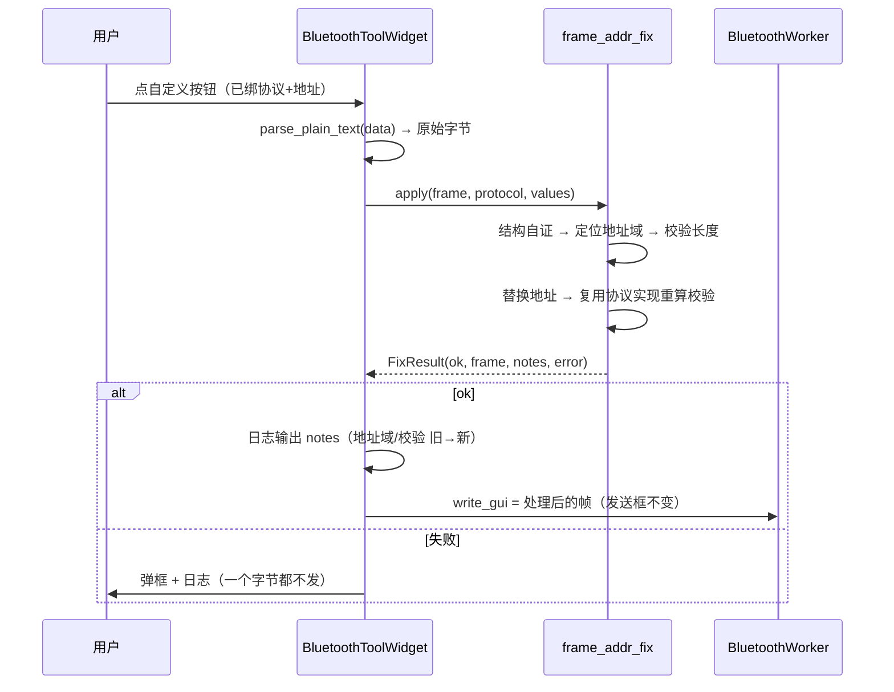

# 设计：按协议替换地址 + 重算校验

## 边界

| 模块 | 角色 | 改动 |
|---|---|---|
| `frame_addr_fix.py`（**新增**） | 纯逻辑（无 Qt / 不 import GUI） | 字段声明 + 按协议定位/替换/重算校验 |
| `bluetooth_core.py` | 按钮数据规范化 | `normalize_button` 保留 `protocol` / `addr` 两个新键（坏值回落 None） |
| `bluetooth_tool_widget.py` | 对话框 + 发送路径 | `ButtonEditDialog` 协议下拉 + 动态地址框；`_on_custom_clicked` 发送前套用 |
| `test/*` | 测试 | 新 `test_bluetooth_addr_fix.py` + 两份扩用例 |

不改：`protocol_registry`（不新增字段）、`validator/*`（只读）、各协议组帧模块（**只调用**）、Web 版。

## 契约

```python
@dataclass(frozen=True)
class AddrField:
    key: str      # "src" | "dst" | "addr" | "sa" | "ca" | "a2"
    label: str    # 「源地址」「目的地址」「表地址」「SA」「CA」「终端地址」
    hint: str     # 写法说明（长度/进制/示例）
    length: int   # 在线字节数（0 = 由帧决定，如 698 SA）

@dataclass(frozen=True)
class FixResult:
    ok: bool
    frame: bytes = b""          # ok=True 时的整帧
    notes: List[str] = field(default_factory=list)   # 「地址域 … → …」「校验和 0xAA → 0xBB」
    error: str = ""

def fields_for(protocol_index: int) -> Tuple[AddrField, ...]      # 不支持的协议 → ()
def apply(frame: bytes, protocol_index: int, values: Mapping[str, str]) -> FixResult
def parse_address(text: str, field: AddrField, frame: bytes, protocol_index: int) -> Tuple[bytes, str]
    """→ (在线字节, 错误)。数字 → 协议编码；hex → 在线顺序；两者都不匹配 → 错误。"""
```

### 每协议适配（复用表见 PRD「现状证据」）

| 协议 | 定位 | 替换 | 校验重算（复用） |
|---|---|---|---|
| 0 南网 | `frame[3] & 0x20`（D5 add）为 1 → 地址域 `[4, 16)`（源 6B + 目的 6B，均反转） | 拼接 `src[::-1] + dst[::-1]` | `sum(frame[3:-2]) & 0xFF` 写回 `[-2]`（口径同 `Frame.calculate_checksum`） |
| 6 645 | 双 `68H`、末 `16H`、`L` 自洽 → 地址 `[1,7)`，CS `[-2]` | — | `DLT645FrameGenerator().build_frame(addr_b, ctrl=frame[8], data=frame[9:-2], scramble=False)`（**整帧重建**，CS 由组帧器算） |
| 7 国网 | `info = frame[4:10]`；`info[0] & 0x04`（bit2）为 1 → 地址域长度 `12 + 6*((info[0]>>4)&0x0F)`；布局 源 6B + 中继 6B×n + 目的 6B | 只换源/目的，**中继原样保留** | `sum(frame[3:-2]) & 0xFF` 写回 `[-2]` |
| 8 698.45 | `L = frame[1] \| frame[2]<<8`；帧长 `L+2`、末 `16H`；SA 从 `[4]` 起（等长约束下长度由 `L - APDU 长度` 反推） | 换 SA / CA | `DLT69845FrameGenerator()._assemble_frame(new_sa, ca, control=frame[3], apdu=frame[apdu_start:-4])`（**整帧重建**，HCS/FCS 由组帧器算） |
| 13 依瓦645 | 双 `68H`、末 `16H`、`((cmd&0x0F)<<8)\|L` 长度自洽 → 地址 `[1,7)`、COMMAND `[8]`、DATA `[10, -2)` | 换 6B 地址（`encode_addr12` 数字 / hex 在线） | `yw645_wire.encode_frame(addr, mode=frame[8]&0xF0, data=unmask_data(frame[10:-2]))`（**整帧重建**） |
| 14 南网上行 | `resolve_layout(frame)` → `addr_index`、`form` | 换 A2（终端地址）/[A1+A2+A3] | `csg_uplink_wire.encode_frame(c=frame[c_index], addr, apdu, form)`（**整帧重建**，CS 覆盖控制+地址+用户数据） |

- **698 SA 长度**：地址特征字节（SA[0]）高 4 位是地址类型、低 4 位是长度-1 的口径需按解析器核实；实现按「用解析器/组帧器同一口径」推导，并在真实帧上验证（见 implement.md 的探针）。
- 所有整帧重建路径都必须**先做结构自证**（长度域与末字节），否则重建会把「本来就不是该协议的帧」洗成看似合法的帧。

### 地址输入语义（用户口径）

```
输入含 ':'/' ' 的 hex 或多个 0x → 按在线顺序（长度必须匹配）
输入是纯十进制数字 → 协议编码（645/依瓦 12 位表号；14 终端地址 10 进制；
                    0/7 12 位表号按 BCD 反转；698 SA/CA 仅接受 hex）
```

### 数据流（发送时）



## 取舍

| 选择 | 理由 | 备选（否决） |
|---|---|---|
| 复用各协议既有编码/组帧实现 | 校验与字节序只有一个来源；改协议实现时自动跟随 | 新写偏移/算法表（第二份口径，必漂移） |
| 只做同长度替换 | 改长度要连带改 L/HCS/FCS 与 698 的地址长度特征位 | 允许改长度（v1 风险高、收益低） |
| 新键 `protocol` / `addr` 落 `normalize_button` | 与 `enabled`/`send_count` 同款宽容处理；旧配置无键即无处理 | 旁挂独立配置文件（多一份状态） |
| 只在发送时替换 | 用户口径；发送框保持模板可复用 | 写回发送框（会覆盖用户的模板） |
| 不做 9/10/11/12 | 多层校验与 NID/TEI 地址语义复杂，容易做错 | 半成品支持（比不支持更危险） |

## 兼容 / 回滚

- 未绑定协议/地址的按钮：`apply` 不被调用，路径与 1.23.80 完全一致。
- 旧配置文件（按钮无新键）→ `normalize_button` 回落 `protocol=None`；保存时无新键不写（或写 None），文件仍可被旧版本读（多出的键被忽略）。
- 回滚 = 还原三个文件的 hunk；无数据迁移。
