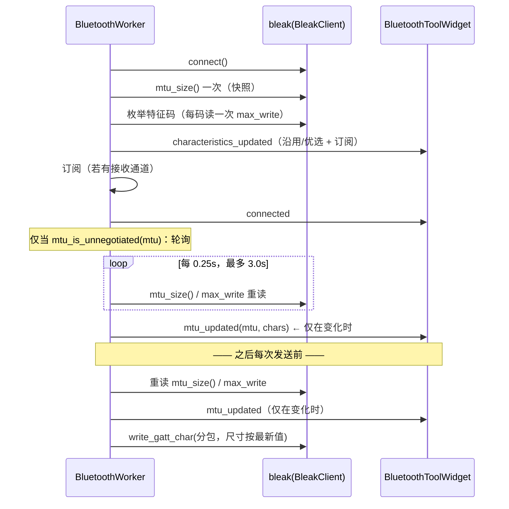

# 设计：蓝牙 MTU/写上限实时化

## 边界

| 模块 | 角色 | 本次改动 |
|---|---|---|
| `bluetooth_core.py` | 纯逻辑（无 Qt / 无 bleak） | 新增 `MTU_DEFAULT` / `MTU_POLL_INTERVAL` / `MTU_POLL_TIMEOUT` / `mtu_is_unnegotiated()` |
| `bluetooth_worker.py` | QObject + 私有 asyncio 循环 | 连接后轮询、活对象持有、发送前 `_refresh_live_limits()`、新信号 `mtu_updated` |
| `bluetooth_tool_widget.py` | UI | 订阅 `mtu_updated`、MTU 文案单一实现、打开中的特征码对话框刷新 |
| `test/*.py` | 测试 | 见 implement.md |

不改：`frame_gen_*`、串口侧、`main_gui.py` 的接线（信号已在 `_wire_worker` 统一连接）。

## 契约

### 新信号

```python
mtu_updated = Signal(int, list)   # (协商到的 MTU, 最新特征码 dict 列表)
```

- **只在读数真的变化时**发出（连接轮询 / 发送前刷新共用一条路径）。
- 与 `characteristics_updated` 的区别（**不可互相替代**）：
  后者语义是「特征码枚举完成」，UI 收到后会走 `沿用/优选 → _apply_characteristics →
  worker.set_characteristics`（重新订阅 + 记忆写入）。用它在连接中途刷上限会产生
  多余重订阅与日志（`bluetooth_tool_widget.py:1675-1694`）。

### 判定「是否需要等」

```python
MTU_DEFAULT = 23                      # ATT 默认 MTU
mtu_is_unnegotiated(v) -> bool        # v <= 23（含 0/None/非法 → True）
MTU_POLL_INTERVAL = 0.25              # 秒
MTU_POLL_TIMEOUT = 3.0               # 秒
```

- 只把「默认值/未知」当作待协商；`247`/`498`/`512`/`517` 都视为已协商。
- `23` 就是默认值，等价于「还没协商成功」——因此对端**真的**只支持 23 时会白等 3s，
  代价是 12 次 property 读 + 一行日志（可接受，且这正是不能把超时当错误的原因）。

### 数据流



### 活对象持有

```python
self._char_objects: Dict[str, Any]   # uuid → bleak 特征码对象（私有）
```

- `_collect_characteristics()` 填充；**只用于重读上限**。
- 不进入投给界面的 dict（界面 dict 保持纯数据，可 JSON 序列化）。
- 断开时清空（`_disconnect_coro` / `_on_disconnected_cb`），防陈旧对象被重读。

### 统一刷新

```python
def _refresh_live_limits(self) -> bool:
    """重读 MTU 与各特征码实时上限；有变化才更新 + 发 mtu_updated + 日志。"""
```

- 变化判据：`new_mtu != self._mtu` 或任一 `dict["max_write"]` 变化。
- 无 `client` / 未连接 ⇒ 静默返回 False（兼容假 worker 与断开后调用）。
- 读数异常（`getattr`/property 抛错）⇒ 保持旧值，不抛。

## 取舍

| 选择 | 理由 | 备选（否决） |
|---|---|---|
| 连接后轮询、超时 3s | bleak 官方推荐做法；显示层不需要毫秒级实时 | 不轮询（当前缺陷：一旦快照为 20 就永久 20） |
| 轮询放在 `connected`/订阅**之后** | UI 与订阅不被 3s 拖住 | 放在 emit 之前（连接会“卡”3 秒） |
| 发送前重读 | 真正的正确性修复：分包按发送那一刻的真实值 | 只在连接时读（竞态下仍可能长期用 20） |
| 新信号 `mtu_updated` | 避免重订阅/记忆写入等副作用 | 复用 `characteristics_updated`（有副作用，见上） |
| 只读不请求 | Windows 不允许应用层请求 MTU（MS 文档） | 调 `client._backend` 私有接口（不可移植） |

## 兼容性 / 回滚

- 界面文案与信号是**新增**；旧调用方（`main_gui` 接线、假 worker 测试）不受影响：
  `mtu_updated` 连接失败时不影响其它信号；`_refresh_live_limits` 在无 `client` 时静默。
- 对端只支持 23 的场景：输出与改动前逐行一致 + 1 行超时说明（见 PRD A2）。
- 回滚 = 还原三个文件的本次 hunk；无数据/配置迁移，无需版本号迁移
  （未新增持久化键）。
