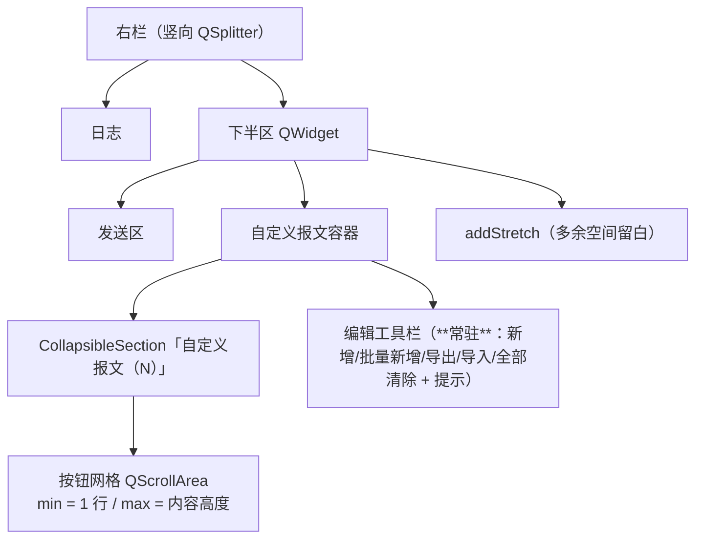

# 设计：按钮区随可用空间自动 + 工具栏常驻

## 结构改动



- **高度语义换成「内容驱动 + 分栏约束」**：
  - `maximumHeight = 内容所需高度`（`custom_host.sizeHint().height()`）⇒ 空间够就不滚动；
  - `minimumHeight = 1 行按钮高度`（`core.CUSTOM_MIN_ROWS`）⇒ 分栏可以把它压小（日志不被挤），
    但不会被压成 0。
  - 于是「默认分栏下 ≈3 行可见」是**默认分栏 240px 的自然结果**，不再是硬编码封顶。
- **工具栏移出折叠区**：`_build_custom_group()` 返回一个容器 `[section, toolbar]`；
  `self.custom_group` 仍是那个 `CollapsibleSection`（既有断言 `custom_group.title()` 不变），
  但 5 个按钮改为容器的子控件 ⇒ 折叠只隐藏按钮网格。

## 契约

```python
# core
CUSTOM_MIN_ROWS = 1        # 滚动区最少可见行数（单一来源；旧的 CUSTOM_ROWS_MAX 取消）

# widget
def _custom_scroll_limits(self) -> Tuple[int, int]:
    """(最小高度, 最大高度)：最小 = 1 行按钮；最大 = 按钮全部显示所需高度（≥ 最小）。"""
def _apply_custom_scroll_limits(self) -> None:     # 重建按钮后 / restyle_for_theme() 各调一次
```

高度计算仍**按真实 `sizeHint`**（按钮行高 + 间距 + 边距；字号可配置 ⇒ 不写死像素，陷阱 63）。

## 取舍

| 选择 | 理由 | 备选（否决） |
|---|---|---|
| 上限 = 内容高度 | 用户报障：拖大日志后 10 个按钮仍只显示 3 行 + 滚动条；内容驱动最直觉 | 保留 3 行封顶（就是缺陷本身）；封顶可配（多一个配置项仍会「白白滚动」） |
| 下限 = 1 行 + 默认分栏 240 | 即使没有硬封顶，日志也不会被 64 个按钮挤没（最小高度小 ⇒ 分栏最小约束不涨） | 下限 = 3 行（分栏最小约束抬高，窄窗口下日志会被压） |
| 工具栏放折叠区外的容器 | 收起按钮区时编辑入口仍在（用户口径）；不用改 `CollapsibleSection` 公共组件 | 给 `CollapsibleSection` 加 footer 能力（改公共组件 + 其 51 项测试） |

## 兼容 / 回滚

- 配置键不变（`custom_collapsed` / `right_split`）；`CUSTOM_ROWS_MAX` 被 `CUSTOM_MIN_ROWS` 取代，
  仅测试与文档引用（无持久化）。
- 回滚 = 还原 `bluetooth_core.py` / `bluetooth_tool_widget.py` 的本次 hunk。
