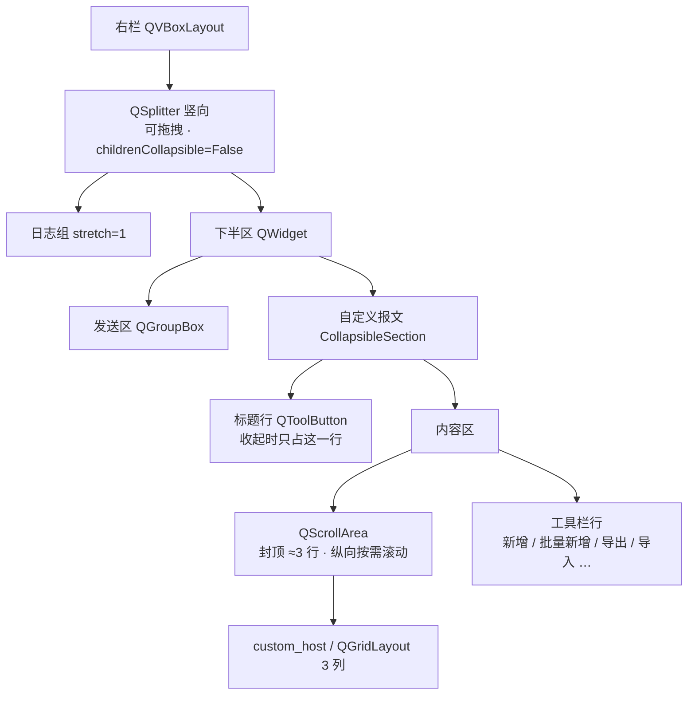

# 设计：自定义报文区空间治理

## 布局改动（右栏）



- 上=日志、下=（发送区 + 自定义区）：拖拽只影响这两块，**发送区不被压缩**（下半区给足最小高度）。
- `setChildrenCollapsible(False)`：不允许把任一侧拖成 0（否则用户会"找不回"日志或发送区）。
- 封顶只作用在**按钮网格**（`QScrollArea`），工具栏行保持可见——即使按钮很多也能新增/编辑。

## 契约

### 新增配置键（`bluetooth_tool_config.json` 的 `settings` 段）

| 键 | 类型 | 默认 | 含义 |
|---|---|---|---|
| `custom_collapsed` | bool | `False` | 自定义区是否收起（True = 只剩标题行） |
| `right_split` | `[int, int]` | `[420, 240]` | 竖向分栏的 `[日志, 下半区]` 高度（px） |

- `bluetooth_core.merge_settings` 负责**宽容与夹紧**（沿用既有风格：坏值不抛、越界夹到范围）：
  - `custom_collapsed`：`_as_bool(raw, False)`；
  - `right_split`：只接受长度 2 的序列、每项 `int`，逐项夹到 `[RIGHT_SPLIT_MIN, RIGHT_SPLIT_MAX]`，
    长度/类型不对 → 回落默认值（新增 `normalize_right_split(raw)` 与常量 `RIGHT_SPLIT_*`）。
- 封顶行数常量 `core.CUSTOM_ROWS_MAX = 3`（**单一来源**：溢出策略只在 core 声明，界面读它）。

### 界面钩子

```python
# 构建
self.right_splitter = QSplitter(Qt.Orientation.Vertical)   # 日志 / 下半区
self.custom_section = CollapsibleSection("自定义报文", key="custom_buttons", expanded=True)
self.custom_scroll = QScrollArea(...)                      # 封顶 + 滚动

# 尺寸与状态
def _custom_scroll_cap(self) -> int: ...                   # 3 行高度（由按钮 sizeHint / 字体算）
self.custom_section.toggled -> 写 settings["custom_collapsed"] + _schedule_save()
self.right_splitter.splitterMoved -> _schedule_save()      # 采集在 _collect_settings
```

- 采集：`_collect_settings()` 增 `custom_collapsed` / `right_split`（读控件状态，**不在拖动过程中反复写盘**）。
- 套用：`_apply_settings_to_ui()` 增 `set_expanded_quiet(...)` 与 `setSizes(...)`；两者都在
  `self._loading = True` 保护块内（不触发额外保存/日志）。

## 取舍

| 选择 | 理由 | 备选（否决） |
|---|---|---|
| 滚动 + 封顶（3 行） | 空间有上限、按钮仍全在（不需要翻页/搜索） | 只折叠（展开时依旧 700px） |
| 复用 `CollapsibleSection` | 已有组件 + 已有 51 项测试；`key`/`toggled`/`set_expanded_quiet` 正好够用 | 再写一个折叠容器（第二份实现） |
| 竖向 `QSplitter` | 不同人现场偏好不同（有人要长日志、有人常点按钮），交给用户 | 固定比例（永远有一方不满意） |
| 固定 3 列 | 用户口径；且 `FlowLayout` 在 `main_gui` 里不可用（本页禁止 import 它） | 宽度自适应列数（需新布局类/或搬 main_gui，越界） |
| 封顶按实际 `sizeHint` 算 | 本项目字号可配置（陷阱 63），写死像素必裁字 | 写死 110px |

## 兼容 / 回滚

- 旧配置文件无这两个键 → 默认「展开 + 默认分栏」，观感与改动前一致（仅多了分栏器与折叠标题）。
- 不改变按钮数据结构、发送/解析路径；`custom_group` 若被其它代码/测试引用 → 保留属性名别名或同步改名
  （实现时先 grep 引用点）。
- 回滚 = 还原 `bluetooth_core.py` / `bluetooth_tool_widget.py` 的 hunk（无数据迁移）。
