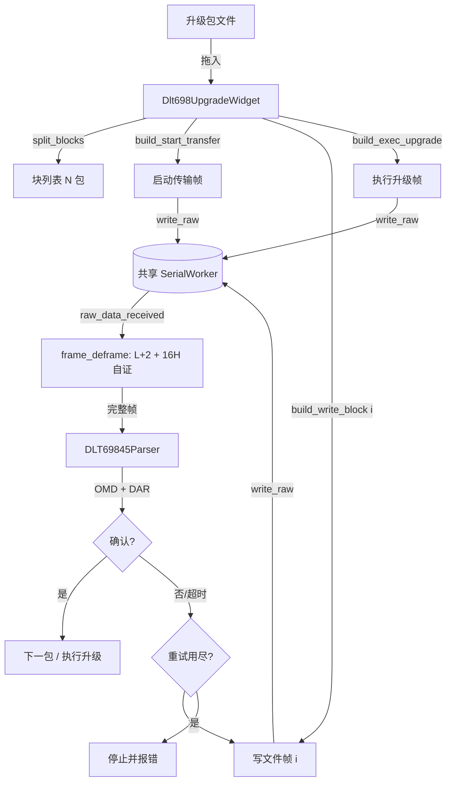

# design.md — 协议8 698.45 文件传输升级

> 本设计中的协议事实**全部经执行验证**（不是推断）：三帧已用现有 `DLT69845FrameGenerator`/`AXDRCoder` 组出并通过 `DLT69845Validator`（HCS/FCS 全通过）+ `DLT69845Parser` 回读。启动传输帧已与 doc 实帧**逐字节一致**。

## 1. 范围与不变量

**做**：桌面新增「升级」标签页（仅协议8 可见）：拖入升级包 → 分包 → 启动传输 → 写文件×N（逐包确认）→ 执行升级；进度/日志/中止；每包字节数、SA、文件信息、校验可配。

**不做**：Web 版；doc 中厂商私有版本查询（OI `0xFFFE`）与整包 5 轮重发；暂停/恢复/终止（方法9~14 除 7/8/13）；安全/密文模式。

**不变量**：
1. 链路层小端、APDU 内 A-XDR 大端，两层不互套（AGENTS §5.6/陷阱 64）。
2. 组帧一律复用 `DLT69845FrameGenerator._assemble_frame`（HCS/FCS 单一来源），不自行拼 L/CRC。
3. 只用共享串口 `self.serial_worker`（注入），不自建端口/句柄。
4. 确认判定走 `DLT69845Parser` 解析结果（APDU 类型 + OMD + DAR），不用字符串/字节比对。
5. `crcmod` 为可选依赖 ⇒ 凡是本页触达的模块，对 `dl_t698_45_*` 一律**函数内惰性 import**（AGENTS/SerialTiming 铁律）。
6. 逐包确认成功才发下一包；任何一包重试用尽即整体停止，不再发后续帧。

## 2. 模块划分

| 文件 | 层 | 职责 |
|---|---|---|
| `dl_t698_45_upgrade.py` | 纯逻辑（新） | 分包 `split_blocks`；`build_sa`；`build_file_info`；三帧构建 `build_start_transfer` / `build_write_block` / `build_exec_upgrade`；确认判定 `check_action_response`；校验值计算 `calc_checksum_value`；`UpgradePlan` 数据类（总包数/每包字节/末包字节） |
| `frame_deframe.py` | 纯逻辑（新，**抽取**） | 从 `serial_tool_widget.py` **原样搬出**的纯分帧族：`STRATEGY_BY_PROTOCOL`/`END_CHAR_STRATEGIES`/`FE_WAKEUP_STRATEGIES`/`_wakeup_base`/`_sane_frame_len`/`frame_length_for`/`declared_frame_len`/`hdlc_frame_len`/`dlt645_frame_len`/`dlms_wrapper_frame_len`/`frame_incomplete` |
| `dlt698_upgrade_widget.py` | Qt（新） | `Dlt698UpgradeWidget`：UI 组装、`_DropArea`、串口订阅、逐包状态机（单发 QTimer）、进度/日志、`cleanup()`、`restyle_for_theme(bool)` |
| `dl_t698_45_axdr.py` | 既有（**修**） | bit-string 长度域语义（位/字节）+ 定长时间类型编码器（见 §6） |
| `serial_tool_widget.py` | 既有（**改**） | 分帧族改为从 `frame_deframe` 导入并**保留同名 re-export**（既有 500+ 测试锚点不变） |
| `dl_t698_45_oi_lookup.py` | 既有（**补**） | 类18 实例方法名：`0xF001` 的 7 启动传输 / 8 写文件 / 9 读文件 / 10 软件比对 / 13 执行升级 / 14 启动传输 |

## 3. 协议层设计

### 3.1 帧骨架（全部复用既有实现）

```
APDU = 07 01 <PIID> <OMD 4B> <参数 A-XDR> 00        # 07 01 = ACTION-Request Normal；末尾 00 = TimeTag(无)
整帧 = generator.generate_action_request_normal(sa, ca, piid, omd, param)
     → 68 | L(2B 小端) | C=0x43 | SA(特征1B+地址nB) | CA | HCS(2B) | APDU | FCS(2B) | 16
```
`_assemble_frame` 已算出 `L = 2+1+len(sa)+1+2+len(apdu)+2`（即整帧 = L+2），**本项目唯一 FCS 实现**。

**★ 逐字节 golden（本次实测：本设计的三帧构建方式产出与 doc 完全相同的字节）**
```
启动传输 = 68 3C 00 43 05 33 00 98 06 55 07 00 3C 7F 07 01 00 F0 01 07 00 02 03 02 06 0A 00 0A 00
           06 00 04 35 63 04 03 E0 0A 04 76 31 2E 30 16 00 12 07 D0 02 02 16 00 09 04 7F 7E D9 D2
           00 54 24 16
写文件(块0+600B，数据=0x00..0xFF×2+88×0x00) = 68 3B 02 ... 07 01 01 F0 01 08 00 02 02 12 00 00
           09 82 02 58 <600B> 00 <FCS> 16      # 2000B 时为 09 82 07 D0（doc 同形）
执行升级(立即) = 68 22 00 43 05 33 00 98 06 55 07 00 A4 47 07 01 02 F0 01 0D 00 02 02
           1C FF FF FF FF FF FF FF 00 00 30 47 16
```
三帧均经 `DLT69845Validator` 全 PASS、`DLT69845Parser.parse` = 成功、`parse_to_table` 正确解出 OMD/参数/时间标签。

### 3.2 步骤① 启动传输（方法7）

```
参数 = 02 03                       # structure(3)
         02 06 <文件信息 6 项>      # 表188 属性2
         12 <u16 大端 块大小>      # [18] 短帧传输块尺寸；>65535 用 06 + u32（[6] 长帧）
         02 02                     # 校验 structure(2)
           16 <校验类型>           # 0=CRC 1=md5 2=SHA1
           09 <len> <校验值>       # octet-string（BER 长形式，由 _encode_length 自动）
       00                          # TimeTag
文件信息 = 02 06 | 0A<len>源文件 | 0A<len>目标文件 | 06<u32 大端 文件大小> | 04 03 <属性字节> | 0A<len>文件版本 | 16<类别>
```
- `传输块大小` 的 `[18]`/`[6]` 恰好与 A-XDR 的 `long-unsigned`(0x12)/`double-long-unsigned`(0x06) 标签同值 —— 实测 `axdr.encode(2000, 0x12)` → `12 07 D0`，与 doc **逐字节相同**；CHOICE 备选内容为**裸值**（不带自身标签/长度），依据：doc 实帧 + 既有 Get-Result `[1] Data`/`[0] DAR` 的既有口径。
- `文件属性` 为 `bit-string(SIZE(3))`：**1 字节十六进制输入，默认 `E0`（=doc 值）**，编码固定 `04 03 <byte>`，绕开位序解释问题（§13 开放问题2）。空输入默认 `E0`。
- `文件大小` 取所选文件真实字节数（只读展示，允许手工覆盖以复现 doc 帧）。

### 3.3 步骤② 写文件（方法8）

```
参数 = 02 02 | 12 <u16 大端 块序号> | 09 <len> <块数据> | 00
```
- 块序号 0 基（doc 首块 = `12 00 00`）；PIID 每帧自增（doc：启动传输 PIID=0、首块 PIID=1）。
- 块数据 BER 长度由 `_encode_length` 自动（600 → `82 02 58`），与 doc 同形。

### 3.4 步骤③ 执行升级（方法13）

```
参数 = 02 02 | 1C <7B 执行升级时间> | <软件许可> | 00
```
- 执行升级时间 = `date_time_s` ≡ `octet-string(SIZE(7))`，**tag + 7 字节、无长度域**（证据见 §6）。
  默认「立即执行」= `1C FF FF FF FF FF FF FF`（doc/规范：全 FF 表示立即执行）。
- 软件许可 CHOICE：默认 **NULL = `00`**（无许可）；若用户填「许可(hex)」，按 `09` **原样透传用户给的字节**（不猜 CHOICE 内 octet-string 的 tag/length 组合，见 §13 开放问题3）。

### 3.5 SA 地址

`SA = <特征字节> + <地址 n 字节>`，特征 = `(类型<<6)|(逻辑地址<<4)|(长度-1)`；地址字节**线上逆序**（GUI 按大端正序输入）。
- 类型：0 单地址 / 1 通配 / 2 组 / 3 广播（广播固定 1 字节 `AA`，忽略长度）。
- **默认通配地址**：类型=1、长度=6、地址 `AA AA AA AA AA AA` ⇒ 特征 `0x45`，线上 `45 AA AA AA AA AA AA 00`。
- CA 默认 `0`（不关注）。
- 复用 `frame_gen_widget._get_dlt698_sa` 的编码口径（同一公式，纯逻辑版落在 `dl_t698_45_upgrade.build_sa`）。

### 3.6 校验值

`校验类型` 与 `校验值` 均为可编辑：类型下拉 {CRC(0), md5(1), SHA1(2)}；值默认由文件自动计算，可手工覆盖。
- md5/SHA1 用 `hashlib`（值 = 摘要是原始字节，无长度前缀）。
- CRC 用 `zlib.crc32(file) & 0xFFFFFFFF`，字节序提供**大端/小端**选择，默认大端。
- **AC3 的逐字节比对必须用「手工填 `7F 7E D9 D2`」路径**，因为 doc 未给对应文件、算法字节序未被证实（§13 开放问题1）。

## 4. 传输状态机（Qt 层）

不用 QThread：单发 `QTimer` + 标志位（照 `test_plan_widget` 的既有范式，避免线程回收问题且无需 `thread_registry`）。

```
状态: idle → starting(启动传输) → transferring(第 i 包) → finishing(执行升级) → done / failed / aborted
每步: 发送(write_raw) → 起 超时QTimer(timeout_ms) → 收到匹配确认 → 停表 → 推进
                               ↘ 超时/否定 → 重试(同一包, PIID 自增)；重试用尽 → 停止(failed)
```
- 参数：`每包字节数`（默认 600，1..8192）、`超时`（默认 3000ms，100..600000）、`重试次数`（默认 3，0..10）、`传输完成后自动执行升级`（默认勾选）。
- 进度：`已确认字节 / 总字节`（百分比）+ `第 x/N 包`；进度只按**已确认**包累加。
- 中止：`中止`按钮 → 停表、置 aborted、不再发送；日志留中止原因。
- PIID：每发一帧自增（&0x7F）。确认匹配以 **OMD + DAR** 为准；PIID 不一致仅记 WARN 日志（部分设备回显规则不同）。

## 5. RX 组帧与确认判定

**必须**订阅 `raw_data_received`（每次交付块，零丢失），**不得**用 `frame_received`（`SerialWorker._process_buffer` 只认 645/FT1.2，698 帧会落到「找第一个 0x16」容错分支被截断；见 SerialTiming 报告 Q1）。
```
_raw_rx = bytearray()
_on_raw(data): _raw_rx += data → 循环:
    need = frame_deframe.frame_length_for("dlt698_45", _raw_rx)   # 认前导 FE；L+2；末字节 16H 自证
    if need and len(_raw_rx) >= need and _raw_rx[need-1] == 0x16:
        frame = bytes(_raw_rx[:need]); del _raw_rx[:need]; _on_frame(frame)
    else: break
判定: DLT69845Parser().parse(frame) → 解析状态=="成功"
      APDU 类型 == 0x87 (ACTION-Response) 且 子类型 == ActionResponseNormal
      OMD 解析值 OI/方法 == 期望（F001/07|08|0D）  且 DAR(结果)==0
```
`write_raw` 发送（静默）+ 本页自建 TX/RX 日志行（避免 `send_frame` 的 `[发送]` 刷屏，AGENTS 陷阱 58）。

## 6. 必须的既有代码修复（含证据）

### 6.1 `AXDRCoder._decode_bit_string`：长度域是**位数**不是字节数（阻塞性缺陷）
- **现象**：doc 的启动传输实帧用现有解析器解析 → `APDU类型 = 失败 / 未知类型(0x76)的解码器尚未实现`（0x76 = `'v'`，即 `"v1.0"` 的 v）。
- **根因**：`04 03 E0` 中 `03` = **3 位**（`文件属性 ::= bit-string(SIZE(3))`，表188），而 `_decode_bit_string`（`dl_t698_45_axdr.py:235-241`）把它当 3 **字节**读取 → 多吃 2 字节 → 整个参数错位。
- **证据**：① 规范全部 bit-string 都是 `SIZE(8/16/32/64/128/3)`（位）；② 同族 `modular_iface_axdr`（协议12）本就按位宽实现并有测试；③ 实测把长度按 `ceil(bits/8)` 读后，doc 实帧**完整解析成功**（32 行，OMD/文件信息/块大小/校验全部正确）。
- **修法**：`bits = 长度域`，`nbytes = (bits+7)//8`，返回消耗 `1+llen+nbytes`，说明文案改 `N位`。

### 6.2 `AXDRCoder._encode_bit_string`：同上（写位宽）
`04 01 E0` → 修后 `04 08 E0`。修：长度域写 `len(value)*8`（由字节数推位宽，与解码侧 `ceil(bits/8)` 严格互逆）。
- **裁决（实施期发现的算术冲突）**：`_encode_bit_string(value: bytes)` **无法**表达「1 字节数据 + 声明位宽 3」这种形态（`04 03 E0`）——位宽是**字段声明**（`bit-string(SIZE(3))`），不可能由原始字节推导。因此分工固定：
  - 通用编码器只管「`N` 字节 = `8N` 位」的自洽形态（互逆可测）；
  - 升级模块的 `build_file_info` **硬编码** `bytes([0x04, 3]) + bytes([attr_byte])` 来产生 doc 的 `04 03 E0`（§3.2 已如此规定）。
- 影响面：`frame_gen_widget` 的 698「A-XDR 自定义」模式与 `reflex_web/frame_gen_utils` 的同一模式**另行自行拼装**（不经本编码器）⇒ 该两处曾存在同类错，已按「调用方收口到单一来源」改为委托 `coder.encode(raw, tag)`（保留各自的 `length` pad/truncate 语义）。
验证：`test/` 内**无任何** 698 bit-string 断言（全仓唯一 bit-string 测试在 `test_modular_iface_axdr.py`，用另一模块）⇒ 无回归面。

### 6.3 定长时间类型的**编码器**多写了长度域
- `_encode_date_time_s` 产出 `1C 07 <7B>`（9 字节）；正确为 `1C <7B>`（8 字节）。
- **证据**：① 规范表（`面向对象的用电信息数据交换协议(20210910).md` 类型表）：`date_time 25/10`、`date 26/5`、`time 27/3`、`date_time_s 28/7`；② 规范自带示例 `1C 07 E0 01 14 00 00 00`（"数据冻结时间"）= tag + **7 字节**（年 0x07E0=2016、月01、日20、时/分/秒 00）**无长度域**；③ 本仓库既有 `_decode_date_time_s` 正是按 tag+7 解（因此现状 **编码↔解码不自洽**）；④ 实测本设计的执行升级帧（`1C FF*7`）被现有解析器正确解为 date_time_s ⇒ 解码侧口径正确、编码侧错。
  - 该示例的另一种读法「`1C` + 长度 `07` + 6 字节数据」**不成立**：年字段为 2 字节大端，`07 E0` = 2016 才对；按长度域读则年 = 0xE001 = 57345，且 SIZE(7) 类型只剩 6 字节数据。规范「执行升级时间为全 FF 表示立即执行」也只在 7 字节数据口径下自洽（长度域不可能是 FF）。
  - 因此 §13 开放问题 4 已定论，不再是开放项；「指定时间」模式编码 = `1C` + [年 2B 大端, 月, 日, 时, 分, 秒]。
- **修法**：`_encode_date_time_s/_encode_date_time/_encode_date/_encode_time` 一律 `bytes([tag]) + 定长字节`（分别 7/10/5/3），与各自解码器对齐。
- **实施结果**：`_decode_time` **已按规范改为 3 字节**（`time ::= SEQUENCE{hour, minute, second}` + 类型表 `time 27/3`），`test_dl_t698_45*.py` / `test_dlt698_preset.py` / `test_web_frame_gen_utils.py` 全绿（无回归证据）；编码/解码两侧现在严格互逆（实测 `1B101530` → 16:21:48，消耗 4 字节）。
- **调用方收口（实施期新增，见 §6.2 裁决）**：`frame_gen_widget._encode_axdr_item` 与 `reflex_web/frame_gen_utils._encode_axdr_item` 的「原始字节类」分支由手拼改为 `coder.encode(raw, tag)`（保留各自 `length` pad/truncate）；逐类型对照实测只有 bit-string / date_time / date / time / date_time_s 变、其余逐字节相同；`test_dl_t698_45.py`(11) / `test_dlt698_preset.py`(31) / `test_web_frame_gen_utils.py`(74) 全绿。

### 6.4 分帧族抽到 `frame_deframe.py`（单一来源）
`serial_tool_widget.frame_length_for("dlt698_45", buf)` 已是 **L+2 + 末字节 16H 自证 + 前导 FEH 容忍**的既有正确实现（`test_dl_t698_45_extract.py`/`test_serial_proto_frame.py` 有断言）。升级页直接复用同一实现 ⇒ **把纯逻辑搬出**，`serial_tool_widget` 保留同名 re-export（`frame_length_for`/`declared_frame_len`/`SerialToolWidget._declared_frame_len`/`_wakeup_base`…，全部测试锚点不变）。

### 6.5 OI 方法名补全
`dl_t698_45_oi_lookup` 类18 现有方法名只有基类 1~5；补 `0xF001` 实例方法名，使解析表能显示「方法7 启动传输 / 方法8 写文件 / 方法13 执行升级」。

## 7. UI 设计（`dlt698_upgrade_widget.py`）

```
┌ 升级 ───────────────────────────────────────────────────────────────┐
│ [拖放区: 拖入升级包文件 或 浏览…]  文件名 xxx.bin  大小 1,234,567 B  │   ← _DropArea(QFrame, setAcceptDrops)
│ ┌ 升级参数 (CollapsibleSection) ────────────────────────────────┐   │
│ │ 每包字节数 [600]  超时(ms) [3000]  重试次数 [3]              │   │
│ │ SA: 类型[通配▾] 逻辑[0] 长度[6] 地址[AAAA…]  CA[0]           │   │
│ │ 文件信息: 源文件[] 目标文件[] 版本[v1.0] 属性[E0] 类别[当前设备▾]│  │
│ │ 校验: 类型[CRC▾] 值[7F7ED9D2] [按文件计算] 字节序[大端▾]      │   │
│ │ 传输块尺寸: [短帧[18]▾]     [x] 传完后自动执行升级            │   │
│ │ 执行升级时间: [立即执行 ▾ / 指定时间 ▾ + 日期选择]            │   │
│ └──────────────────────────────────────────────────────────────┘   │
│ [开始升级] [中止] [清除]       进度: ▓▓▓▓░░░░ 42%  第 253/1024 包   │
│ ┌ 日志(只读) ───────────────────────────────────────────────────┐  │
│ │ [TX] 07 01 00 F0 01 07 00 …  (启动传输)                       │  │
│ │ [RX] 87 01 00 F0 01 07 00 00 00 00 00  → DAR=0 成功           │  │
│ └──────────────────────────────────────────────────────────────┘   │
└────────────────────────────────────────────────────────────────────┘
```
- 拖放：本页内自建最小 `_DropArea(QFrame)`（`setAcceptDrops(True)` + `dragEnterEvent`（`hasUrls`）/`dropEvent`（`urls()[0].toLocalFile()`）→ 校验存在/非空/非目录 → `file_dropped = Signal(str)`）。全仓唯一先例 `DragDropTextEdit` 按文本读文件、且位于 main_gui，不可复用。
- 按钮宽度一律 `gui_utils.fit_btn_width`；折叠区用 `collapsible_section.CollapsibleSection`（不引入 `ButtonScrollArea`——本页控件少，不需要高度治理）。
- 配置持久化 `app_paths.data_path("dlt698_upgrade_config.json")`（原子写 + 坏文件宽容；**按属性访问 `app_paths.data_path`**，便于测试沙箱重定向）。
- `cleanup()`：停表、断开串口信号、落盘配置（**不得关闭串口**）。
- `restyle_for_theme(dark)`：日志/拖放区配色。
- 未连接串口 → 「开始升级」禁用 + 提示（用 `connection_changed` 驱动）。

## 8. 接线清单（`protocol_registry.py` + `main_gui.py`）

1. `protocol_registry.ProtocolSpec` 增 `has_upgrade: bool = False`（紧随 `has_sequence_diagram`）；协议8 条目 `has_upgrade=True`；可选 helper `protocols_with_upgrade()` + `__all__`。
2. `main_gui` 标签创建段（约 `:3123-3130` 后）：`_upgrade_placeholder = QWidget()` + `_upgrade_tab_index = tab_widget.addTab(..., app_icons.load_icon("hard-drive-upload"), "升级")` + **`setTabVisible(_upgrade_tab_index, False)`**（构造期 `_on_protocol_changed` 可能不触发，协议专属 tab 必须创建即隐藏）。
3. `_ensure_lazy_tab`（`:4412-4429`）加分支；新增 `_ensure_upgrade_tab()`（样板 `:4500-4518`：`hasattr` 守卫 → 函数内 import → `tab.set_serial_worker(self.serial_worker)` → `_replace_lazy_tab` → `apply_chinese_context_menus`）。
4. `_on_protocol_changed`（`:4853-4860` 旁）加 `setTabVisible(self._upgrade_tab_index, spec.has_upgrade)`。
5. `_shutdown_threads`（`:8613-8627` 旁）加 `getattr(self, "upgrade_tab", None)` → `cleanup()`（try/except）。
6. `_restyle_for_theme`（`:13310-13319` 旁）加 `upgrade_tab.restyle_for_theme(self._is_dark_theme())`。
7. 文档：`AGENTS.md` §6 Tab 可见性规则 + §1/§3/§5.6/§8 新陷阱；`CHANGELOG`/`APP_VERSION`/`README`/两个 `.iss`（发版约定）。

## 9. 数据流



## 10. 错误处理（全部外显，不静默）

| 情形 | 行为 |
|---|---|
| 未连接串口 | 开始按钮禁用；点击仍给提示；零字节发送 |
| 文件为空/目录/不可读 | 弹框 + 日志；不改变状态 |
| 每包字节数非法（0/超界） | 输入即校验，非法则拒绝开始并指出范围 |
| 确认帧 DAR≠0 | 日志给 DAR 值与含义（`DAR_MAP`），按重试处理 |
| 超时 | 日志给「本包第 k 次超时 / 已重试 k/3」；用尽 → failed + 明确「第 x 包失败，已停止」 |
| 收到非本步 OMD 的帧 | 记 WARN 日志并忽略（不当作确认） |
| 解析失败（HCS/FCS 不符） | 记 WARN + 原始 hex；不计确认 |
| crcmod 缺失 | 开始时报「协议8 需要 crcmod，请 pip install crcmod」，不崩 |

## 11. 测试策略

- `test/test_dl698_upgrade.py`（纯逻辑，**CORE_TESTS**）
  - AC3 逐字节 golden（doc 实帧全等）；写文件帧 600/2000 两档 BER 长度与 golden 形状；执行升级帧 golden。
  - 分包矩阵：{0,1,599,600,601,2000,1234567} × {1,600,2000,8192} → 包数/末包字节/拼接还原 == 原文件。
  - SA：通配默认（`45 AA*6`）、指定单地址（doc 的 `05 33 00 98 06 55 07`）、广播 `AA`、长度越界拒绝。
  - 确认判定：DAR=0 通过；DAR≠0 拒绝；OMD 不符拒绝；非 ACTION-Response 拒绝；HCS/FCS 破坏帧拒绝（变异反证）。
  - 校验值：md5/SHA1/CRC32 大端·小端各自与 `hashlib`/`zlib` 对拍。
  - bit-string/date_time_s 编码↔解码互逆；doc 实帧解析零错误（守 §6.1）。
  - **变异反证**：位宽改回字节（红）、date_time_s 加回长度域（红）、块序号 1 基（红）、SA 不逆序（红）、L+2 改 L（红）。
- `test/test_dl698_upgrade_gui.py`（offscreen，**GUI_TESTS**）
  - 假 SerialWorker（`raw_data_received`/`connection_changed`/`write_raw` 计数）：全通；中间包重试后成功；超时用尽中止；中止按钮；进度百分比与已确认字节一致；未连接禁用；拖放（构造 `QDropEvent`+`QMimeData.setUrls`）落在 `_DropArea` 上触发。
  - 布局护栏：按钮 `width >= sizeHint` 且未写死上限；`_DropArea` 可见。
- 既有测试同步：`test_protocol_registry.py`（`has_upgrade` 仅 8）、`test_yw645_gui.py` 可见性矩阵加一行、`test_dl_t698_45*.py` 全绿（守 §6 修复无回归）、`test_serial_proto_frame.py`/`test_serial_tool_widget.py`/`test_dl_t698_45_extract.py` 全绿（守 §6.4 抽取）。

## 12. 兼容性 / 回滚 / 风险

- **兼容**：新增 tab + 新增字段 + 纯新增模块；对其它 12 协议零影响（tab 隐藏）。§6 的解析器修复会改变 bit-string 与定长时间类型的**编码输出**（此前是错的）与 bit-string 解析显示文案（`N字节`→`N位`）——唯一既有使用面是 698「A-XDR 自定义」组帧模式与 `parse_to_table` 文案，均无测试锚定。
- **回滚**：删除新增 3 个文件 + 注册表/GUI 接线 6 处即回到现状；§6 修复可单独回滚（各自独立 hunk）。
- **风险**：
  1. 通配地址是否被现场设备受理未经验证（doc 用单地址）⇒ UI 默认通配但**一键切 doc 单地址**，日志给出实际线上 SA。
  2. 600B/包的确认超时在不同波特率下差异大 ⇒ 超时可配，默认 3000ms，超时日志给出已收字节数便于判断。
  3. 升级过程中其它订阅 `frame_received` 的页面会把 698 帧显示成被截断的「接收帧」——`SerialWorker` 既有行为的必然结果（非本页引入），design 记录、不修。
  4. 大数据包（>2000B）单帧超串口/设备缓冲 ⇒ 校验上界并在 UI 提示。

## 13. 开放问题与决策（实施前定论）

| # | 问题 | 决策 |
|---|---|---|
| 1 | CRC 校验值的算法/字节序/覆盖范围（doc 只给 `7F 7E D9 D2`，无对应文件可复算） | 默认 `zlib.crc32` 大端；提供小端与**手工覆盖**；AC3 用手工值。**不宣称**与设备一致 |
| 2 | `文件属性` `bit-string(SIZE(3))` 的位序（`E0` → 3 位全 1 = 可读可写可执行，还是全 0？） | 字段以**原始字节**输入/输出（默认 `E0`），编码固定 `04 03 <byte>` ⇒ 位序不影响字节正确性 |
| 3 | `软件许可` CHOICE 内 octet-string 是否再带 tag/长度 | 默认 NULL(`00`)；填许可时按用户给的 hex **原样透传**，不猜 |
| 4 | `date_time_s` 长度域 | 已定论：**tag + 7 字节，无长度域**（§6.3 证据） |
| 5 | 传输块大小上界 | UI 上限 8192（与 `_sane_frame_len` 同族判据一致），超过提示 |

## 14. 实施结果（2026-10-15 落地，对照 §2 清单）

| 交付 | 状态 | 证据 |
|---|---|---|
| `dl_t698_45_upgrade.py`（纯逻辑） | ✅ 379 行，零 Qt（实测 `import` 不带入 PySide6） | `test/test_dl698_upgrade.py` **225/0**（A1/A3 逐字节 golden、A4 112 项分包矩阵、A5 SA、A6 确认判定、A7 校验对拍、A9 5 条真变异反证） |
| `dlt698_upgrade_widget.py`（Qt 页） | ✅ 1464 行，5 按钮 / 23 标签；无 `send_frame`/`open_port`/`close_port`/`setFixedWidth`；顶层不 import 升级模块 | `test/test_dl698_upgrade_gui.py` **194/0**（连跑 5 轮）+ 接线测试 **29/0** |
| `frame_deframe.py`（分帧单一来源） | ✅ 284 行，仅依赖 `wakeup_prefix`；`serial_tool_widget` 同名 re-export | 3010 缓冲 × 7 策略差分对拍 **0 差异**；`test_serial_proto_frame`(147) / `test_serial_tool_widget`(536) / `test_dl_t698_45_extract`(46) / `test_wakeup_fe_prefix`(73) 全绿 |
| `dl_t698_45_axdr.py`（3 处口径） | ✅ bit-string 按位、定长时间不带长度域、`time` 3 字节 | 干净进程实测 `04 08 E0` / `19 <10B>`→2016-05-19 08:05:00.164 / `1A <5B>` / `1B <3B>` / `1C <7B>`→2016-01-20 全互逆；doc 实帧 `parse_to_table` **32 行 0 错误** |
| `dl_t698_45_oi_lookup.py`（F001 方法名） | ✅ +17 行，OI 实例级覆盖优先、其它 OI 不变 | `0xF001` 7/8/9/10/13/14 → 启动传输/写文件/读文件/软件比对/执行升级/启动传输 |
| `frame_gen_widget` / `reflex_web/frame_gen_utils`（授权方收口） | ✅ 2 文件各 1 处 | 逐类型对照：仅 bit-string / date_time / date / time / date_time_s 输出变化 |
| `protocol_registry` + `main_gui` 接线 6 处 | ✅ +7 / +43 行 | 真实 `MainWindow` 接线测试 29/0（含反例自检与沙箱不污染）；渲染冒烟：tab 文案「升级」、协议8 可见 / 协议0 隐藏、懒加载替换成功、**0 个裁字按钮** |
| 测试登记 | ✅ `release_check.py`：`test_dl698_upgrade.py` → `CORE_TESTS`；两个 GUI 测试 → `GUI_TESTS` | `release_check.py --sync-iss` → **PASS=124 FAIL=0 WARN=0**；`--with-gui` 见收尾记录 |
| 文档/版本 | ✅ `AGENTS.md`（§1/§3/§5.6/§6/§8 陷阱 76-77/§10）、`.trellis/spec/frontend/component-guidelines.md §7j`、`main_gui.py` CHANGELOG + `APP_VERSION 1.23.85` + `BUILD_DATE 2026-10-15`、`README.md`、两个 `.iss`（`--sync-iss` 已对齐） | 按本仓惯例，**发版四件套（`APP_VERSION`/CHANGELOG、`AGENTS.md`、`README.md`、两个 `.iss`）留在工作区随发版批次提交**，不随本次功能提交 |

**独立复核（trellis-check，28 分钟）结论**：协议口径全部与权威源一致（复核者独立从 `.docx` 解出实帧逐字节核对 + 在规范 md 中逐条查到 `time 27/SIZE(3)`、`date_time_s 28/SIZE(7)`、方法 7/8/9/10/13/14 名称、通配/广播地址定义）；分帧族与 HEAD 原文逐函数比对 IDENTICAL。**发现并修掉 3 处阻塞级缺陷 + 1 条恒真断言**（详见 §14 表末行与 AGENTS §8 陷阱 77）：① RX 重同步只跳「非 68/FE」⇒ 一次线噪让缓冲头永久卡住、整轮升级失败；② 传输中换升级包 ⇒ `_on_ack` `IndexError`（Qt 吞掉→卡死）或静默改发另一文件数据；③ 传输中点「清除」⇒ 按钮门控不复位、页面永久不可用；④ `cleanup` 断信号的验证只投整帧 ⇒ 在「忘了断信号」时照样绿（改为再投半帧）。GUI 套件 176 → **194 项**。

**遗留/边界（记录，不扩大范围）**：
- `文件属性` 的位序解释（`E0` 高 3 位为 1 = 可读/可写/可执行）仍是**推断**；本实现按原始字节处理，故不影响帧字节正确性。详见 §13-2。
- **`软件许可`（§13-3 细化）**：规范 方法13 声明 `软件许可 CHOICE{NULL[00], License octet-string [09]}`；本实现**留空发 NULL(00)**，填写时**按原样写入**（要求用户自带 `09 <长度>` 前缀，UI tooltip 已写明并给例子）。理由：没有真实帧可证「CHOICE 标签与 octet-string 自身标签是否叠加」（`[18] long-unsigned` 是单标签裸值，但 octet-string 是变长类型），故不猜测包装、给出显式通道。
- 校验值的算法/字节序**未经设备证实**（§13-1）。
- 通配地址是否被现场设备受理未验证（§12-1）。doc 用的是单地址，UI 可一键改回。
- 每包字节数上限 8192 时整帧 8226B > `RAW_MAX_FRAME_LEN`（8192）：TX 不需自解帧故无失败路径，仅记录。
- 逻辑地址选 2/3 时不补「扩展逻辑地址字节」（与既有 `frame_gen_widget` 同惯例），仅记录。
- 大升级包为同步 `read()`（数十 MB 时界面会短暂卡顿），未改。
- 前置缺陷 `test/test_ebe0.py`（0/6）经「旧口径/新口径」对拍确认**改动前即失败**，且不在 `release_check` 清单内。
- 仓库内 1.23.80~1.23.84 的条目只存在于 `main_gui.py:CHANGELOG`，未回填 `AGENTS.md §10`（本次只补 1.23.85，未动别人的历史条目）。
