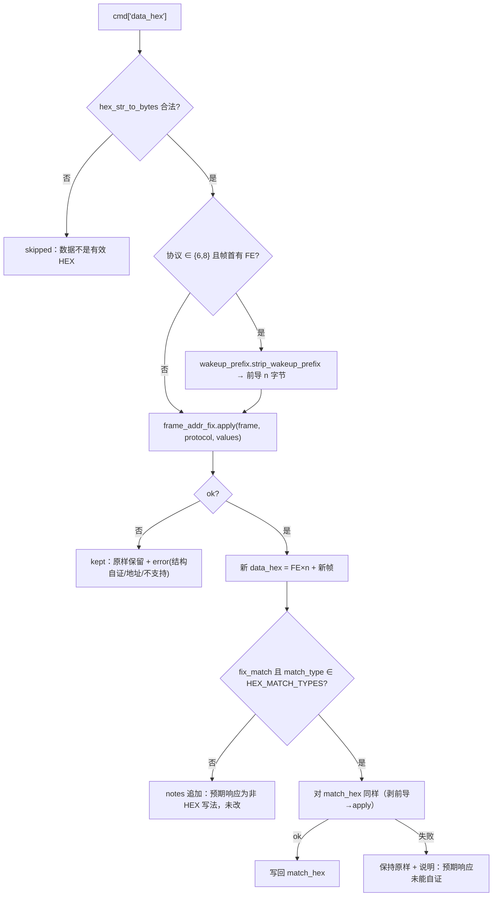

# 设计：串口工具批量替换通信地址

> PRD 见 `prd.md`。核心事实：**地址替换引擎已存在**（`frame_addr_fix.py`，蓝牙页 1.23.81 起在用），
> 本任务只补「串口工具侧的批量编排 + 入口 + 撤销」，**不新增任何偏移/算法/校验表**。

## 1. 边界

| 模块 | 角色 | 改动 |
|---|---|---|
| `serial_tool_widget.py` 纯逻辑段（≤948 行，无 Qt） | 批量编排 | 新增 `HEX_MATCH_TYPES` / `AddrBatchItem` / `batch_fix_commands()` |
| `serial_tool_widget.py` GUI 段 | 对话框 + 写回 + 撤销 | 新增 `BatchAddrDialog`；`MainWindow→SerialToolWidget` 侧新增 `_batch_replace_addresses` / `_apply_addr_batch` / `_undo_addr_batch` / `_addr_batch_undo` 与一个按钮 |
| `frame_addr_fix.py` | **复用，不改** | — |
| `test/*` | 测试 | 新 `test/test_serial_addr_fix.py`；`test_serial_tool_widget.py` 新增段 [35] |
| `release_check.py` | 门禁 | `CORE_TESTS` 增加一行 |

不改：`protocol_registry`、各协议解析器/校验器/组帧器、蓝牙页、Web 版、配置格式（`CONFIG_VERSION` 不动）。

## 2. 契约

```python
# ── serial_tool_widget.py 纯逻辑段 ─────────────────────────────────────
# 只有这四种匹配方式的「预期响应」是纯 HEX（其余是通配/正则/不匹配，不得按 HEX 处理）
HEX_MATCH_TYPES = ("contains", "equals", "starts_with", "ends_with")

@dataclass
class AddrBatchItem:
    index: int                  # commands 里的原下标（作用范围可能不含全部）
    name: str
    status: str                 # "ok" | "kept" | "skipped"
    data_hex: str               # status == "ok" 时是替换后的帧；否则是原值
    protocol: Optional[int]     # 要写入协议列的值（None = 不改该键）
    match_hex: str              # 预期响应（原值或替换后的值）
    match_changed: bool
    notes: List[str]            # apply() 的 notes（地址域 …；校验和 0xAA → 0xBB）
    error: str                  # kept / skipped 的可读原因

def batch_fix_commands(commands: List[dict],
                       indices: List[int],
                       protocol_index: int,
                       values: Mapping[str, str],
                       write_protocol: bool = True,
                       fix_match: bool = True) -> List[AddrBatchItem]
```

**纯函数**：只读 `commands` / `indices`，**不修改入参**（测试逐键对拍快照钉住）；
GUI 拿到结果后再写回，因此撤销点天然 = GUI 写回前抓的快照
（`_addr_batch_undo = [(index, old_data_hex, old_protocol, old_match_hex), …]`，仅 3 个键会被改动）。

### 单条命令的处理流程



- **前导 FE 只对 6 / 8 剥离**：依据 DL/T 698.45 §6.3.1 b) 与 DL/T 645 §5.3.1（AGENTS §8 陷阱 75）。
  其余协议带 FE 属于**本应失败**的帧，剥了会「救活」错帧。
- **`write_protocol` 与替换成败解耦**：作用范围内的每条命令都写协议列（用户声明「这批报文属于协议 X」），
  替换失败的条目单独在 `error` 里说明 —— 用户不会误以为「都换成功了」，因为汇总弹框分三态计数。
- **`fix_match` 的「能自证才替换」**：`apply` 第一步就是结构 + 原帧校验自证，
  所以片段式预期响应（`68 D0`）、通配（`68 D0 XX XX 16`）、正则一律走不到写回，
  只需保证「不适用 → 保持原样 + 说明」与「失败 → 保持原样 + 说明」两条都有日志。

## 3. GUI 结构

```text
命令按钮行（cmd_btns，现 8 个按钮）
  …添加 编辑 删除 上移 下移 | 保存配置 加载配置 加载报文文件 | 【替换地址】 ← 新增（与「加载报文文件」相邻）

BatchAddrDialog（新建，模式照 `bluetooth_tool_widget.ButtonEditDialog` 的地址区）
  ├─ 协议：QComboBox（frame_addr_fix.supported_choices()）
  ├─ QGroupBox「地址参数」 → QFormLayout 按 fields_for 动态重建（保输入值）
  ├─ 作用范围：QComboBox（「勾选的命令（N 条）」/「全部命令（M 条）」，默认勾选；无勾选→全部）
  ├─ ☑ 同时把协议写入这些命令的「协议」列（默认勾选）
  ├─ ☑ 同时替换「预期响应」中的地址（默认勾选）
  ├─ 提示行：将写入 N 字节：xx xx… ／ 预览：地址域 … → …；校验和 0xAA → 0xBB（或错误）
  └─ OK / Cancel（OK 前校验地址必填 + 逐字段 parse_address）
```

执行链（`SerialToolWidget` 侧）：

```text
_on_batch_addr_clicked()
  → 收集 作用范围（勾选行 / 全部）+ 协议 + values
  → 若作用范围为空：提示后返回（不做任何改动）
  → items = batch_fix_commands(...)                     # 纯逻辑
  → _apply_addr_batch(items)                            # 抓快照 → 写回 → 重建表 → 落盘 → 日志 + 汇总
  → 汇总弹框（成功 N / 保留 M / 跳过 K + 每类前 3 条原因）+「撤销本次替换」按钮
```

- **日志**：走既有 `_log()`（唯一写窗口点，同时进日志文件）；明细上限 20 行，其余汇总一行。
- **汇总弹框**：`QMessageBox` + 自定义按钮 `addButton("撤销本次替换", ActionRole)`；
  无改动（全 `skipped`/`kept`）时不显示撤销按钮。
- **落盘**：写回后 `_schedule_save()`（与添加/编辑/删除同一路径）。

## 4. 取舍

| 选择 | 理由 | 备选（否决） |
|---|---|---|
| **写回**表内 `data_hex`（不是发送时替换） | 用户口径「批量替换」；加载报文后地址即固定，表里看到的就是要发的内容，导出/复制也一致 | 发送时套用（每次发送都要过一遍；表里显示错误地址，导出仍是旧地址） |
| 复用 `frame_addr_fix` | 偏移/字节序/校验只有一个来源（同 AGENTS §8 陷阱 31/55/61 的单一来源原则） | 串口页另写一套适配（第二套口径必然漂移） |
| 对话框选协议 + 可选写回协议列 | 「加载报文文件」导入的报文 `protocol=None`，逐条取协议拿不到东西 | 按命令协议分组（对导入场景无用，且要用户先逐条设协议） |
| 只对 6/8 剥前导 FE | 规范只有这两条依据；其余协议带 FE 应报错 | 全协议剥（会把本应失败的帧洗成看似合法的帧） |
| 预期响应「能自证才替换」 | 匹配规则常是片段/通配/正则，机械替换会把规则改坏 | 一律替换（写坏通配/正则，且用户不知道） |
| 内存快照撤销（3 键） | 批量写回是破坏性操作，一次撤销是最低成本安全网 | 无撤销（误操作只能手工逐条回退） |
| 明细日志上限 20 行 + 汇总弹框 | 几百条逐条打印会挤掉收发日志（AGENTS §8 陷阱 58 的 burst 精神） | 全部逐条打印 |
| 纯函数返回「新值」而非直接改 `commands` | 可脱 GUI 单测、可直接做「预览」、撤销点天然存在 | 就地改（测试要连 GUI；预览与执行两份逻辑） |

## 5. 兼容 / 回滚

- 不触发本功能时，本页行为与 1.23.82 **逐字节一致**（新按钮只是新入口，既有路径一行未改）。
- 写入协议列只动被作用命令的 `protocol` 键（该键自 1.23.47 起已参与落盘/导出，旧配置缺键回落 `None`）。
- 配置格式未变 ⇒ **不需要 `CONFIG_VERSION` 迁移**（没有「默认值语义」被改）。
- 回滚 = 还原 `serial_tool_widget.py` 的 hunk + 删新测试文件 + 撤 `release_check.py` 那一行；无数据迁移。

## 6. 风险与对策

| 风险 | 对策 |
|---|---|
| 命令按钮行已有 8 个按钮，第 9 个在小窗口可能**裁字**（AGENTS §8 陷阱 63） | 走 `gui_utils.fit_btn_width`（只设 `minimumWidth`、不设上限）；测试断言 `width() >= sizeHint().width()` 且 `maximumWidth == QWIDGETSIZE_MAX`（须在 `show()` 之后量）；仍溢出则把「批量」组拆到第二行 |
| 用户把「协议列」当成了「这批都替换成功」的凭据 | 协议列写入与替换成败**分开**：汇总弹框分三态计数 + 每类前 3 条原因；日志逐条给原因 |
| `regex` 预期响应被误当 HEX 处理 | 判据是 `match_type ∈ HEX_MATCH_TYPES`（白名单，不是「非 wildcard 即 HEX」）+ 专门的测试用例 |
| 几百条命令时日志/弹框过长 | 日志明细上限 20 行；弹框每类最多 3 条原因 + 总数 |
| `frame_addr_fix` 只支持 6 个协议 | 作用范围内不属于该协议的命令会 `kept`（可读原因）；对话框只列 `supported_choices()` |
