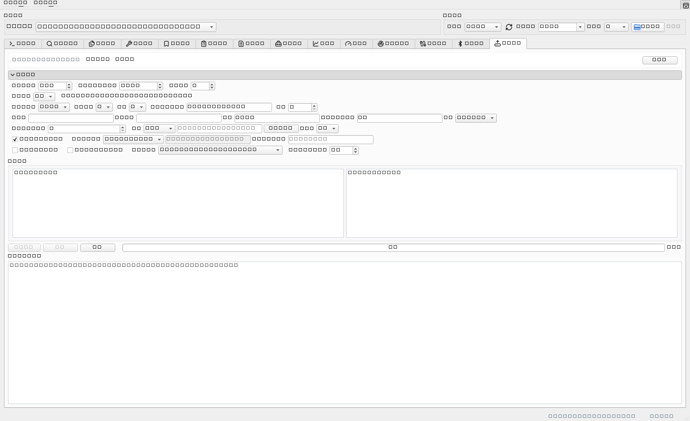

# 南网协议解析工具

[]() [](https://github.com/Liruitao1993/South_Network_Protocol_Analysis_Tool/releases) [](https://github.com/Liruitao1993/South_Network_Protocol_Analysis_Tool/releases) [](https://github.com/Liruitao1993/South_Network_Protocol_Analysis_Tool/stargazers)
[]() []() []()

**把电力通信报文从「看不懂的一串十六进制」变成「逐字段讲清楚的一张表」。**

面向电力通信**现场调试、联调测试、协议开发与检测验证**的一站式桌面工具：支持 **15 种电力通信协议**，在同一个窗口里完成 **解析 → 校验 → 组帧 → 串口 / 蓝牙收发 → 批量分析 → 时序图 → 测试报告** 的全流程；**Windows 双击即用，无需安装 Python、无需联网**。


## 为什么值得用

| 现场的常见问题 | 这个工具怎么做 |
| --- | --- |
| 报文看不懂，翻几百页协议文档逐字节对 | **15 种协议分层解析**到字段级（含 A-XDR / BER-TLV / 位域 / 日期时间），点解析行会**反向高亮**输入框里对应的字节 |
| 抓包日志几百行，靠人眼一条条挑 | **批量解析**：文件 / 剪贴板 / pcap 导入，自动从混杂文本里提出完整帧；类型过滤、搜索、Excel / CSV / JSON 导出；点摘要行可**回跳原始日志位置** |
| 校验和总对不上，组帧怕写错字节 | 内置**协议校验**（起始符 / 长度域 / 校验和 / CRC 逐项给结论）与**组帧模板**；还能「**仿照报文**」——粘一帧现成报文自动回填全部参数，并逐字节重建校验 |
| 串口、蓝牙、抓包工具来回切 | 串口 + **BLE 蓝牙**收发、**蓝牙 ⇄ 串口虚拟透传**、**TCP 抓包流重组**、实时监控器，都在一个程序里 |
| 要按用例反复发命令、留证据 | **测试方案**（增删改 / 顺序发送 / 超时匹配 / 结果记录）+ **Lua 脚本**（分支、循环、变量共享），结果一键导出 Excel 报告 |
| 结论要讲给别人听 | **通信时序图**（CCO ⇄ STA 一键成图、导出 PNG）、**报文对比**（字节 / 字段级 diff + 人话解读）、**频谱图**（光标读数 / MARK / Δ 测量） |

> 现场设备不等人，所以每一步都给**人话结论**：这条帧为什么不合格、DAR 是什么、第几包没确认、重试到第几次 —— 而不是只丢一堆十六进制。

## 下载

**推荐：下载 Windows 免安装版** —— 单文件 exe，双击即用，目标机器**不需要 Python、不需要联网**。

👉 **[前往 Releases 下载最新版](https://github.com/Liruitao1993/South_Network_Protocol_Analysis_Tool/releases/latest)**

- 最新版本：`1.23.85`（编译日期 2026-10-17）
- 系统要求：Windows 10 / 11（64 位）；「TCP 监控」功能需另装 [npcap](https://npcap.com/)
- 历史版本与源码：[Releases](https://github.com/Liruitao1993/South_Network_Protocol_Analysis_Tool/releases)；Windows 安装包用 Inno Setup 脚本 `南网解析工具.iss` 生成
- 想让同事直接在浏览器里用？Reflex Web 版支持**局域网零安装部署**，见下文 [部署到目标机器](#部署到目标机器)

## 目录

- [为什么值得用](#为什么值得用)
- [下载](#下载)
- [功能总览](#功能总览)
- [支持协议](#支持协议)
- [快速开始](#快速开始)
- [使用说明](#使用说明)
- [项目结构](#项目结构)
- [测试](#测试)
- [开发文档](#开发文档)
- [更新记录](#更新记录)
- [参与与反馈](#参与与反馈)
- [许可证](#许可证)

当前版本为 `1.23.85`，版本号与编译日期见 `main_gui.py` 中的 `APP_VERSION` 与 `BUILD_DATE`。

## 功能总览

| 模块 | 说明 |
| --- | --- |
| 单帧解析 | 输入十六进制报文，按协议分层解析，点击解析行联动高亮输入框对应字节并自动滚动到位置 |
| 批量解析 | 从文件/剪贴板/pcap 导入多帧报文，自动提取完整帧，支持导出选中/全部、类型过滤与 JSON / CSV / Excel 导出；摘要列对**测试帧（业务标识 0xF0）**体现测试模式（如 `测试模式:PLC物理层透传测试模式(3)`）、测试ID、通信频段 |
| 原始报文定位 | 批量摘要表点击行可回跳输入日志对应行；右键「转到原始报文位置」弹出只读查看器并高亮该帧 |
| 协议校验 | 覆盖起始符、长度域、校验和与 CRC（含协议9逐 PB PBCS CRC-24），逐项展示通过 / 失败 / 警告 |
| 表格复制 | 解析结果、批量结果、监控器与 TCP 监控表格支持右键复制及 Ctrl+C |
| 帧生成 | 南网、国网、698.45、DLT645-2007、模组化接口组帧模板，支持预设命令一键填充与解析回读；协议9（南网新一代载波）链路层组帧采用五层折叠表单（FC / 物理块 / MAC 头 / MSDU / ED 封装），SOF 帧优先，25 个测试模式；**支持「仿照报文」——粘贴一帧现成报文自动回填全部参数，并做逐字节重建校验，参数集可存成本地模板** |
| 串口通信 | 串口参数配置、帧发送、实时接收解析与日志窗口；**断帧可调**——协议特征断帧（68 家族自动跳过帧首前导 FEH）/ 仅按字节超时，4 个断帧超时（字节静默 / 聚合最长持有 / 协议帧等待静默 / 协议帧等待上限）现场可调，日志给出当前断帧依据；**批量替换通信地址**——按所选协议把作用范围内每条命令的地址域换成现场表计地址并**重算校验**（可同时写入「协议」列、同步替换预期响应），结果逐条可查、一次可撤销 |
| 蓝牙通信 | BLE 扫描 / 连接、**特征码自动优选与一键探测**（连上即可收发，无需在特征码列表里挑；按设备记忆选择）、收发报文解析、自定义报文按钮、**蓝牙 ⇄ 串口虚拟透传**（把蓝牙模块当无线串口延长线） |
| 虚拟表 | 协议8（698.45）从站模拟器；协议6 另有「645虚拟表」：离线粘贴读请求生成响应、档案 DI 值、可选串口从站 |
| 通信时序图 | 协议9/10/11 批量结果一键生成 CCO⇄STA 序列图，与摘要表双向联动，可导出 PNG |
| 测试方案 | 测试项 CRUD、顺序发送、超时匹配、结果记录与 Excel 报告导出 |
| Lua 脚本 | 测试流程中嵌入可编程逻辑，支持条件分支、循环遍历、数据解析与变量共享 |
| 报文对比 | 双报文字节级 / 字段级对比，支持差异高亮、人话解读与报告导出 |
| 报文工具 | ASCII / HEX 转换、DLT645 偏移、字节逆序、Pn/Fn 转换、CRC/校验和计算 |
| 频谱图 | 按频谱仪参数（起止/中心/扫宽、RBW/VBW、参考电平、每格 dB、单位、检波方式）输入单条 trace 全部扫频点数值，绘制仪器式网格频谱图；支持光标读数、MARK 标记与两点 Δ（频段宽度/电平差）测量，可导出 PNG |
| LLM 预处理 | 批量解析可折叠面板，OpenAI 兼容 API 多轮清洗原始日志后再解析 |
| 实时监控器 | 南网新一代 / 国网新一代串口报文实时监控、自动组帧、过滤与 CSV 记录 |
| TCP 监控 | 基于 scapy 的 TCP 抓包、流重组与南网新一代 / 国网新一代自动识别解析 |
| 档案与拓扑 | 南网 / 国网协议档案导入导出、拓扑组网统计 |
| 查询页 | DI、AFN、DLT645 DI、OBIS、PLC RF 命令字、新一代业务标识、HDC 1.0 报文 ID、EB 数据标识、模组化接口信息类查询 |
| 多端界面 | PySide6 GUI、实验性 Reflex Web |
| 主题与字体 | 5 套主题与字体设置，支持配置持久化；表格 Ctrl+滚轮缩放 |
| 系统集成 | 系统托盘（**菜单内嵌报文输入框**）、**任务栏图标快捷按钮**、全局热键、快捷解析小窗、剪贴板报文检测、Notepad++ 集成、单实例、命令行解析、文件右键菜单与开机自启 |
| 问题反馈 / 报文分享 | GUI 与 Web 共用服务端库；单帧可「分享此帧」到 Web 报文分享页 |
| 自动更新 | 帮助菜单检查更新，可配置自动检查并选择版本下载 |
| 状态栏 | 本软件 CPU / 内存占用、线程数明细（可点击复制） |

## 支持协议

工具支持 15 种电力通信协议，下拉框索引即协议编号：

| 索引 | 协议 | 标准号 | 字节序 | 校验 |
| --- | --- | --- | --- | --- |
| 0 | 南网协议 | Q/CSG1209021-2019 | 小端 | 8 位位组算术和 |
| 1 | PLC RF 协议（万胜海外） | 万胜 V1_04 | 大端 | 累加和 & 0xFF |
| 2 | HDLC/国网DLMS | IEC 62056-46 | 大端 | CRC-16/FCS（CCITT） |
| 3 | DLMS-APDU（国网） | IEC 62056-46 | 大端 | 无 |
| 4 | DLMS Wrapper 裸报文 | IEC 62056-46 | 大端 | 无 |
| 5 | DLMS-APDU 裸报文 | IEC 62056-46 | 大端 | 无 |
| 6 | DLT645-2007 电表协议 | DL/T 645-2007 | BCD，低字节在前 | 累加和 & 0xFF |
| 7 | 国网协议 | Q/GDW 10376.2-2024（含福建增补 AFN 50H~56H） | 小端 | 8 位位组算术和 |
| 8 | 698.45 协议 | DL/T 698.45-2017 | 小端（链路层）/**大端（A-XDR 数据）** | CRC-16（crcmod `x-25`） |
| 9 | 新一代载波协议（通感一体化） | 通感一体化宽带载波通信规约 | 小端 | CRC-32（MAC 帧）+ CRC-24（PBCS） |
| 10 | 国网新一代双模通信互联互通 | 国网新一代双模通信互联互通技术规范 | 小端 | CRC-32（MAC 帧） |
| 11 | HDC 1.0 双模互联互通 | Q/GDW 12087.42-2020 | 小端（MAC 地址大端） | CRC-24（FC/PB）+ CRC-32（MAC） |
| 12 | 模组化终端功能模块接口 | Q/GDW 模组化终端功能模块接口协议 | 小端（链路层）/**大端（A-XDR 数据）** | CRC-16/PPP FCS（x-25） |
| 13 | 依瓦定制645 | 依瓦定制645协议 V1.0 | 地址域高字节在前 / 数据域逐字节 | 8位位组算术和（数据域 ±0x33） |
| 14 | 南网上行通信规约 | Q/CSG 11109004-2013 | 小端（长度L/地址域/多字节字段）；数据标识 DI 低字节在前 | 8位位组算术和（控制域+地址域+链路用户数据） |

> HDC 1.0（索引 11）与模组化终端功能模块接口（索引 12）目前仅在 PySide6 主程序支持；Reflex Web 版支持索引 0–10（11 种）。协议 13/14 已接入 PySide6 主程序与 Reflex Web 解析/查询/提取。

## 快速开始

### 环境要求

- Windows 优先，支持 UTF-8 / GBK 中文路径
- Python 3.8+
- TCP 监控需要安装 `scapy`，Windows 下还需要安装 npcap

### 安装依赖

```bash
pip install pyside6        # GUI 必需
pip install crcmod         # 698.45 协议 CRC 校验（1.7.0 起）
pip install lupa           # Lua 脚本引擎（1.8.1 起，可选）
pip install openpyxl       # Excel 测试报告（可选）
pip install scapy          # TCP 流量监控（可选，Windows 需 npcap）
pip install bleak          # 蓝牙工具（BLE 通信，1.23.71 起）
pip install reflex         # Reflex Web 版（实验性）
```

> `lupa` 未安装时 Lua 脚本功能不可用，其余功能不受影响；`scapy` 或 npcap 未就绪时，TCP 监控标签页会给出安装提示；`bleak` 未安装时蓝牙工具标签页会给出安装提示并禁用扫描 / 连接，其余功能不受影响。

### 运行

```bash
# PySide6 GUI 版（主入口）
python main_gui.py

# Reflex Web 版（实验性）
python reflex_web/run_app.py
```

**局域网部署（Windows 服务器 · 固定端口）**：完整步骤见 [`docs/Web版局域网部署教程.md`](docs/Web版局域网部署教程.md)——含防火墙放行、开机自启（任务计划/NSSM）、备份与升级、排错表。构建时用 `--port <端口>` 把端口固化进启动脚本（默认 8080）。

**Web 路由（1.23.14 起）**：`/` = **产品首页**（介绍桌面客户端：Hero、功能卡、12 协议表、命令行/系统集成、下载入口、页脚；`reflex_web/reflex_web/landing_web.py`）；`/app` = **在线工具**（原主页的 9 个标签页，含单帧/批量/组帧/对比/查询/频谱图/报文工具/客户端下载/问题反馈）；`/share`、`/feedback`、`/feedback-admin` 不变。首页的截图/版本/体积读 `reflex_web/downloads/`（`client_screenshot.png`、`version.json`、`*.exe`），换图换版本无需改代码；缺图时降级为占位卡。

**Reflex Web 版组帧**：南网(0)/国网(7)/698.45(8)/DLT645(6) 四种协议组帧与 GUI 完全对齐——预定字段（uint/enum/bytes/ascii/bcd/oi/oad_list/list/sub_fields 按类型分派）、自定义模板（含校验和回填）、698.45 A-XDR 数据编辑器；实时回读解析预览；预设命令按钮（NW_command.json / GW_command.json / DLT645_command.json 等）一键填入与保存。启动前先编译前端：`cd reflex_web && reflex export --frontend-only --env prod --no-zip`，再 `python reflex_web/run_app.py`。

**问题反馈**：导航栏「问题反馈」入口（`/feedback`）——用户提交问题类型/涉及协议/描述/联系方式/截图（≤3 张）；管理员通过 `/feedback-admin`（复用发布管理口令）查看/标记状态/删除。数据存 `reflex_web/data/`（SQLite + 截图），**重新部署自动保留**，备份只需拷贝该目录。

**报文分享（1.21.0 起）**：单帧解析后点「分享此帧」（Web 主页或 GUI 按钮行），报文 + 协议 + 分享人 + 说明入库（frameshare.db，与反馈同一 data/ 目录、部署自动保留）。所有人可在 Web 导航「报文分享」页浏览与搜索（hex 支持连续无空格输入）；GUI 提交走 `POST /api/frameshare`，分享人自动记忆。管理员（复用反馈管理口令）登录后可在列表每条记录上点「删除」清理杂乱分享（1.21.1 起）。

**桌面端问题反馈（1.20.0 起）**：GUI 客户端「帮助 → 问题反馈(F)...」打开反馈对话框，提交到 Web 服务端 `POST /api/feedback`，与网页反馈**共用同一个数据库**——主页「问题反馈」Tab 统一查看，桌面端来源的记录带「桌面端」徽章并附客户端环境信息。反馈服务器地址在对话框内可改（默认 `http://127.0.0.1:8000`，持久化到 `config.json` 的 `feedback.server_url`）。

### 部署到目标机器

有两种方式将 Reflex Web 版部署到没有 Python 环境的目标机器：

**方式一：内嵌 Python（推荐，零安装）**

构建包含 Python 运行时的部署目录，目标机器无需安装 Python，解压即用：

```bash
python reflex_web/build_embedded_deploy.py --python-version 3.12
# 输出: dist/reflex_web_embedded/
```

把 `dist/reflex_web_embedded/` 整个目录复制到目标机器，运行 `start_web.cmd`（Windows）或 `./start_web.sh`（Linux）即可。

**日常迭代构建（推荐）：** 源码/依赖几乎不动时，用增量模式只刷新源码层，复用已有内嵌 Python 与依赖，
避免每次重新下载解释器 + 重装依赖（完整耗时 10+ 分钟 → 增量约 1 分钟）：

```bash
python reflex_web/build_embedded_deploy.py --skip-deps
```

仅首次构建、改依赖或换 Python 版本时才需要去掉 `--skip-deps` 完整重建。

**方式二：UV 虚拟环境（需要目标机器有 Python）**

构建依赖虚拟环境的部署目录，目标机器需要安装相同版本的 Python：

```bash
python reflex_web/build_offline_deploy.py --python-version 3.12
# 输出: dist/reflex_web_offline/
```

详细说明见 [`reflex_web/离线部署.md`](reflex_web/离线部署.md)。

### 打包 exe

项目当前提供 `南网协议解析工具.spec`，打包时请先确认 `main_gui.py` 中的 `BUILD_DATE` 已更新为当前日期：

```bash
pip install pyinstaller
pyinstaller 南网协议解析工具.spec --noconfirm
```

生成的 exe 位于 `dist/`，文件名自动带版本号与时间戳，例如 `南网协议解析工具_v1.23.0_20260910120000.exe`。新增需打包的数据文件时，需要同步检查 spec 的 `datas` 配置。Reflex Web 版另有 `reflex_web/reflex_web_exe.spec`。

> 当前主程序 spec 未显式声明 `scapy`。如需将 TCP 监控功能打包进 exe，请先在 `南网协议解析工具.spec` 中补充 `scapy` 相关 hidden imports，并确保目标机器安装 npcap。

## 使用说明

### 单帧解析

1. 顶部下拉框选择协议类型
2. 在「输入报文」文本框粘贴十六进制报文（支持带空格 / 无空格混合）
3. 点击「解析报文」
4. 下方表格显示分层解析结果，点击解析行会高亮输入框中的对应字节并自动滚动到该位置

解析 HDLC 帧后，可双击 `DLMS APDU` 行打开深度解析窗口，支持 Get / Set / Action 等 APDU 类型与 BER-TLV 递归解析。

国网新一代（索引 10）与 HDC 1.0（索引 11）可选择解析级别（自动识别 / FC+PB / 仅FC / 仅MAC / 仅PB / FC+MAC / 应用层）与通道（PLC 载波 / HRF 无线）；新一代载波（索引 9）另支持 FC+eFC 级别与 ED 监控包装剥离。ED 包装头格式支持「自动识别(推荐) / PLC2.0 台体 / 广西台体(14字节头)」。

解析成功后可点「分享此帧」，把有价值的命令帧分享到 Web 服务端报文分享库。

### 批量解析

切换到「批量解析」标签页：

- 从文件加载或剪贴板粘贴
- **导入 pcap**：离线读经典 `.pcap`（零依赖）/ `.pcapng`（需 scapy），TCP 流重组后自动批量解析——PLC2 监控帧 / 业务帧 / 原始 TCP 负载三模式，接「按类型全选 → 时序图」
- 自动从混杂文本中提取完整帧
- 摘要表支持 Ctrl/Shift 多选，「导出选中」只导出目标子集；「按类型全选」可一键选中某类型全部帧
- 点击摘要行可在输入框回跳并选中对应报文行
- 右键「转到原始报文位置」弹出只读查看器（行号 / 高亮 / Ctrl+F 搜索），查看导入时的原始日志快照
- 新一代载波协议支持监控日志前缀剥离与业务摘要；ED 包装头可选 PLC2.0 / 广西台体 / 自动识别
- 国网新一代 / HDC 1.0 支持日志前缀剥离与业务摘要

批量解析工具栏另有「LLM 智能预处理」可折叠面板：配置 OpenAI 兼容 API 后，可对原始日志做多轮智能清洗再解析（内置提取 hex、清理前缀、按协议分类等模板，大文件自动分块异步执行）。


### 通信时序图

批量解析协议 9 / 10 / 11 后，点工具栏「时序图」或切换到「通信时序图」标签页：

- 节点按 TEI 自动判别（TEI=1 为 CCO 固定最左，其余 STA 按首现排序）
- 信标/SACK/应用层广播画虚线，单播画实线；支持台体发射机、未入网站点、阶段分隔线
- 滚轮缩放、拖拽平移、「适应窗口」、「导出 PNG」
- 点击图上消息跳回批量解析页定位对应帧行；反向选中摘要表行时图上对应消息高亮
- 摘要表有勾选行时仅用勾选帧生成，否则使用全部帧

### 虚拟表（协议 698.45 / DLT645）

**协议 698.45「虚拟表」**

「虚拟表」标签页仅在协议 8 下显示，提供 698 从站模拟：

- **离线模式**：粘贴主站请求帧，自动生成响应帧并解析回读，可一键送入单帧解析器
- **串口从站模式**：独立选择串口参数，持续监听 `68...16` 请求帧并自动组帧回复（建议配虚拟串口对）
- 支持 GET Normal/NormalList/Record、链接请求、SET/ACTION 成功 DAR、安全明文封装
- 档案数据（`meter_sim_data.json`）可在档案页增删改、JSON 导入导出；多表通配、黑/白名单、电能递增、冻结漏点等可配置

**协议 6「645虚拟表」（1.23.5）**：

- 离线：粘贴主站读数据请求 → 生成 `91H` 应答（未知 DI 回异常 `D1H`）
- 档案页编辑 DI→值（`dlt645_sim_data.json`）
- 可选串口从站自动监听回复（虚拟串口对）

### 实时监控器

「监控器」标签页在协议 9（南网新一代）与协议 10（国网新一代）下显示：

- 串口原始字节流自动组帧，支持静默间隔组帧与监控解帧模式
- 南网新一代使用 `ED..EE` 包装，国网新一代使用 `96..16` 包装
- 左侧帧列表支持过滤、暂停、自动滚动、清空、CSV 记录与日志目录打开
- 右侧展示完整解析表格与原始 HEX，双击帧可送入单帧解析页

### TCP 流量监控

「TCP监控」标签页基于 scapy 实现：

1. 选择网卡并输入 BPF 过滤条件，例如 `tcp port 8080` 或 `host 192.168.1.1`
2. 点击「开始抓包」
3. 上方 TCP 流列表按四元组实时汇总包数、字节数与最新时间
4. 选中一条流后，下方展示按监控封装格式重组切分出的应用层帧
5. 选中帧后自动调用南网新一代或国网新一代解析器，右侧显示解析结果

TCP 监控支持流关注、表格复制、暂停刷新、CSV 实时记录与历史 CSV 加载。首次打开标签页时 scapy 在后台惰性加载，不阻塞主界面。

记录下来的 CSV 不会「找不到」：工具栏「打开位置」一键在资源管理器中**定位并选中当前记录文件**（无记录文件时打开记录目录）；「记录目录」菜单可**自选记录目录并记住**（重启仍生效，默认 `<数据目录>/Output`），也可恢复默认；状态栏的记录名悬停可看到完整路径。

### 协议8 文件传输升级（「光伏升级」页，1.23.85）

选到「698.45 协议」时会出现**「光伏升级」标签页**：把分布式产品的**二进制升级包**拖进去，工具按 DL/T 698.45 的文件传输（OI `F001` 文件分块传输管理）把包分成若干块逐块下发，**每块等设备回确认帧**才发下一块，全部传完后自动发执行升级命令。

1. **拖入升级包**（或点「浏览…」）：显示文件名与字节数，空文件/目录/不可读会明确报错
2. **参数**：每包字节数（默认 600）、确认超时（默认 3000ms）、重试次数（默认 3）、传完是否自动执行升级
2b. **发送通道**（参数区第一行）：**串口**（默认，走顶部「串口配置」的连接）或**蓝牙**（**复用「蓝牙工具」页已建立的连接** —— 先在那页扫描/连接/选特征码；本页不自己开连接）
   - 选蓝牙时**每包字节数上限会自动算好**：按「一次 ATT 写能承载的字节数」（协商 MTU − 3，或特征码自带的免响应写上限）减去 698 整帧开销（帧头/地址/HCS/APDU 头/BER 长度/FCS/结束符，用真实组帧反推）—— 例：**MTU 512 ⇒ 一次写 509 字节 ⇒ 每包最大 475 字节**（你说的「不超过 480」成立）；超出会自动收敛，计算过程写在通道标签上
   - 蓝牙通道下每帧**一整帧一次 ATT 写**（不会把 698 帧拆到多次写；万一超上限会拒发并报错）；MTU 协商完成/变化、连接变化、SA 改了都会自动重算
   - 蓝牙未连接、或 MTU 还没协商好时，「开始升级」会禁用并说明去哪连（**不设一个假的上限**去误导）
3. **SA 地址默认通配地址**（类型=通配、长度 6、`AA AA AA AA AA AA`），可改为单地址/组地址/广播地址，也可按文档示例一键回填；CA、文件信息（源文件/目标文件/文件大小/文件属性/文件版本/文件类别）、校验类型与校验值（可一键按文件算 CRC32/MD5/SHA1）都可编辑
4. **流程** = 启动传输（让设备进入接收升级包状态）→ 写文件 ×N（**每包一帧、逐包确认**）→ 执行升级（默认「立即执行」）
5. **进度与日志**：进度条只按**已确认**的块累加（已传字节/总字节 + 第 x/N 块）；每帧收发的 hex 与判定结果（DAR 值、第几次重试、失败原因）都写进日志，失败/超时同时弹框；**不超过 200 字节的帧整帧显示**，写文件大帧只显示头尾各 100 字节、中间用 `...` 省略并标注总长
6. **串口复用**顶部「串口配置」的连接（不另开端口），未连接时禁止开始
7. **可选「读版本信息」**（默认不勾）：`升级前读版本信息` / `升级完成后读版本信息` 两个开关 —— 勾上后会在升级前、收尾时各发一帧读取命令，结果同时出现在**日志**与**「版本信息」展示区**
   - **收尾那次与「传完后自动执行升级」无关**：勾了自动执行 ⇒ 执行升级被确认后读；**没勾** ⇒ 最后一包写完被确认后读（有的设备收全升级包会**自动复位升级**）
   - **读之前先等设备复位**：参数区「**升级后等待(s)**」默认 **10 秒**（0~600 可改，0 = 立即读）—— 复位期间设备读不到版本；等待时状态栏实时显示「等待设备复位（剩余 N 秒）」，`中止`/`清除` 可随时打断
   - **展示区**（就在「升级参数」下面）：`升级前` / `升级完成后` **并排两栏**，逐字段列出读到的内容，升级前后一眼可比；未读显示「（未读取）」，读失败显示原因；点「开始升级」或「清除」都会重置
   - **日志**里解析内容写在**响应帧的下一行起**（帧一行、明细在下），不用再横向拖到底：`→ 版本信息（升级前·内部）读取成功（6 项）` + 每字段一行（名称 / 值 / 原始字节，如 `软件版本日期 = 2026-08-03 [0A06323630383033]`）
   - **逐字段解析**：按 DL/T 698.45 表191「版本信息」的六个字段解析（厂商代码 / 软件版本号 / 软件版本日期 / 硬件版本号 / 硬件版本日期 / 厂商扩展信息），`YYMMDD` 日期自动补全为 `20YY-MM-DD`；若设备回的字节长度与该表声明不符，字段名照给但会多一行 `⚠ 长度未自证`（写明声明值与实发值），不是版本信息结构时则原样给「数据」一行
   - **读版本内容**下拉二选一：**通用版本信息**（标准 OAD `43 00 03 00`，电气设备类属性 3）或**内部版本**（厂家扩展 OAD `FF 10 04 00`）
   - 命令是通用的 698.45 读取（`05 01 <PIID> <OAD> 00`），**SA/CA 与升级传输同一份配置**（默认通配 `AA AA AA AA AA AA`）
   - **读版本失败不阻断升级**：超时/否定/解析失败按重试次数重发，用尽后记一条日志继续；只有所选那条命令的响应才认（设备若回另一条的响应按「OAD 不符」忽略）
   - 两个开关、「读版本内容」与等待时长都会记住，传输进行中被冻结

> 组帧口径已按实帧**逐字节验证**：`协议文档/8.698.45协议/代理升级流程.docx` 里 62 字节的「启动升级」实帧，以及读版本信息的两条现场实帧（通用版本 `68 17 00 43 05 AA AA AA AA AA AA 00 AA 2A 05 01 01 43 00 03 00 00 6D 5C 16`、内部版本 `68 17 00 43 05 03 24 08 04 26 20 00 CD 9A 05 01 2C FF 10 04 00 00 C2 8A 16`），由本工具组出的帧完全相同（含帧头校验与帧校验）。



### 蓝牙工具（BLE）

「蓝牙工具」标签页让工具本身具备 **BLE 蓝牙通信能力**（常驻显示，与协议无关）：

1. 「扫描设备」列出周边 BLE 设备（可选只显示有名称的设备），按信号强度排序
2. 选中一行点「连接」；连接后显示设备名、地址与**协商 MTU**
3. 「特征码…」选择接收（Notify / Indicate）与发送（Write）通道。对话框左右分栏、不可用项置灰，提供「全选 / 全不选 / 自动选择」，并记住上次选择
4. 收发框手动发送 / 接收，接收侧按**静默超时自动切帧**；可选按当前协议解析收到的帧（日志输出摘要 + 逐字段表），解析口径与单帧页、串口工具页完全一致
5. 「送入单帧解析」把输入框内容直接送去主窗口单帧页逐字段解析

其它能力：

- **虚拟模式（蓝牙 ⇄ 串口透传）**：BLE 收到的数据原样写入串口，串口收到的数据原样写入 BLE —— 把蓝牙模块当成**无线串口延长线**。串口复用主窗口顶部「串口配置」的连接（不另开 COM 口），任一侧未连接时明确丢弃并记日志
- **自定义报文按钮**：可新增 / 批量导入（每行 `名称,内容[,HEX|ASCII]`）/ 编辑 / 移位 / 删除 / 导出 / 导入，按钮上点右键即可操作。按钮区**随可用空间自动**（空间够就把按钮全显示、不够才滚动），整区可折叠（收起只剩标题行，状态记住），**编辑按钮常驻在按钮区下方**（收起时也在），右栏还能**拖动分栏**自由分配「日志 ↔ 发送区 + 自定义区」的高度
- **按钮可绑定「协议 + 地址」**（1.23.81）：编辑按钮时选协议，下方按协议出现 1~2 个地址输入框（南网/国网 = 源/目的；645/依瓦 = 表地址；698.45 = SA/CA；南网上行 = 终端地址）。点按钮发送时按该协议**替换地址域并重算校验**，日志给出「地址域 … → …；校验和 0xAA → 0xBB」；**发送框仍显示原始报文**（替换只作用于真正写出去的字节）。地址写法两种都认：带分隔符的 hex 按在线顺序写入，纯数字按协议编码（自动字节序/BCD）。失败（地址非法、长度不符、帧不含地址域、协议暂不支持）会弹框说明并**一个字节都不发**
- **按钮可按「协议类别」批量替换地址**（1.23.84）：工具栏「批量地址…」→ 选协议 → 对话框列出全部按钮（每行带当前绑定摘要），**默认勾选「已绑定该协议」的按钮**（另有 全选 / 全不选 / 只选本协议）→ 填一次该协议的地址 → 一次写入这批按钮。每个按钮按**自己的报文**预检（698.45 的 SA 长度由各帧自己决定），失败的行标出原因且**默认不勾**；强行勾上会二次确认「将跳过哪些」后照改其余。协议下拉第一项 =「（清除协议与地址）」可**批量解绑**
- **发送格式三态**：自动（HEX 优先）/ HEX 字节 / ASCII 文本。**HEX 写错绝不静默改按文本发**：`68 12 0G` 会报错拒发，而不是把这 8 个字符的 UTF-8 字节写到设备上；位数不成对（`68 12 0`）同样拒发（不让底层静默补 `0`）
- **日志**：可选行首时间戳、窗口行数上限、自动保存到 `<数据目录>/Output/bluetooth_log_*.txt`（目录可自选并记住，「打开目录」一键定位），文件收尾写入行数与停止时间
- **参数持久化**：上述开关、特征码选择、自定义按钮与日志设置都存进 `bluetooth_tool_config.json`（原子写，坏文件回落默认）
- 写入按**协商 MTU / 特征码 `max_write_without_response_size`** 自动分包，包间可配延迟；断开或掉线前会把未成帧的残包交出，不丢尾包
- **MTU 与写上限是实时的**：ATT_MTU 由操作系统异步协商（Windows 上应用层只能读、不能请求），连接那一刻常只读到 ATT 默认值 23（单包 20 字节）—— 所以连接后会**轮询等协商结果**（3 秒内到即自动更新界面，日志打出 `MTU 协商更新：23 → 247`；对端确实只支持默认值则只提示一行），且**每次发送前都会重读**，分包按发送那一刻的真实上限
- 只提供扫描 / 连接 / 收发 / 组帧，**不做任何云侧上传**；`config.json` 与蓝牙配置都在本机数据目录

> 与「串口工具」标签页一样，「蓝牙工具」的端口/波特率只在顶部「串口配置」设置，本页只订阅信号。

### 系统集成与命令行

GUI 版提供 Windows 系统集成能力：

- 关闭主窗口默认最小化到系统托盘，托盘左键单击可显示 / 隐藏主窗口
- **右键托盘图标就能直接输入报文解析**：托盘菜单里内嵌一个输入框（带「解析」按钮），打字/粘贴报文后回车即可出结果 —— 判据与剪贴板检测同源（整串是 HEX 就直接解析并按特征识别协议；否则按文本提取报文）；识别不了时状态栏 + 气泡会说明原因
- **任务栏图标上的快捷按钮**：鼠标**悬停任务栏图标**时，预览里出现 4 个可点按钮（解析剪贴板 / 快捷解析 / 批量解析 / 光伏升级），用的是系统官方 `ITaskbarList3/4` 缩略图工具栏接口
  - 说明：Win11 的任务栏对第三方是封闭的（Win10 的「任务栏自定义工具栏」已被移除），**任意控件（包括输入框）不能放进任务栏那一行**；截图中那种「封面+标题+播放键」是**系统媒体卡片（SMTC）**，只有媒体会话能占。所以「在任务栏上操作」的受支持做法就是上面这两条
  - 另注：缩略图按钮只在窗口**有任务栏按钮**时可见（点 X 隐藏到托盘后就不显示了；想常驻请配合「最小化而不是隐藏」）
- 全局热键默认 `Ctrl+Alt+X`，复制十六进制报文后按下即可弹出**快捷解析小窗**（uTools 风格悬浮面板，实时解析 + 徽章 + 完整字段树；Esc/再按热键/失焦隐藏；「在主窗口打开」转入完整视图）
- 开启「剪贴板报文自动检测」后，在任意软件中复制十六进制报文会自动弹出解析提示框，自动识别协议后可直接转入解析
- 可注册 Notepad++ 集成：在 Notepad++ 中选中报文并按 Ctrl+C 复制，右键「用协议解析工具解析」或运行命令即可解析
- 程序支持单实例，重复启动会把命令行参数转发给已运行实例
- 在「配置 → 主题与字体」的「系统集成」面板可配置开机自启、关闭行为、热键与文件右键菜单
- 注册文件右键菜单后，`.log` / `.txt` / `.hex` / `.bin` 文件可右键选择协议直接解析

剪贴板提示框与热键 / 命令行解析弹窗支持切换协议；南网新一代 / 国网新一代报文还可选择解析级别、PB 帧类型，并自动剥离 `ED..EE` 监控包装头。

命令行示例：

```bash
# 按协议索引直接解析十六进制报文
python main_gui.py --parse "68 0E 00 00 00 00 01 00 01 E8 00 05 EF 16" --protocol 0

# 按协议名称解析文件中的报文
python main_gui.py --file sample.log --protocol 国网新一代

# 启动后最小化到托盘
python main_gui.py --minimized

# 读取剪贴板中的十六进制报文并直接弹出解析结果
python main_gui.py --clipboard
```

### 报文对比

切换到「报文对比」标签页：

- 双报文字节级对比与字段级语义对比
- 差异高亮、人话解读、忽略校验和 / 序列号等选项
- 导出对比报告

### 报文工具

「报文工具」标签页提供协议调试常用功能：

- ASCII / HEX 双向转换
- DLT645 偏移（±0x33H）
- 字节逆序
- 报文与 Pn/Fn 转换
- CRC-16 / 24 / 32 与校验和计算
- HEX 与 bitstring 转换

### 帧生成与预设命令

「协议组帧」标签页在协议 0（南网）、协议 6（DLT645-2007）、协议 7（国网）、协议 8（698.45）、协议 9（南网新一代载波）与协议 12（模组化接口）下显示；「预设命令」标签页在协议 0 / 6 / 7 / 8 / 12 下显示（协议 9 暂无预设命令库）：

- 按字段模板填写参数
- 支持预设命令一键填充
- 生成帧后可直接通过串口发送，也可解析回读闭环校验
- 协议 6 支持主站请求 / 从站应答 / 异常应答三组命令，DI 由数据字典驱动并按 data_type 掩码自动推导字段表单
- 协议 9 为**链路层组帧**：①FC 帧控制 / ②物理块 PBH+PBCS / ③MAC 帧头 / ④MSDU / ⑤ED 封装 五层折叠表单，定界符支持 **SOF 帧**（BPLC / ISAC-PLC、长/短 MAC 头、多物理块）、信标帧与选择确认帧（SACK）；默认按 `ED…EE` 封装下发，可切「应用层帧 / 仅测试帧数据单元 / 整帧 MPDU」四种输出层次，FCCS / PBCS（CRC-24）与 ICV（CRC-32）自动计算
- 协议 9 支持**「⓪ 仿照报文 / 模板」**：把官方测试系统里拷来的整帧报文粘进组帧页（ED..EE 封装 / 整帧 MPDU / 应用层帧都能自动识别）→ 点「解析并回填」→ 各层参数被填成默认值（含测试模式与其参数）→ 只改需要变的字段再生成。回填后**立刻用同一套参数重建并与原帧逐字节对比**：完全一致才提示可放心微调；表单表达不了的字段会按「手工 HEX 保真」兜底并明确提示，「对比当前输出」可随时报告首个不一致的字节偏移
- 协议 9 的这套参数可**存成本地模板**（`csg_frame_templates.json`，含完整参数集与原始参考报文）：下次从下拉加载模板 → 只改 TEI / 帧序号 / 频段等关键字段 → 直接生成新帧
- 右侧「**显示响应解析**」开关：协议 9 是纯组帧场景，响应帧解析默认收起、把高度让给实时解析预览；其它协议保持默认显示，勾选状态会被记住

### 频谱图

「频谱图」标签页把频谱仪屏幕上的参数与 trace 数值画成图（常驻显示，与协议无关）：

- 参数区：起始/终止/中心/扫宽四字段**双向联动**（改任一项自动重算其余，按回车或移开焦点生效），可切换 kHz/MHz/GHz；另有 RBW、VBW、参考电平、每格 dB（0.1~20）、纵向格数（4~12）、幅值单位（dBm/dBμV/dBmV，支持按 50Ω 换算）、检波方式
- 数据区：粘贴频谱仪导出的 trace 所有扫频点数值（空格/逗号/分号/换行或中文分隔符均可），点数即频率轴点数、等间隔线性均分；**带日志前缀的行会自动取行尾真实数值**（如 `2026-09-14 12:25:43 015: 流程日志：… --USER--MTC@PC: -51.564613` → `-51.564613`，支持 `-51.5 dBm` 这类单位后缀），清洗行数/跳过行数显示在状态行；非法数值仍明确报错（不会只取一半）
- 绘图：仪器式网格（横向 10 格 × 纵向可配格数，顶格为参考电平、向下每格 −dB/div）；勾选「纵轴自动适配」改为按数据范围取轴；标题与参数注记随图渲染
- **光标测量**：鼠标在图上移动即显示十字光标与读数框（最近数据点的频率与幅值，吸附不插值）
- **MARK 标记与两点测量**：点击绘图区添加标记 M1~M6（吸附最近数据点），**每个标记一种颜色**，图上标记与标记表文字同色，便于一一对应；标记表列出 `标记/频率/幅值/Δ频率(哪两点)/Δ幅值(哪两点)`，Δ 一律标注是哪两个标记之差（如 `M1↔M3`），可用「Δ 参考」下拉切换参考标记；测量栏显示峰值/谷值；「峰值搜索」「下一个峰值」可把标记移到全局峰或下一个局部峰（环形）
- **积分带宽（IBW）**：设定中心频率与积分带宽后勾选「显示积分带宽」，图上出现两条点划线竖线 + 半透明填充带 + `IBW 起–止` 标签，并给出带内**积分功率**（按「频率步进/RBW」归一化，RBW 未填则注明未归一化）与带宽内点数；带宽超出扫宽按交集积分并提示
- 导出：工具栏「导出 PNG」，默认 1600×1000，标记、Δ 与积分带宽注记一并渲染，可直接贴入测试报告

### 测试方案

切换到「测试方案」标签页：

- 添加发送帧、后台监听、纯等待、Lua 脚本等测试项
- 配置超时与匹配规则
- 顺序执行并记录结果，支持导出 Excel 测试报告

Lua 脚本使用说明见 [`docs/Lua脚本使用说明.md`](docs/Lua脚本使用说明.md)。

### 查询、档案与拓扑

- 查询页支持南网 DI、国网 AFN、DLT645 DI、OBIS 码、 PLC RF 命令字、新一代业务标识、HDC 1.0 报文 ID 与 EB 数据标识查询
- 档案管理与拓扑信息仅在南网 / 国网协议下显示
- 支持档案导入导出与拓扑组网统计

### 自动更新与状态栏

- 「帮助 → 检查更新」可拉取仓库全部版本并选择下载；可在「配置 → 更新设置」开启/关闭自动检查
- 状态栏显示本软件 CPU / 内存占用与线程数；点「线程: N」可查看 Python 线程与 QThread 明细并一键复制

## 项目结构

```text
main_gui.py                  # PySide6 GUI 主程序，应用入口
parser_registry.py           # Parser 懒加载注册（按名缓存实例）
protocol_registry.py         # 协议能力注册表（下拉/Tab/校验/提取/包装查表）
app_paths.py                 # 可写数据文件路径唯一入口（frozen 下落 exe 目录）
app_icons.py                 # 应用图标加载
auto_updater.py              # 自动更新检查与下载
proc_stats.py                # 本进程 CPU / 内存采样（纯标准库）
protocol_parser.py           # 南网协议解析器
gdw10376_parser.py           # 国网协议解析器
gdw_eb_di_lookup.py          # 本地通信模块扩展协议 EB 数据标识查询（附件1）
plc_rf_parser.py             # PLC RF 协议解析器
hdlc_parser.py               # HDLC / DLMS 解析器
dlms_deep_parser.py          # DLMS APDU 深度解析
dlt645_parser.py             # DLT645-2007 解析器
dlt645_data_codec.py         # DLT645 数据域编解码（decode/encode 成对互逆）
dlt645_frame_gen.py          # DLT645-2007 帧生成（唯一 645 封装实现）
dlt645_frame_schema.py       # DLT645 组帧命令 schema
dl_t698_45_parser.py         # 698.45 链路层解析器
dl_t698_45_apdu_parser.py    # 698.45 APDU 解析器
dl_t698_45_axdr.py           # A-XDR 编解码
dl_t698_45_data_decode.py    # 698.45 APDU 数据内容业务解码
dl_t698_45_frame_gen.py      # 698.45 帧生成
dl_t698_45_frame_schema.py   # 698.45 组帧字段 schema
csg_new_gen_parser.py        # 新一代载波协议解析器
csg_new_gen_cmd_payloads.py  # 新一代载波应用层命令载荷
gw_new_gen_parser.py         # 国网新一代双模解析器
gw_new_gen_mme_parser.py     # 国网新一代 MME 管理消息解析
gw_new_gen_cmd_payloads.py   # 国网新一代应用层命令载荷
hdc10_parser.py              # HDC 1.0 双模互联互通解析器
hdc10_mme_parser.py          # HDC 1.0 MME 网络管理消息解析
frame_diff_engine.py         # 协议感知报文对比引擎
send_frame_lib.py            # 南网帧生成
gdw_send_frame_lib.py        # 国网帧生成
frame_gen_widget.py          # 协议组帧组件（含协议9 链路层组帧页，栈切换托管）
csg_test_frame_gen_widget.py # 协议9 组帧页：五层折叠表单（FC/PB/MAC/MSDU/ED）
csg_new_gen_frame_gen.py     # 协议9 应用层组帧（25 个测试模式）
csg_link_frame_gen.py        # 协议9 链路层组帧（FC / 物理块 / MAC 头 / MSDU / 整帧 MPDU）
csg_frame_reverse.py         # 协议9 仿照报文回填（把现成报文反解成组帧参数，纯逻辑）
csg_frame_templates.py       # 协议9 仿照模板本地存储（参数集 + 参考报文，原子写）
collapsible_section.py       # 通用可折叠区组件（标题后缀 + 状态收集/恢复）
preset_buttons.py            # 预设命令组件
sequence_diagram_widget.py   # 通信时序图组件（纯逻辑模型 + QGraphicsView）
batch_source_view.py         # 批量原始日志快照只读查看器
meter_sim_widget.py          # 虚拟表 tab（698 从站模拟器）
meter_sim/                   # 虚拟表核心逻辑包（纯字节操作，无 Qt）
test_plan_widget.py          # 测试方案组件
lua_script_engine.py         # Lua 脚本引擎
serial_worker.py             # 串口通信线程
bluetooth_core.py            # 蓝牙纯逻辑：配置持久化 / MTU 分包 / 静默超时切帧（无 Qt、无 bleak）
frame_addr_fix.py            # 按协议替换地址域 + 重算校验（无 Qt；复用各协议组帧/校验实现，v1 支持 0/6/7/8/13/14）
bluetooth_worker.py          # 蓝牙通信线程（QObject + 私有 asyncio 事件循环）
bluetooth_tool_widget.py     # 蓝牙工具标签页（扫描/连接/特征码/收发/虚拟透传）
monitor_widget.py            # 实时监控器组件
monitor/tcp_monitor.py       # TCP 流量监控组件
system_integration/          # 系统集成：托盘 / 热键 / 快捷小窗 / 剪贴板 / Notepad++ / 单实例 / 右键菜单
message_tool_widget.py       # 报文工具组件
spectrum_widget.py           # 频谱图组件（纯逻辑层 + QPainter 自绘）
theme_settings.py            # 主题与字体设置
enhanced_export.py           # 增强导出功能
llm_preprocess.py            # LLM 预处理客户端
llm_preprocess_widget.py     # LLM 预处理面板
llm_api_manager.py           # LLM API 管理对话框
feedback_dialog.py           # GUI 问题反馈对话框
share_dialog.py              # GUI 报文分享对话框
lookup_pages.py              # 协议查询页
reflex_web/                  # Reflex Web 版（实验性）
test/                        # 测试脚本目录（所有 test_*.py 统一存放）
validator/                   # 协议校验引擎
report/excel_reporter.py     # Excel 测试报告
templates/test_templates.py  # 测试模板库
docs/Lua脚本使用说明.md       # Lua 脚本使用文档
南网协议解析工具.spec          # PyInstaller 打包配置
```

## 测试

项目无正式测试框架，`test/*.py` 为独立脚本，直接运行（命令在项目根执行）：

```bash
# 协议解析
python test/test_protocol_registry.py     # 协议能力注册表（1.23.1）
python test/test_csg_new_gen.py            # 新一代载波协议
python test/test_gw_new_gen.py             # 国网新一代双模协议
python test/test_gdw_fujian.py             # 国网福建增补规约 + EB 数据标识
python test/test_hdc10.py                  # HDC 1.0 双模互联互通协议
python test/test_hdc10_real.py             # HDC 1.0 真实报文回归
python test/test_dl_t698_45.py             # 698.45 协议
python test/test_dl_t698_45_data_decode.py # 698.45 APDU 数据内容业务解码
python test/test_dl_t698_45_fujian.py      # 698.45 福建简化698 List 结构
python test/test_nw_lcmi.py                # 南网本地通信模块接口协议 LCMI
python test/test_hdlc.py                   # HDLC 帧
python test/test_plc_rf.py                 # PLC RF
python test/test_dlt645_frame_gen.py       # DLT645 组帧闭环
python test/test_csg_link_frame_gen.py     # 协议9 链路层组帧（176 项，与解析器回读对拍）
python test/test_csg_frame_reverse.py      # 协议9 仿照报文回填（96 项，24 模式全量反解）
python test/test_csg_frame_templates.py    # 协议9 仿照模板存档（92 项）
python test/test_collapsible_section.py    # 可折叠区组件（51 项，offscreen）
python test/test_csg_frame_gen_gui.py      # 协议9 组帧页 GUI 端到端（139 项，offscreen）
python test/test_sack_fix.py               # SACK 帧解析
python test/test_ed_fallback_fix.py        # ED..EE 监控帧非法回退修复
python test/test_ed_gx_wrapper.py          # ED 广西台体包装头

# 批量 / 监控 / 时序图
python test/test_csg_batch_prefix.py       # 新一代载波监控日志前缀剥离
python test/test_csg_batch_parse_level.py  # 新一代载波解析级别
python test/test_csg_summary.py            # 新一代载波批量摘要
python test/test_csg_sequence_model.py     # 通信时序图纯逻辑模型
python test/test_csg_sequence_gui.py       # 通信时序图 GUI
python test/test_batch_src_line_jump.py    # 批量摘要回跳原始日志行
python test/test_batch_snapshot_locate.py  # 批量原始快照定位查看器
python test/test_monitor_deframe.py        # 监控解帧
python test/test_monitor_plc2_deframe.py   # PLC2 解帧
python test/test_gw_monitor_summary.py     # 国网新一代监控摘要

# 功能组件
python test/test_spectrum_model.py         # 频谱图纯逻辑（解析/日志清洗/校验/轴/单位/联动/标记/峰值搜索/Δ成对/积分带宽，225 项）
python test/test_spectrum_gui.py           # 频谱图 GUI（offscreen，含光标、MARK 颜色、Δ 标注、积分带宽竖线、日志粘贴，135 项）
python test/test_bluetooth_core.py         # 蓝牙纯逻辑（配置持久化/MTU 分包/协商判据/按钮协议地址/空间治理配置，161 项）
python test/test_bluetooth_addr_fix.py     # 按协议替换地址 + 重算校验（六协议真帧 oracle + 校验器 0 fail + 共享校验入口，111 项）
python test/test_bluetooth_worker.py       # 蓝牙通信线程（注入假 bleak，106 项，不碰硬件；含 MTU 轮询）
python test/test_bluetooth_widget.py       # 蓝牙工具页 GUI（offscreen + 假 worker/假串口，270 项）
python test/test_bluetooth_tab_wiring.py   # 蓝牙页在 main_gui 里的接线（懒加载/注入/主题/收尾，36 项）
python test/test_meter_sim.py              # 698 虚拟表从站模拟器
python test/test_quick_parse_panel.py      # 快捷解析小窗
python test/test_frame_share.py            # 报文分享
python test/test_feedback_api.py           # 反馈提交 API
python test/test_feedback_dialog.py        # GUI 反馈对话框
python test/test_web_feedback.py           # Web 版问题反馈
python test/test_diff_engine.py            # 报文对比引擎
python test/test_lua_engine.py             # Lua 脚本引擎
python test/test_theme_settings.py         # 主题与字体设置
python test/test_app_paths.py              # 数据路径定位
python test/test_app_exit.py               # 关闭/托盘退出进程不残留
python test/test_statusbar_stats.py        # 状态栏 CPU/内存
python test/test_auto_updater.py           # 自动更新
python test/test_web_frame_gen_utils.py    # Reflex Web 组帧纯逻辑
python test/test_web_landing.py            # Web 产品首页（内容不变式/防漂移/死链接线/路由搬迁，100 项）
```

> **约定**：所有测试文件一律放入 `test/` 目录（项目根目录禁止新增 `test_*.py`）。新测试文件头需 `import _path_setup`（详见 `test/_path_setup.py` 说明与 `AGENTS.md` §7）。

## 开发文档

- [`AGENTS.md`](AGENTS.md)：AI Coding Agent 上手指南，包含架构、协议映射、字节序与校验约定、开发原则与变更日志
- [`docs/Lua脚本使用说明.md`](docs/Lua脚本使用说明.md)：Lua 脚本功能使用说明与 API 参考
- [`.trellis/workflow.md`](.trellis/workflow.md)：Trellis 开发工作流与任务规范

完整版本变更记录见 `main_gui.py` 中的 `CHANGELOG`（按版本倒序），或运行 `git log --oneline`。

## 更新记录

> 完整历史见 `main_gui.py:CHANGELOG`。以下仅摘录最近版本要点。

### 1.23.85 — 2026-10-15

- **新增「升级」标签页:协议8(698.45)文件传输升级**(同版改名为**「光伏升级」**)。拖入二进制升级包 → 按可设的**每包字节数**(默认 600)分包 → 用 698.45 文件传输逐块下发,**每块等设备确认帧**才发下一块 → 全部传完发**执行升级**命令(默认「立即执行」)。SA 默认**通配地址**,可改单地址/组/广播;超时、重试次数、文件信息、校验值(可一键按文件算)均可配
- **TX/RX 日志帧显示口径修正**:不超过 200 字节的帧**整帧显示**(原先 62 字节的启动传输帧被截到 48 字节,尾部的校验值/结束符看不到);写文件大帧只显示**头尾各 100 字节**、中间用 `...` 省略并标注总长
- **新增可选的「读版本信息」两步**:`升级前读版本信息` / `升级完成后读版本信息`(默认不勾、勾选状态记住、传输中冻结),把设备回的版本内容写进日志便于比对;「读版本内容」可选 **通用版本信息**(OAD `43 00 03 00`)或**内部版本**(厂家扩展 OAD `FF 10 04 00`);命令用通用 698.45 读取(`05 01 <PIID> <OAD> 00`),SA/CA 与升级传输同一份配置。**读版本失败不阻断升级**(重试用尽记日志继续);两条命令的响应互斥(OAD 不符即忽略)
- **读版本信息的展示改版 + 逐字段详细解析**(现场反馈:解析结果原来贴在帧尾、日志不换行,得横向拖到底才看得见;内部版本只给出一串值看不出字段含义):日志改为「帧一行 + 明细在下」,**「升级参数」下面新增「版本信息」展示区**(升级前/升级完成后并排两栏,前后对比一目了然,开始升级/清除都会重置);按表191 六个字段逐项解析并补全日期(现场实帧 → `厂商代码=LHIN / 软件版本号=0039 / 软件版本日期=2026-08-03 / 硬件版本号=001A / 硬件版本日期=2025-10-13 / 厂商扩展信息=GWGSXXXX`),每项附原始字节;**长度与该表声明不符时字段名照给但多一行 `⚠ 长度未自证`**,非结构数据则兜底一行「数据」
- **「升级完成后读版本信息」不再依赖是否发执行升级命令,且读之前先等设备复位**(用户纠错:有的设备收全升级包就**自动复位升级**,所以没勾「传完后自动执行升级」同样要读版本;复位期间读不到,得等一会儿再读):新增参数**「升级后等待(s)」默认 10 秒、可改 0~600**(0 = 立即读),等待期间状态栏实时显示「等待设备复位(剩余 N 秒)」、日志写明等多久与何时结束;等待中设备吐的帧按「忽略(等待设备复位中)」处理,中止/清除可随时打断
- **新增「发送通道」:串口(默认)/蓝牙**:蓝牙通道**复用「蓝牙工具」页的连接**(本页不开也不断连接),并把 ATT 限制截过来当每包数据上限 —— 这是**按真实 698 组帧算**出来的(一次 ATT 写上限 − 帧头/地址/校验等开销):**MTU 512 ⇒ 一次写 509 字节 ⇒ 每包最大 475 字节**(你说的「不超过 480」成立),超出自动收敛并在通道标签写出计算过程;蓝牙下每帧**一整帧一次 ATT 写**(不拆到多次写,超限拒发并报错);MTU/连接/SA 变化都会自动重算;未连接或 MTU 未协商时禁用「开始升级」并说明原因
- **桌面「粘性入口」:托盘菜单里直接输入报文 + 任务栏图标上的快捷按钮**(关于「像汽水音乐那样在任务栏放控件」的结论与做法:Win11 任务栏对第三方封闭、任意控件进不去那一行,截图那种是系统媒体卡片 SMTC、媒体会话专属):① **托盘菜单内嵌输入框**,右键托盘 → 打字/粘贴 → 回车直接解析(判据与剪贴板检测同源,识别不了会说明原因);② **悬停任务栏图标**时预览里出现 4 个可点按钮(解析剪贴板/快捷解析/批量解析/光伏升级),走系统官方 `ITaskbarList3/4` 缩略图工具栏接口(本机 Win11 实测可用;只在窗口有任务栏按钮时可见)
- **进度只按已确认的块累加**(已传字节/总字节 + 第 x/N 块);每帧收发 hex 与判定结果(DAR 值、第几次重试、失败原因)进日志,失败/超时同时弹框;串口复用顶部「串口配置」的连接
- **组帧逐字节验证**:`协议文档/8.698.45协议/代理升级流程.docx` 里 62 字节的「启动升级」实帧,本工具组出的帧完全相同(含帧头校验/帧校验)
- **顺带修复三个既有协议栈缺陷**:① 解析器把位串(`bit-string`)的长度字段当成**字节数**(规范是**位数**) —— 直接后果是上面那条实帧原先根本解析不出来;② 组帧侧的位串长度同错;③ 日期时间类组帧多写了一个长度字节(`time` 同时从 4 字节修回规范的 3 字节)
- **内部改进**:串口分帧判据抽成独立模块 `frame_deframe.py` 作为单一来源(串口工具改为同名转发,行为逐字节不变,用 3010 组缓冲 × 7 种策略差分对拍验证);「A-XDR 自定义」组帧模式改为直接调用共享编码器
- 测试:`test_dl698_upgrade.py` 225 项(纯逻辑,含文档实帧逐字节 golden)+ `test_dl698_upgrade_gui.py` 194 项(离屏假串口)+ `test_dl698_upgrade_tab_wiring.py` 29 项(真实主窗口接线)
- **独立复核发现并修掉 3 处阻塞级缺陷**:① 接收缓冲重同步太保守,一次线噪就让后续所有确认收不到(整轮升级失败) → 改为「没有半截帧在等且切不出整帧时才丢弃」;② 传输途中换升级包/改参数会让状态机卡死、甚至静默改发另一个文件的数据 → 改为传输中拒绝改动(提示先「中止」);③ 传输途中点「清除」后页面永久不可用 → 补上按钮门控复位。同轮还修掉一条**恒真测试断言**与两条不触产品代码的伪变异反证

### 1.23.84 — 2026-10-14

- **蓝牙工具:自定义按钮支持「按协议类别批量替换地址」**。工具栏新增「批量地址…」:选协议 → 列出全部按钮(每行带当前绑定摘要)→ **默认勾选「已绑定该协议」的按钮**(另有 全选/全不选/只选本协议)→ 填一次地址 → 一次写入这批按钮的 `protocol` + `addr`
- **每个按钮按「自己的报文」预检**(不是只按第一个按钮):报文能否解析、地址长度(698.45 的 SA 由**该帧**的地址特征字节决定)、写法是否合法、能否成功替换。失败的行标出可读原因并**默认不勾**(不动勾选 = 天然全或无);强行勾上 → 二次确认「将跳过这 N 个」后照改其余,被跳过项逐条写进日志
- **顺带支持批量解绑**:协议下拉第一项「(清除协议与地址)」→ 一次移除这批按钮的绑定,发送时恢复按原样发送
- **单一来源**:原先只活在「单按钮编辑」对话框里的「按帧定地址长度 + 逐字段解析」抽成 `frame_addr_fix.addr_lengths_for_frame()` / `check_values()`,单按钮对话框改调它(行为与文案逐字符不变)
- 工具栏调整为 6 个按钮并去掉行内提示标签(信息已在每个按钮 tooltip 末行);实测 10/14/16/24 号字下**均不裁字**
- 测试:`test_bluetooth_addr_fix.py` 111 项、`test_bluetooth_widget.py` 270 项;变异反证 4 条(默认勾选改成全勾 / 「只选本协议」改成全选 / 跳过时静默不确认 / 清除只删 protocol)逐条实测变红后逐字节还原

### 1.23.83 — 2026-10-14

- **串口工具新增「替换地址」批量操作**：批量替换通信地址——按所选协议把作用范围内（勾选 / 全部）每条命令的地址域换成现场表计地址并**重算校验**（改地址后校验必然变，否则对端直接丢帧）。复用蓝牙页那套 `frame_addr_fix`（地址定位 / 字节序 / 校验算法只有一个来源），对话框按协议动态生成地址输入行、可实时预览「地址域 … → …；校验和 0xAA → 0xBB」
- 三个口径：① 也可**同时把协议写入这些命令的「协议」列**（「加载报文文件」导入的报文协议为空，写入后接收侧才能按它断帧解析）；② **同时替换「预期响应」中的地址**——只有能通过结构+校验自证的整帧才替换，片段 / `XX` 通配 / 正则一律保持原样并说明；③ 前导 `FEH` 只对协议 6 / 8 剥离并**原样恢复**（规范依据见 AGENTS §8 陷阱 75），其余协议带前导就该报错
- 替换失败**一律原样保留**并给出可读原因（结构不符 / 原校验不符 / 协议不支持 9~12），汇总弹框分「已替换 / 未替换 / 跳过」三态计数；**「撤销本次替换」**一键回到替换前（逐字节）
- 测试：`test/test_serial_addr_fix.py`（104 项，六协议真帧 oracle = 替换后该协议校验器 0 fail）+ `test_serial_tool_widget.py` 段 [35]（536 项，按钮不裁字 / 对话框字段联动与预览 / 端到端替换与落盘 / 撤销 / 发送中禁止）；**变异反证 5 条**（前导不恢复 4+1 红 / 前导门控失效 5 红 / 未成功也改预期响应 1 红 / 就地改入参 2 红 / 关闭协议列写入失效 1+1 红）逐条变红后逐字节还原

### 1.23.82 — 2026-10-13

- **蓝牙工具：自定义报文按钮再多也不挤占界面**。原先按钮网格是「固定 3 列、无高度上限、无滚动、不可折叠」，上限 64 个按钮约 22 行、直接把日志压没；现在：① 按钮区**按内容自动**——上限 = 全部按钮显示所需高度、下限 = 1 行，**空间够就不滚动**（把日志上拖腾出空间后 10 个按钮不再出现滚动条），空间不够才滚动；② **编辑按钮常驻**（新增…/批量新增…/导出…/导入…/全部清除移到折叠区外，收起时也可见可点）；③ 整区**可折叠**、展开状态记住；④ 右栏新增**竖向分栏器**（日志 ↔ 发送区+自定义区），可拖拽分配并把尺寸记住
- 实测（1200×800）：10 个按钮 + 腾出空间 → 滚动条 0；64 个按钮 + 同样空间 → 按钮区用满可用高度、超出才滚动；默认分栏下 64 个按钮 → 日志仍有 496px

### 1.23.81 — 2026-10-13

- **蓝牙自定义报文按钮支持「按协议替换地址 + 重算校验」**：新增/编辑按钮时可以绑定**协议**与**地址**（协议下拉 + 按协议动态出现的 1~2 个地址输入框）。点按钮发送时按该协议替换帧内地址域并重算校验，日志写明「地址域 … → …；校验和 0xAA → 0xBB」；**发送框保持原始报文**（替换只作用于真正写出去的字节）。地址写错/长度不符/帧不含地址域/协议不支持时**弹框提示且一个字节都不发**
- **v1 支持 6 个协议**：南网 / DLT645 / 国网 / 698.45 / 依瓦定制645 / 南网上行。地址位置与校验算法**复用各协议自身实现**（645/698/依瓦/南网上行整帧重建，南网/国网字节拼接 + 各自校验函数），因此改协议实现时这里自动跟随；协议 9/10/11/12 等明确提示暂不支持
- **地址两种写法都认**：`01 00 00 00 00 00`（带分隔符 → 按帧内在线顺序原样写入）或 `000000000033`（书写序 → 按协议自动处理字节序/BCD）；对话框实时显示「将写入 N 字节：…」，并可对着内容框里的报文**预览替换后的校验变化**

### 1.23.80 — 2026-10-13

- **蓝牙工具：MTU / 写上限改为实时**（修「同一台设备有时 20 字节、有时 512 字节」）。ATT_MTU 由**操作系统异步协商**（Windows 上应用层只能读、不能请求），连接那一刻常只读到 ATT 默认值 **23**（单包 20 字节）；旧实现只读一次快照，一旦读到 20 就整条连接期都用 20 分包。现**连接后轮询等协商结果**（3 秒内到即更新界面并记一行 `MTU 协商更新：23 → 247`；对端确实只支持默认值则只提示一行，不报错），并且**每次发送前都重读**——分包按发送那一刻的真实上限（实测同一连接内 300 字节从 15 包变为 2 包）
- 实时更新走**独立信号**（不复用「特征码枚举完成」那条），因此不会重复订阅、不会改写已选通道；「特征码…」对话框开着时会就地刷新读数并保留勾选

### 1.23.79 — 2026-10-13

- **蓝牙工具「特征码」不再需要手挑**：连接后按「同一条码既能写又能通知（透传回环）> 厂商透传族谱（Nordic UART / `FFE1` / `FFE5` / `FFF0~FFF2` …）> 名称含 `tx/rx/uart/串口`」自动优选收发通道，并降权设备名 / 电量 / DFU 这类标准 GATT 特征码；日志直接给出选择依据（旧逻辑取「第一个可用」，实测会选到电量特征码）
- 新增**一键「自动探测」**：按打分顺序逐个试「订阅 → 写一帧 → 等回包」，命中即锁定并报告收到多少字节；失败逐条给原因，全败恢复原选择。**探测帧优先用发送框里已有的报文**（HEX 写错直接拒绝、不发半截），发送框为空时用默认探测帧（可在配置里改）
- 选择**按设备地址记忆**：同一台模块下次连接直接沿用；换模块会自动重新优选。状态行直接显示「发送 → `0xFFE1` ｜ 接收 → `0xFFE1`」，「特征码…」对话框也把推荐结果置顶预选
- 测试：三份蓝牙套件扩到 116 / 81 / 169 项，含 3 条变异反证

### 1.23.78 — 2026-10-13

- **串口工具：协议特征断帧不再被前导 FEH 破坏**（现场：协议 698.45 下 `FE FE FE FE 68 21 00 … 38 16`（39 字节）被切成两条 `[RX]`）。根因是分帧函数一律要求首字节 `0x68`，前导 FE 使其判不出长度 → 退回 10ms 静默窗口。现 68 家族（南网 / 国网 / 645 / 698.45 与未指定协议的启发式）先跳过帧首连续 FE 再算长度（复用 `wakeup_prefix` 单一来源），一帧按交付分片也能拼回一行
- **新增「断帧设置」**：断帧方式（自动＝有协议按协议特征、无协议按字节超时；仅按字节超时＝忽略协议结构）+ 4 个可调超时（字节静默 / 聚合最长持有 / 协议帧等待静默 / 协议帧等待上限），默认值沿用原常量因此老配置行为不变；日志在改设置、协议变化与每轮开始时给出一条「按什么断帧」的说明，便于现场自查
- 测试：`test/test_serial_proto_frame.py`（147 项，新增前导 FE 矩阵与新参数）、`test/test_serial_tool_widget.py`（501 项，新增现场帧两块交付只出 1 行等）；3 条变异反证实测变红

### 1.23.77 — 2026-10-13

- **协议9 新增 2.0 测试扩展 `0x0009`「报文聚合传输测试模式」**（《宽带双模通信模块（通感一体物联版）相关测试命令定义_260922》1.4.9：数据区 1 字节 = `报文聚合数目`，要求聚合发送的 MAC 帧个数）。此前 `0x0001~0x0008` 已支持，`0x0009` 缺失；本次补齐**解析 / 组帧 / 仿照报文回填 / 批量摘要**四处（粘贴一帧现成的 `0x0009` 报文即可回填参数并逐字节重建）
- 组帧页测试模式下拉自动多出「B 2.0测试扩展 · 报文聚合传输测试模式」（界面不硬编码模式清单）；顺带把该页三处**互不一致且已过期**的模式数量文案（26 / 24 / 26）改为从模式清单动态取值（现 25）
- 测试：新增 `test/test_csg_test_ext_0009.py`（76 项，含 3 条变异反证），登记 `release_check.py:CORE_TESTS`

### 1.23.76 — 2026-10-13

- **修复协议8 / 协议6「带 FEH 前导码的合法帧解析失败」**（现场：蓝牙工具收到 `FE FE FE FE 68 21 00 C3 …` 报「起始字符错误: 0xFE」，39 字节全可见却一字段都解不出）。这是**规范符合性缺口**——DL/T 698.45-2017 §6.3.1 b)「在有效数据帧前加 4 个 FEH 作为前导码」、DL/T 645-2007 §5.3.1「建议先发送 4 个字节 FEH 以唤醒接收方」，旧实现把首字节当起始符判据
- 新增 `wakeup_prefix.py` 作全仓唯一前导判定（只剥帧首**连续** `0xFE`，帧中间的 FE 不动）：协议8 解析器/表格、协议6 解析器（`check_structure`/`check_frame`/`calc_checksum`/`parse`）/645 转表、两个校验器全部按**剥离后**的帧判定；表格首行给出「唤醒前导字节」并把其后所有行偏移整体 +skip（高亮与输入框原文逐字节对齐），**解析与校验结论不再自相矛盾**；无 FE 的帧输出逐行不变；协议 0/7/9/10/11/12/13 行为一律不变
- 蓝牙工具分包日志补说明（「数据 N 字节按单包上限 M 字节分为 K 包（来源；协商 MTU=…）」）：BLE 的 `MTU−3` 是 ATT 层物理上限、应用层无法一次写出更多字节；若透传模块逐包转 UART，建议把「包间延迟」设为 0（698 §6.3.1 c) 要求帧内字节之间无空闲间隔）
- 测试：新增 `test/test_wakeup_fe_prefix.py`（73 项，offscreen GUI 在内），登记 `release_check.py:CORE_TESTS`

### 1.23.59 — 2026-09-23

- **TCP 监控「记录位置」**：工具栏「打开位置」一键在资源管理器中定位并选中当前记录文件；「记录目录」菜单可自选目录并记住（重启生效，默认 `<数据目录>/Output`），也可恢复默认；状态栏记录名悬停看完整路径
- 记录目录收敛到单一来源 `record_dir()`（原先硬编码 `app_data_dir()/Output`，测试沙箱拦不住）；顺带修复「加载记录」按钮因未导入 `QFileDialog` 而一点即抛 `NameError` 的既有缺陷
- 测试：新增 `test/test_tcp_monitor_record_dir.py` 61 项（含图标键与路径单一来源静态守卫）

### 1.23.58 — 2026-09-23

- **新增协议12 模组化终端功能模块接口**（源文档 anydoc 转 MD 归档于 `协议文档/12.模组化功能协议/`）：链路层 `68 + L(小端) + C + FCS + 16`（FCS = CRC-16/PPP，`x-25`）、APDU 8 类 A-XDR CHOICE、DT 信息类标识；新增 `modular_iface_parser` / `modular_iface_axdr` / `modular_iface_data` / `modular_iface_frame_gen` / `ModularIfaceValidator`，注册表 index 12 —— 单帧解析、批量解析与摘要、协议校验、组帧（13 个模板）、预设命令与「信息类查询」查询页全链路可用
- **A-XDR 编码层以 DL/T 698.45 附录 H.1.1 真实编码实例为据重写**（本文档本身无示例帧）：A-XDR 多字节为**大端**、SEQUENCE 内定长类型不带 tag 与长度域；同时修正 `DAR` 表（21 项 → 表11 的 4 值）与 DT 位段（5+3+8 → 4+4+8），新增 `verify_frame()["axdr_tail"]` 作为拿到真实帧时的判据
- 测试：`test/test_modular_iface.py` 430 项 + `test/test_modular_iface_axdr.py` 185 项
- 遗留：Reflex Web 版尚未支持协议12 的解析/查询/组帧；协议12 未接入虚拟表与 TCP 监控协议识别

### 1.23.57 — 2026-09-22

- 串口工具响应分帧修复（首片只有 1 字节 `68` 时整帧被切碎、一帧输出成多行）
- 串口工具命令表新增「次数」列（每条命令单独设置本轮连发次数）
- 国网 F112 芯片 ID 解析修复（24 字节线上为整块小端，先原样显示再整体倒序后按表 104 解析）

### 1.23.40 — 2026-09-21

- **修复协议6（DL/T645-2007）串口只发不收**（用户报障：协议6 打开串口发送测试，只有发送没有接收）：
  - 根因一：`SerialWorker._process_buffer` 只按 **FT1.2** 切帧（`68H + 长度2B + … + 16H`），而 DL/T645 是 `68H + 地址(6B) + 68H + C + L + 数据 + CS + 16H` —— 它把**地址低字节当长度域**（`68 01 00 …` 算出长度 1 < 8）→ 整帧丢弃，`frame_received` 永不触发
  - 根因二：协议组帧页只连 `frame_received`、未连 `raw_data_received`，切帧失败时接收数据**完全静默**
  - 修：按「首个 68H 之后偏移 +7 是否也是 68H」判别双起始符（与 `dlt645_parser` 同口径），总长 = 12 + 数据长度；FT1.2 分支与容错路径不变；支持 FEH 唤醒前导、粘包、半帧分次到达
  - 修：接收回调补 `dlt645` 分支（原先落进 `else` 被 gdw_parser 解析，收到回包也只显示解析失败）

### 1.23.39 — 2026-09-20

- **协议11 应用层扩展**（依据新归档的《HPLC技术应用手册》与《2024年2批HDC模块即装即采增补协议要求(山东)》）：
  - **通信测试命令(0x006)** 按 A-HS-11-03 表2 解析「检测扩展命令」——测试模式/配置操作（6 频段切换 / 7 ToneMask / 8 无线信道切换 / 12 MCS / 13 安全测试 / 其余为模式持续时间）。实测切频帧 `01 61 30 00` 解出 `频段切换操作 + 目标频段3（1.758~2.930MHz）`
  - **事件上报(0x0008)** 新增数据域字段级解析（原先只打印原始 hex）：位图方式（事件类型 1/2，起始TEI + 节点位图置位展开）、地址方式（3/4，电表个数 + 每只电表地址与带电状态）、**设备信息（51，即装即采附件3）**——设备地址/协议类型/描述符 + M 台下挂设备清单
- **TCP 监控协议11 自动解析修正**：ED 包装布局改用 CRC-24 自证（原启发式对 SACK/网间协调帧会误判 plc2 致业务帧错位 1 字节）；自动识别拿到帧控制证据时把 HDC 1.0 提到南网新一代之前
- **修正报文头长度位拼接**：事件上报/通信测试原按「低位在字节0」拼装（事件帧显示 192 字节头），改为与本文件其余报文一致的 `byte0[6:7]` 高2位 + `byte1[0:3]` 低4位、单位 4 字节字

### 1.23.38 — 2026-09-20

- **协议11 可解析 ED 封装的信标帧**：现场帧 `ED A4…FF EE` 的帧长域与末尾 EE 不一致时，按末尾 EE 重算整包再解包；业务按 FC+信标载荷解析（中央信标、时隙分配条目等）。摘要示例：`国网HDC监控包装帧 | NID:3 | 信标帧 | 中央信标 | 1→?`

### 1.23.37 — 2026-09-20

- **TCP 监控支持 HDC 1.0 与 ED 封装解析**：协议下拉新增「HDC 1.0」；选中后 ED..EE 帧按 **国网HDC** 文案解析包装头字段，并用 HDC10Parser 解析业务帧。流重组保留完整 ED 帧；协议10/11 的 ED 公共头 auto 判别优先 8 字节 HDC/gx 布局

### 1.23.36 — 2026-09-20

- **ED 包装头文案按协议分语义**：协议9 仍显示 PLC2.0/广西台体；协议10/11 显示 **国网HDC监控包装头**（与广西同为 8 字节公共头，解释语言随当前协议切换）。字节布局与解析逻辑不变

### 1.23.35 — 2026-09-20

- **协议10/11 单帧支持 ED 封装勾选与 4字节反转**（与协议9 同一套工具栏能力）：切到国网新一代 / HDC 1.0 时可见「ED监控协议」「ED包装格式」「4字节反转」「字节剔除」；勾选 ED 后解包失败明确报错，未勾选时对 10/11 仍自动识别合法 ED 帧。能力由 `protocol_registry.ProtocolSpec.has_ed_monitor` / `has_reverse_4byte` 声明（9/10/11）

### 1.23.34 — 2026-09-20

- **修复协议11 FC 可变区域跨字节位域位序错误**（FC 源TEI 应为 `002` 却解析成 `032`，而 MAC 头 TEI 正确）。根因：FC 跨字节位域按「首字节=高位」组装，而规范各表（表19/23/27/30/34）的「字节号/比特位」列是 **LSB-first 位流**；MAC 头一直按 LSB-first 解析故正确。实证：`广播标志位=比特1`→`(b11>>1)&1=1` 且该帧目的TEI 为广播 4095；`分集拷贝基本模式=比特4-7`→4 且物理块恰为 136 字节。修复：新增 `hdc10_parser._bits_lsb`，6 个 FC 可变区域解析函数的 源TEI/目的TEI/帧长/符号数（13 处）全部改用；现场 7 帧的 FC TEI 现与 MAC 头原始TEI 逐帧一致。回归 `test/test_hdc10_fc_bits.py`（22 项）。

### 1.23.33 — 2026-09-20

- **修复协议11 单帧解析/快捷弹窗仍把 ED..EE 监控包装帧当应用层解析**。根因：ED 解包在单帧路径被硬门控在协议9（`parse_single` 要求协议==9 且勾选「ED监控协议」，该复选框仅 9/10 可见；快捷弹窗 `_preprocess` 只认协议 9/10）→ 协议11 下 ED 帧原样进解析器。修复：两条单帧路径的 ED 识别扩到协议 9/10/11，协议10/11 自动识别（新增 `_ed_business_is_fc` 防误剥离判据），协议9 勾选态契约不变。回归扩到 30 项。

### 1.23.32 — 2026-09-20

- **修复协议11（HDC 1.0）ED..EE 监控包装帧无法解析**（现场日志帧被误判为「应用层报文」端口 0xED）。根因：协议11 的行提取完全不做 ED 解包（该能力只在协议9 的 `csg_line`），且既有解包硬编码 `EDA5`+固定剥 15 字节，而现场帧是 `EDA4` 且公共头为 gx(8B，应剥 14B)。修复：`batch_core` 新增通用解包三件套（`ed_wrapper_prefix_len`/`split_ed_frames`/`unwrap_ed_line`，支持一行多帧拼接），协议10/11 行提取改为 ED-aware（桌面/Web 同源）。现场 7 帧现解出 7 条 152B 业务帧，FCCS/PBCS/ICV 全部正确，MMTYPE 0x0008 完整展开。回归 `test/test_hdc10_ed_wrapper.py`（26 项）。

- **协议11（HDC 1.0）网络管理消息 MME 全 20 个类型字段级深解析补齐**：关联确认/汇总、代理变更三件套、离线指示、通信成功率、网络冲突、过零NTB采集/告知、网络诊断、路由修复六件套、无线信道冲突，以及单跳帧无线发现列表 TLV（站点属性/路由/邻居信道位图与非位图）。修复 0x000A 网络冲突 `NameError`、补全 0x0050~0x0055 名称、纠正 0x0001/0x0006 字段口径；全部变长结构做截断容错。新增 `test/test_hdc10_mme_full.py`（81 项）。

- **协议10/11 批量摘要：网络层 MME 帧体现 MMTYPE**（用户报障：协议11 仅PB 批量时详情已是关联请求，摘要只有 `0→1 | msduSeq:x | 单播`）。桌面兼容两协议字段名（`管理消息类型(MMTYPE)` / `消息类型(MMTYPE)`），Web `get_hdc10_summary` 同口径；pb_only 网络层摘要示例：`MMTYPE:0x0000(关联请求) | 0→1 | msduSeq:29590 | 单播`
- 测试：`test/test_gw_pb_mme_summary.py`

### 1.23.29 — 2026-09-18

- **协议10/11「仅MAC帧」不再自动解析物理块头**（用户报障：GUI 协议11 选「仅MAC帧」粘贴现场帧后仍像在解析 PBH）：契约与协议9 对齐——mac_only 输入即 MAC 帧，从字节 0 解析。协议10 原先把首字节当 PBH 导致 MAC 头错位；协议11 去掉 bit7 自动剥 1 字节。现场帧关键字段：源TEI=0 / 目的TEI=1 / MSDU类型=0 / MMTYPE=0x0000 关联请求 / ICV 校验通过。协议11 MME 字段字节高亮偏移改为绝对帧偏移。GUI 解析级别切换后自动重解析
- 测试：`test/test_hdc10_mac_only_contract.py`（35 项）登记 `CORE_TESTS`

### 1.23.24 — 2026-09-17

- **协议11（HDC 1.0）修复「无物理块头」帧整体错位**（用户报障：同一帧协议10 能解析、协议11 只剩 17 行且 MAC/MSDU 树全错）：`_parse_pb_block` 原先无条件剥离 1 字节物理块头(PBH)，而该帧 PB 体第 1 字节即 MAC 帧头起始。新增 `HDC10Parser._probe_pb_form()` 逐字节打分探测 PB 形态（依据：第4-2部分 表37 物理块头的 bit7=帧结束标志恒为 1、表10 标准 MAC 帧头在版本 0 时 byte1/byte6 必为 0x00、帧内 ICV == `crc32(MSDU)`），现场帧 auto 级别 **17 行 → 57 行**，MAC 头/ICV/端口号/报文ID/抄表头/DATA 全部可读，与协议10 结果一致
- **同时修复既有缺陷**：`_parse_pb_and_mac_header` 把绝对偏移当作 data 内相对索引 ⇒ 解析级别「fc_mac」下 MAC 头整体错位（原始源TEI 读成 2、MSDU类型 读成 0）
- 补齐抄表报文头的**设备超时时间**（§5.3.1.8）与**选项字**（表8/表9，并发抄表下为「报文间间隔」）两行 —— 协议10 早已输出、协议11 缺失
- 新增 `test/test_hdc10_pb_structure_probe.py`（39 项，含变异反证）；真实夹具 60 帧 × 7 解析级别逐帧零差异

### 1.23.23 — 2026-09-17

- **协议6 新增「主动上报状态字 / 主动上报模式字」位表解析**（依据新增文档 `协议文档/6.645协议/国网计量中心电能表全性能试验检测公告-第4号补遗-…md`）：**主动上报状态字**（DI `04001501` / `04001503`，96 位 / 12 字节）与**主动上报模式字**（DI `04001104`，64 位 / 8 字节）先前只能输出一串二进制，现在**整体展开为事件名**。字节序**低字节在前**，由补遗自带三个报文示例自证
- **保留位置位不再静默**：输出「保留位（补遗未定义事件）: Bit76」（用户现场帧命中的正是 Bit76——补遗未定义该位，需向表厂确认）；既不臆造事件名也不丢弃信息。语义区分：模式字 1 = 允许主动上报，状态字 1 = 该事件已发生
- **修正「电表运行状态字 1~7」位号**（原表 8 个字无一正确）：例 —— 状态字4 收到 `0x0002` 时原报「A相潮流方向异常」，附录C 该位实为 Bit1=**欠压**；状态字3 的供电方式原被当作两个单 bit，实为 **Bit2~Bit1 两位域**（主电源 / 辅助电源 / 电池供电）。修正后与附录C 逐位一致，并与补遗 96 位表的 A 相组**双源互证**
- 提醒文案纠错：未收录位域的出处不再只写「见DL/T645-2007附录C」（对主动上报表是错误出处），改为并列两个出处
- 位表与格式化器**单一来源**（`dlt645_data_codec.py`），桌面、Web、645 虚拟表共用；新增 `test/test_dlt645_status_word_bits.py`（130 项，含桌面↔Web 逐行对拍与 **变异反证 3 条**）

### 1.23.22 — 2026-09-17

- **645 帧校验和 / 结构 / 长度不符时不再拒解析**（用户报障：CS 写错就完全不解析、只弹「无效的DLT645帧格式」，表格一片空白）——只要帧长 ≥12 字节，一律继续**完整解析**，并在表首插入醒目提示： `⚠ 校验和错误`（帧内值 + **正确值** + 计算规则 `CS = 起始符 68H 到数据域最后 1 字节的算术和 & 0xFF`）、`❌ 帧结构错误`（指明哪个字节不符）；数据长度声明与实际不符时补「应声明 Y 字节」；帧长不足 12 字节则给出帧长说明 + 原始报文
- 新增结果字段 `checksum_expected` / `structure_valid` / `structure_error`；`valid` 语义**保持不变**（虚拟表等消费方不受影响）；**合法帧输出逐行不变**（实测 13 行一致）
- **行为变化（有意接受）**：645 虚拟表从站对坏 CS 主站帧由「异常应答」变为「正常应答」——引擎本就有意「尽力响应」（对无效帧仍尝试取控制码/数据），旧行为只是解析器返回空表导致的偶然；虚拟表日志现会显示「⚠ 帧校验未通过: 校验和错误，期望 0xXX，实际 0xYY」
- 附带：消除 `hdc10_parser.py` 两处静态分析误报（零行为变更）；新增 `test/test_dlt645_tolerant_parse.py`（135 项）

### 1.23.21 — 2026-09-17

- **协议6（DL/T 645-2007）新增《光伏协议转换单元》扩展协议解析**（依据新增文档 `协议文档/6.645协议/附件1：协议转换单元【低压分布式光伏协议转换单元】-技术规范书0625.md`）：新增 **682 个扩展数据标识**（变量 `02E6xxxx` 77 / 参数 `04E6xxxx` 172 / 事件 `03E6xxxx` 433），含电压·电流·有功·无功·功率因数块与全变量块、额定值/运行状态/输出类型/各调节值与时段调节/档案/触发限值、各类控制事件与电压越限·通信异常·清零·升级·校时记录 —— 原先一律显示「未知数据标识」，现逐字段展开
- 新增扩展控制码 **`0FH` 主站请求 / `8FH` 从站应答**（无线转发透传帧：数据域 = 数据标识 + 透传数据；透传内容命中扩展 DI 会二次展开）
- 解码要点：切分以**「数据长度」列**为准（数据格式列仅作显示提示）；多字节 BCD 低字节在前；**功率块最高位为符号位**（±7999.9999）；单相设备 B/C 相 `FF` 标注；事件块每字节从左往右对应逆变器 12→1；调控结果枚举；`DI0` 双语义（逆变器 1~12 / 第 N 次）
- 扩展 DI 表**只在新增模块 `dlt645_pv_ext.py` 定义一份**，解析器 / 查询页 / Web 共用合并（未改动生成物 `dlt645_di.json`）；两端查询页可检索（1099 标准 + 682 扩展）
- 顺带修复本次引入的**组帧侧错配**：多值掩码被当单值套模板（约 44 个 DI，运行状态被当「通信地址」等），现多值掩码一律走裸字节模板，实测标准表 1099 条零误伤
- 文档中数据切分有歧义的 5 处保留原始 hex 并标注「存疑」，不臆造字段；该扩展协议的**组帧下发**、645 虚拟表从站支持、附录 G 厂商逆变器协议属范围外
- 新增 `test/test_dlt645_pv_ext.py`（156 项）

### 1.23.20 — 2026-09-17

- **协议11（HDC 1.0）应用层报文收口**：`0x00A0 鉴权安全`、`0x00A4 配电信息上报` 原先落到「未识别的业务数据」→ 现按规范给出业务名（这两个业务在规范里只有报文ID表、无字段格式章节，故只报名字 + 原始数据，不臆造字段）
- **「是否应用层」改按 MAC 头声明的类型字段判断**（表10 标准头 `48` / 表13 单跳头 `128`），首字节启发式仅在无 MAC 头上下文时回退 —— 修复双向误判（真实帧实测：声明 `48` 的帧被当「厂商扩展」不解析、声明 `47` 的帧反被当应用层错位解析）
- 端口白名单不再挡在通用头之前：非白名单端口以前「连端口号都不显示」，现显示 `保留(0xNN)`；并区分 `⚠ 未按业务格式解析`（有定义但未命中已实现分支）与 `⚠ 格式未定义`（规范确实无格式章节）两种措辞（原先一律说成后者，属事实错误）
- 报文ID 高 4 位标示信道安全机制时（如 `0x2004` 完整性保护的校时）新增 `⚠ 安全保护` 提示：数据域受保护、按明文解析的字段可能无效（仍保留解析，不空白）；该行已进两端批量摘要元数据黑名单
- 基线对拍 60 帧真实夹具：仅允许的 3 帧变化，其余 57 帧逐字节一致；新增 `test/test_hdc10_app_dispatch.py`（94 项）

### 1.23.19 — 2026-09-17

- **修复协议11 抄表报文解析崩溃**（用户报障）：协议11 + 解析级别「应用层报文」+ 抄表类报文（报文ID `0x001`/`0x002`/`0x003`）+ 端口 `0x11` 时弹 `解析失败：name 'proto_ver' is not defined`
- 根因：`hdc10_parser._parse_meter_reading` 渲染「协议版本号」时引用了**从未赋值**的局部名（同文件其他 6 个同类函数都有赋值，唯独它漏写）；默认「自动识别」级别走 MAC 帧路径、不经过该函数，故自协议11 引入以来长期潜伏
- 修复后现场 88 字节并发抄表帧：报文ID `0x0003` / 协议版本 `1` / 报文头 `2×4B` / 规约类型 `3`=DL/T698.45 / 转发数据长度 `75` / 报文序号 `17543` / DATA 内嵌 698.45 报文
- 新增 `test/test_hdc10_meter_reading.py`（13 项，含 F821 静态守卫防同类复发）

### 1.23.18 — 2026-09-16

- **应用层报文批量摘要显示业务功能与关键业务字段**（用户反馈：协议11 选「应用层报文」时摘要只有 `端口:18 | 报文:0x0030`，同一批 21 帧完全相同、无法扫读）：现为 `端口:18 | 报文:0x0030 | 开始升级 | 升级ID:2075013183 | 升级时间窗:120分钟`
- 业务名按两种表布局探测（协议11 取「业务数据」区首个带缩进字段名；协议10 取「报文ID」解析值），关键字段取业务段窗口内前 2 个非元数据字段；**扫描窗口限定为必需**——不加限定时 FC/MAC 字段（`版本`/`原始源TEI`/`定界符类型`）会占满关键字段位（真实夹具实测修复前 6/6 中招、修复后 0/6）
- Web 协议10 摘要按表类型分流：应用层报文与协议11 同一实现，物理层/网络层帧保持原路径（不丢 TEI/发送类型等信息）；物理层段全量对齐属 Web 共享核心任务
- 新增 `test/test_gw_app_summary_detail.py`（42 项，含用户 20 行样本端到端）

### 1.23.17 — 2026-09-16

- **修复协议11 批量解析一帧都解析不出**（现场：粘贴 `Line NNNN: 时间戳: B1D[3] mrd:ar[24]:<hex>` 弹「预处理后未保留有效报文内容！」，而同一报文单帧解析正常）：根因两处 —— ① 批量前缀剥离硬读协议10 的解析级别（协议11 的级别存在另一属性，界面却共用同一个下拉框），协议10 残留的「应用层报文」让剥离按 app 规则过滤；② app 判据端口集过窄，只认端口 `11`，漏掉 `0x12`（升级业务，本批帧正是它）与 `0x1A`（鉴权安全）
- 修复：级别改取「**与真正用于解析的级别同源**」的当前参数；app 判据改为**端口集合**且集合取自解析器端口表（单一来源，含 `0x11`/`0x12`/`0x1A`）；Web 端同步并新增两端逐字符对拍断言防漂移
- 新增 `test/test_hdc10_batch_strip_level.py`（29 项，含用户 20 行现场样本端到端）

### 1.23.16 — 2026-09-16

- **窗口 / 分栏 / 列宽状态持久化**：主窗口几何、结果分栏比例、10 张关键表格的列宽在退出时存入 `config.json`、启动时恢复；配置菜单新增「恢复默认窗口布局」；带**屏外回落**（拔掉外接显示器后恢复的坐标不可见 → 回落默认居中）与非法值容错（配置被手改坏逐项跳过、不阻断启动）
- 存储放在**顶层 `window` 段**而非 `ui` 段（`ui` 段每次都被主题保存整体重建，写进去会被抹掉）；只在**真实退出**路径写盘（最小化到托盘不写）；列宽按列数校验后套用
- **修掉本特性引入的「测试污染真实配置」副作用**：加 `_window_shown_once` 守卫（从未真正显示过的窗口不写盘）+ 新增共享配置沙箱 `test/_config_sandbox.py`
- **GUI 死代码清理**（`main_gui.py` −301 行）：删除 5 组重名方法的历史版本、6 个零引用方法/函数、13 个临时脚本；顺带修回被误删接线的「配置 → 模型API管理」菜单（此前点了没反应），并新增 `test/test_menu_wiring.py` 行为式守卫
- 新增 `test/test_window_state.py`（93 项）

### 1.23.15 — 2026-09-16

- **批量解析后台化**：原先点「批量解析」后剥离/提取/逐帧解析/逐行上表全在 UI 线程同步跑，33 MB 真实日志（49,532 帧）冻结窗口约 21 s 且无进度无取消。现拆为「主线程同步预处理（快照/行映射/前缀剥离/清洗/提取，约 1.5 s）+ 后台线程逐帧解析（200 帧/片）」，工具栏加**进度条与取消**按钮（取消实测 10~15 ms 停止，取消后已完成结果保留且可看详情/导出）
- **详情按需，常驻内存 229.4 MB → 20.6 MB**：批量结果不再缓存每帧完整解析表，详情/导出/复制/时序图改走 LRU 50 帧按需重解析（实测 0.11 ms/帧）
- **修复详情节与批量解析结果不一致**（实测 934/49,532 帧表格差 1 行）：根因是解析器存在**跟帧可变状态**（部分字段仅在特定分支被写、未在入口重置）⇒ 同一帧在不同解析历史下结果不同；现把「帧前状态」锁存进记录、重解析前复原（未改解析器内部算法）
- 摘要过滤提速（0.87 s → 0.012 s / 次）：整段用 `setUpdatesEnabled` 包裹 + 关键词输入 250 ms 去抖
- 新增 `test/test_gui_batch_perf.py`（99 项）；4 个既有批量测试改用 `test/_batch_wait.py::wait_batch()` 等待

### 1.23.14 — 2026-09-15

- **Reflex Web 版新增独立产品首页**：`/` 改为介绍桌面客户端的落地页（Hero + 关键数字条 + 12 功能卡 + 12 协议支持表 + 命令行/系统集成 + 下载区 + 页脚），原 9 标签页工具页让位到 `/app`；`/share`、`/feedback`、`/feedback-admin` 路由不变
- 新增 `landing_web.py`（纯内容 + 纯展示组件，**不 import `reflex_web`**，版本/体积/截图/主题全参数注入 → 可脱离 State 直接构建整页断言）；主题控件抽为 `theme_controls_compact()` 两端共用；修 420px 视口横向溢出、深色模式下强调色表面白字对比度不足
- 顺带修掉顶栏一处写死的事实错误：版本徽章硬编码 `v1.13.0`（落后十几版本）→ 改读 `downloads/version.json`，读不到就**不渲染**而不是显示假版本
- **Web 运行时数据外置**：反馈库/分享库/上传截图、发布管理上传的 exe、管理员口令原先都写在**代码目录内**，而升级多为「删掉旧部署目录 → 拷新包」⇒ 数据在**新程序启动前**就被删除；更糟的是构建脚本未排除运行时数据，会把**构建机的开发库**打进部署包。现新增 `app_data.py` 作为运行时路径**唯一来源**，数据根默认位于**部署目录的上一级** `nw_web_data/`（由启动脚本注入 `NW_WEB_DATA_DIR`，可覆盖）；两个构建脚本共用 `deploy_common.py` 排除运行时数据，并生成 `迁移数据.cmd/sh` 供旧版升级搬迁
- 顺带修掉单文件 exe 的数据清零问题：onefile 的 `sys._MEIPASS` 每次启动解包、退出即删，而 `run_app.py` 曾把它当数据根 ⇒ 反馈库/分享库/downloads/口令**每次重启全部丢失**；冻结态改为 exe 同级 `nw_web_data/`
- **修复下载地址端口错乱**（部署在 8091 的实例点「下载客户端」跳到 `host:8000`）：网页按钮改走**同源相对路径** `/download/<exe>`（任意 host/port 都对，且能**自愈**历史 `version.json` 里写死的端口），发布页的绝对地址改用当前请求的真实 host（不再猜 IP/端口）
- 部署易用性：两个构建脚本新增 `--port`（默认 8080，写进三份启动脚本与 `部署说明.txt`）；新增 `docs/Web版局域网部署教程.md`（Windows 服务器从零到上线：防火墙放行、常驻、备份、升级、排错）
- 新增 `test/test_web_landing.py`（100 项）、`test/test_web_data_paths.py`、`test/test_web_download_url.py`（35 项）

### 1.23.13 — 2026-09-15

- **修复批量解析「预处理」命令链在中文输入法全角状态下不可用**（现场： `find "CSG"` 报「未知命令: find　＂CSG＂」，而无参数的 `hex_extract` 能执行，看起来「有的命令能跑、有的报错」）：全角空格（U+3000）与全角/弯引号都不是 ASCII 字符，`shlex.split` 既不把它们当分隔符也不当引号 → 整串被当成一个命令名
- 新增 `pp_cli.split_commands()`（GUI / Web 共用）：先按原样拆分，**只有首个 token 不是已知命令时**才做全角→半角归一化重试 → 「半角分隔符 + 参数里刻意保留全角字符」的写法不被改写
- 未知命令报错附转义形式与**字符码位**（全角/零宽字符肉眼不可见，旧文案无法定位）+ 半角书写提示；GUI 命令框 tooltip、帮助对话框与 Web 说明同步补规则
- 新增 `test/test_pp_cli.py`（47 项）

### 1.23.12 — 2026-09-15

- **Reflex Web 版解析 P0 缺陷修复（10 条，对齐桌面口径）**：12 种协议「校验报文」全部因未定义变量报错（改复用桌面 `protocol_registry.make_validator`）；批量失败判定只看首行 → 改全表扫描 `❌` 开头的行（两侧同时统一空表 = 失败）；奇数长度 hex 被静默截断末位 → 改为报错；协议10/11「仅物理块PB」从不下发帧类型、协议9 缺「仅MAC帧」级别与 PB 帧类型下拉；南网 DI 查询页 AFN 列算错（`di3 & 0x0F` 使所有 E8 前缀都显示 `08H`）→ 改为 AFN = DI1；协议10 查询页此前直接复用协议9 的表 → 改读自有 7 类表 49 条；协议8 查询页「属性/方法」列恒为 `-` → 从 OI 查询表填充；报文工具 CRC-24 参数错误（`rev=False`）→ 改 `rev=True`
- **ED..EE 监控包装支持广西台体（gx，8 字节公共头）**：判别下沉到解析器（逐帧打分），桌面此前在未勾选 ED 复选框时同样错位 1 字节 —— **两侧本次同时修好**；摘要区分 `PLC2.0监控包装帧` / `广西台体监控包装帧`
- **Web 新增「频谱图」常驻标签页**（与协议无关）：桌面 `spectrum_widget.py` 的**纯逻辑层被 Web 直接复用**（参数校验 / trace 日志清洗 / 刻度 / 标记吸附 / 峰值搜索 / 积分带宽同一实现），QPainter 自绘换成 SVG；功能对齐桌面（四字段双向联动、单位换算、M1~M6 标记固定配色与 Δ 标注、峰值搜索、积分带宽含 RBW 归一化、导出 PNG）
- **Web 新增主题系统**：6 个预设主题 + 5 个强调色 + 3 个模式（浅色 / 深色 / 跟随系统），**215 处硬编码色值全部 token 化**（浅色取改造前原值、观感等价，深色只覆盖 token），选择写入 `localStorage` 刷新保持；频谱图配色一并跟随主题
- Web 批量结果界面：摘要改为**分页**（替代原先「截断到 300 条 + 24 MB 整批序列化」）、新增**搜索/筛选**（匹配摘要 / 类型 / 帧HEX / #序号 + 状态筛选，作用于全量后分页）、内容全宽、高度随视口
- 新增 `test/test_web_parse_fixes.py`（75 项）、`test/test_web_spectrum.py`（64 项）、`test/test_web_theme.py`（89 项）、`test/test_web_batch_paging.py`（57 项）

### 1.23.11 — 2026-09-15

- **南网查询页「添加 / 删除自定义 DI」收口为共用单源**：新增 `custom_di_store.py`（纯逻辑无 Qt：JSON 读写 / 单字节 hex 校验 / 键解析 / upsert / 批量删除），`protocol_parser`、主界面与简化版查询页共用同一份实现（未知字段不丢）
- 行为增强：重复 DI 由「直接拒绝」改为**覆盖确认**（提示区分「已添加 / 已覆盖」）；删除支持**多选批量**（提示带条数与被忽略的内置条数）；新增条目即时合并进解析器 DI 表（单帧解析立刻生效）
- `lookup_pages.py` 简化版查询页两枚弹「功能待实现」的死按钮改为真实增删
- 新增 `test/test_nanwang_custom_di.py`（92 项，含 sandbox 零污染真身与重启保持）

### 1.23.10 — 2026-09-14

- **批量解析摘要体现测试帧的测试模式**：协议9 业务标识 `0xF0` 测试帧与协议10/11 通信测试/检测扩展命令的摘要列现在带上 `测试模式:…`（含 `安全测试模式`/`新一代测试模式` 子模式）；没有测试模式字段的测试帧回退显示 `测试ID`/`扩展ID`/`通信频段`，上行测试帧显示「测试帧上行」
- `test/test_csg_summary.py` 去掉文件内复刻的摘要逻辑（已与产品实现漂移），改为复用 `main_gui.MainWindow` 真实实现并新增测试帧用例

### 1.23.9 — 2026-09-14

- **新增「频谱图」标签页**（常驻，与协议无关）：频谱仪参数（起始/终止/中心/扫宽四字段双向联动、频率单位、RBW/VBW、参考电平、每格 dB、纵向格数、幅值单位、检波方式）+ 单条 trace 全部扫频点数值 → 仪器式网格频谱图，标题与参数注记随图渲染
- **50Ω 单位换算**：幅值单位可选 dBm / dBμV / dBmV，勾选「输入按 dBm，50Ω 换算」时按 dBμV = dBm + 107、dBmV = dBm + 47 换算
- **纵轴双口径**：默认仪器式（顶格 = 参考电平，向下每格 −dB/div），可勾选「纵轴自动适配」按数据 min/max 留 5% 余量取轴；越界点裁剪到边缘并提示个数
- **光标读数与测量**：鼠标悬停绘图区显示十字光标与读数框（最近数据点的频率/幅值）；点击添加 MARK 标记 M1~M6，**每个标记一种颜色**（图上标记与标记表文字同色，便于一一对应）；标记表列出频率/幅值/`Δ频率(哪两点)`/`Δ幅值(哪两点)`，Δ 一律标注是哪两个标记之差，可用「Δ 参考」切换参考标记；测量栏显示峰值/谷值；「峰值搜索」「下一个峰值」按 3 dB 显著度环形搜索局部峰，导出 PNG 时标记与 Δ 注记一并渲染
- **积分带宽（IBW）**：中心频率 + 积分带宽 + 显示开关；图上两条点划线竖线、边沿间半透明填充带与 `IBW 起–止` 标签；带内积分功率（按 `频率步进/RBW` 归一化，RBW 未填则注明未归一化）、带宽内点数；越界按交集积分并提示、无交集不填充
- **trace 日志清洗**：直接粘贴带日志前缀的行即可出图——每行自动取行尾真实数值（`… --USER--MTC@PC: -51.564613`，支持 `-51.5 dBm` 电平后缀）；**秒/毫秒时间戳不会被当成数值**（表头/纯时间戳行跳过并计数）；含数值却无法确定行尾数值的行（如 `… INFO: -51.5 dBm extra`）**明确报错并指出行号**（不静默丢行）；状态行提示「已清洗 N 行日志，跳过 K 行无数值」且切换纵轴口径不会丢该提示
- **导出 PNG**（默认 1600×1000），浅/暗主题自动适配调色板
- 实现：新建 `spectrum_widget.py`（纯逻辑层 + QPainter 自绘，零新增依赖，不用 matplotlib/QtCharts）；新增 `test/test_spectrum_model.py`（225 项）与 `test/test_spectrum_gui.py`（135 项 offscreen）

### 1.23.8 — 2026-09-12

- **645虚拟表「模拟设置 · 随机产生事件」**：勾选后每次读取事件状态字（DI `04001501` 主动上报状态字，`BS96` 12 字节）返回新的随机 12 字节值且与上一次不同；不勾选读档案值（新增默认项 12 字节全 0 = 无事件、读多少遍都一样）；离线与串口两条应答路径均生效，勾选状态经 `dlt645_sim_data.json` 的 `random_event` 持久化
- **修复事件状态字应答被截断**：虚拟表引擎类型/长度解析改用权威源 `dlt645_frame_schema.get_di_info`（`data_type` + `length`，并以 `nbytes=length` 调 `encode_value`），04001501 应答从 `L=0x08`（4 字节）恢复为 `L=0x10`（4 字节 DI + 12 字节数据）；新增 `dlt645_sim/dynamic_data.py` 与 `test/test_dlt645_sim_event_word.py`

### 1.23.7 — 2026-09-11

- **645虚拟表「模块版本查询」**：虚拟表作主站一键下发 LME 4.2/4.6/4.7 请求，模块回包复用 `DLT645Parser` 做深度解析

### 1.23.6 — 2026-09-11

- **云母主题（Mica · Win11）**：第 7 套内置主题，Win11 云母观感静态实现——壁纸取色均值底色 #f3f3f3 + Fluent 浅色配色 + DWM 圆角窗；全不透明（透明底衬会在批量解析等页面产生表面重影，已弃用），要透出壁纸请用毛玻璃主题

### 1.23.5 — 2026-09-11

- **645 虚拟表 GUI**：协议6 新增「645虚拟表」——离线应答 / 档案 / 串口从站

### 1.23.4 — 2026-09-11

- **DLT645 从站模拟引擎** `dlt645_sim/`：读数据闭环 + 异常应答 + 档案；GUI/串口接入后续版本

### 1.23.3 — 2026-09-11

- **发布前自检** `python release_check.py`：版本/CHANGELOG/Inno Setup/spec datas/核心测试一键跑；`--sync-iss` 同步安装脚本版本
- `python test/test_core_suite.py` 与自检共用核心测试清单

### 1.23.2 — 2026-09-11

- **批量解析「导入 pcap」**：离线读 pcap/pcapng → TCP 重组 → 批量输入并自动解析；经典 `.pcap` 零依赖
- 新增 `pcap_import.py` 与 `test/test_pcap_import.py`

### 1.23.1 — 2026-09-11

- **协议能力注册表 `protocol_registry.py`**：12 种协议的展示名/别名/占位符/查询页/组帧模式/Tab 能力/解析级别族/批量提取策略/校验器/解析器包装统一声明；`main_gui` 查表分派
- 修复协议6 预设命令页未调用 `set_protocol("dlt645")`
- 新增 `test/test_protocol_registry.py`

### 1.23.0 — 2026-09-09

- **通信时序图**（协议 9/10/11）：批量解析结果一键生成 CCO⇄STA 序列图；TEI 自动判别节点、广播/单播/SACK 有向箭头、阶段分隔线、台体与未入网站点归并；与摘要表双向联动；支持缩放、平移、导出 PNG
- **批量解析回跳与原始快照**：摘要行点击回跳输入日志对应行；右键「转到原始报文位置」弹出只读查看器（行号/高亮/搜索）
- **ED 包装头**：新增广西台体(14字节头)格式与自动识别；单帧/批量/校验四条链路统一
- **协议9多物理块**：逐块交错展示、跨 PB 行高亮偏移修复、填充 CRC-24 支持逐 PB PBCS 回填

### 1.22.1 — 2026-09-08

- 协议9 多物理块帧 PB 大小按帧长一致性推断，逐 PB PBCS CRC-24 三态校验
- 多物理块帧表格逐块交错展示；噪声载荷抑制 MAC 伪解析行
- 单帧解析选中行高亮同步滚动到输入框对应位置
- 修复 exe 打包后窗口/托盘图标缺失；「分享此帧」按钮补图标

### 1.22.0 — 2026-09-08

- **协议6（DL/T645-2007）组帧**：主站请求/从站应答/异常应答三组命令，DI 驱动字段表单，解析预览实时刷新；Reflex Web 同步支持
- LME 自定义接口查询请求 11H 结构化组帧；EB 数据标识 645 帧口径修正
- 广播校时解析修正（数据域第 6 字节为年 YY）
- 修复协议9 SACK 帧批量解析误报 MAC 长度不足；通道判别改为逐帧自动判别

## 参与与反馈

- **点个 ⭐ Star** —— 让更多做电力通信的同行能搜到这个工具；Star 也是别人第一眼判断「这东西靠不靠谱」的信号
- **遇到问题 / 想加协议 / 想支持新台体** —— 直接开 [Issue](https://github.com/Liruitao1993/South_Network_Protocol_Analysis_Tool/issues)，附上报文 hex 与协议名（能复现就能修）
- **程序内反馈** —— 「帮助 → 问题反馈」提交到 Web 服务端（自动带客户端环境信息）；有价值的命令帧可以用单帧解析页的「**分享此帧**」共享到报文分享库
- **贡献代码** —— 提交前请跑一次 `python release_check.py`（版本一致性 + 核心测试）；架构、字节序与校验约定见 [`AGENTS.md`](AGENTS.md)

> 用着顺手的话，欢迎把它转给还在逐个字节数报文的同事。

## 许可证

MIT
