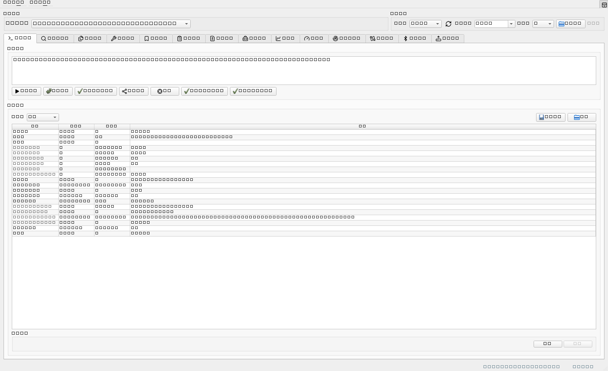
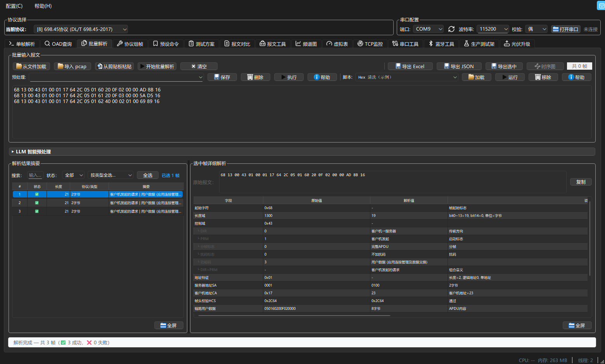

# 电力通信报文解析工具

[](https://github.com/Liruitao1993/South_Network_Protocol_Analysis_Tool/releases/latest) [](https://github.com/Liruitao1993/South_Network_Protocol_Analysis_Tool/actions/workflows/ci.yml) [](https://github.com/Liruitao1993/South_Network_Protocol_Analysis_Tool/releases) [](https://github.com/Liruitao1993/South_Network_Protocol_Analysis_Tool/stargazers) [](LICENSE)
[]() []() []() [English](README.en.md)

**把电力通信报文从「看不懂的一串十六进制」变成「逐字段讲清楚的一张表」。**

面向电力通信**现场调试、联调测试、协议开发与检测验证**的一站式桌面工具：支持 **15 种电力通信协议**，在同一个窗口里走完 **解析 → 校验 → 组帧 → 串口 / 蓝牙收发 → 批量分析 → 时序图 → 测试报告** 全流程。**Windows 双击即用，无需安装 Python、无需联网。**



## 下载

**Windows 免安装版**：单文件 exe，双击即用，目标机器不需要 Python、不需要联网。

👉 **[下载最新版](https://github.com/Liruitao1993/South_Network_Protocol_Analysis_Tool/releases/latest)**

| 项目 | 说明 |
| --- | --- |
| 系统要求 | Windows 10 / 11（64 位） |
| 体积 | 约 100 MB（单文件，已内含 Python 运行时） |
| 首次启动 | 单文件 exe 需先解压到临时目录，**首次启动明显比之后慢**，属正常现象 |
| 可选依赖 | 「TCP 监控」需另装 [npcap](https://npcap.com/)；其余功能开箱可用 |
| 安装包 | 需要写注册表 / 建快捷方式时，用 `南网解析工具.iss`（Inno Setup）生成的安装版 |

> 国内访问 GitHub 下载慢或失败？见 [`docs/推广/06-Gitee镜像与国内分发.md`](docs/推广/06-Gitee镜像与国内分发.md)。
> 杀毒软件报毒？见下方[常见问题](#常见问题)。

## 30 秒上手

1. **打开程序** → 左侧选择协议（默认「南网协议」）。
2. **粘贴报文** → 输入框里贴入十六进制，如 `68 0E 00 00 00 00 01 00 01 E8 00 05 EF 16`，按 `Ctrl+Enter`。
3. **看结果** → 解析结果按「层 → 字段 → 原始值 → 解析值 → 说明」列出；**点任意解析行，输入框里对应的字节会反向高亮**。

命令行也能用：

```bash
# 直接解析一帧
python main_gui.py --parse "68 0E 00 00 00 00 01 00 01 E8 00 05 EF 16" --protocol 0

# 解析日志文件里的所有报文
python main_gui.py --file sample.log --protocol 国网新一代

# 读剪贴板里的报文并直接弹结果 / 启动后最小化到托盘
python main_gui.py --clipboard
python main_gui.py --minimized
```

## 为什么值得用

| 现场的常见问题 | 这个工具怎么做 |
| --- | --- |
| 报文看不懂，翻几百页协议文档逐字节对 | **15 种协议分层解析到字段级**（含 A-XDR / BER-TLV / 位域 / 日期时间），解析行与输入字节**双向高亮联动** |
| 抓包日志几百行，靠人眼一条条挑 | **批量解析**：文件 / 剪贴板 / pcap 导入，自动从混杂文本里提取完整帧；类型过滤、搜索、Excel / CSV / JSON 导出；点摘要行**回跳原始日志位置** |
| 校验和总对不上，组帧怕写错字节 | 内置**协议校验**（起始符 / 长度域 / 校验和 / CRC 逐项给结论）+ **组帧模板**；「**仿照报文**」粘一帧现成报文即可回填全部参数，并逐字节重建校验 |
| 串口、蓝牙、抓包工具来回切 | 串口 + **BLE 蓝牙**收发、**蓝牙 ⇄ 串口虚拟透传**、**TCP 抓包流重组**、实时监控器，全在一个程序里 |
| 要按用例反复发命令、留证据 | **测试方案**（增删改 / 顺序发送 / 超时匹配 / 结果记录）+ **Lua 脚本**（分支、循环、变量共享），结果一键导出 Excel 报告 |
| 结论要讲给别人听 | **通信时序图**（CCO ⇄ STA 一键成图、导出 PNG）、**报文对比**（字节 / 字段级 diff + 人话解读）、**频谱图**（光标读数 / MARK / Δ 测量） |

> 现场设备不等人，所以每一步都给**人话结论**：这条帧为什么不合格、DAR 是什么、第几包没确认、重试到第几次 —— 而不是只丢一堆十六进制。

## 支持协议

工具支持 15 种电力通信协议，下拉框索引即协议编号：

| 索引 | 协议 | 标准号 | 字节序 | 校验 |
| --- | --- | --- | --- | --- |
| 0 | 南网协议 | Q/CSG1209021-2019 | 小端 | 8 位位组算术和 |
| 1 | PLC RF 协议（万胜海外） | 万胜 V1_04 | 大端 | 累加和 & 0xFF |
| 2 | HDLC/国网DLMS | IEC 62056-46 | 大端 | CRC-16/FCS（CCITT） |
| 3 | DLMS-APDU（国网） | IEC 62056-46 | 大端 | 无 |
| 4 | DLMS Wrapper 裸报文 | IEC 62056-46 | 大端 | 无 |
| 5 | DLMS-APDU 裸报文 | IEC 62056-46 | 大端 | 无 |
| 6 | DLT645-2007 电表协议 | DL/T 645-2007 | BCD，低字节在前 | 累加和 & 0xFF |
| 7 | 国网协议 | Q/GDW 10376.2-2024（含福建增补 AFN 50H~56H） | 小端 | 8 位位组算术和 |
| 8 | 698.45 协议 | DL/T 698.45-2017 | 小端（链路层）/ **大端（A-XDR 数据）** | CRC-16（crcmod `x-25`） |
| 9 | 新一代载波协议（通感一体化） | 通感一体化宽带载波通信规约 | 小端 | CRC-32（MAC 帧）+ CRC-24（PBCS） |
| 10 | 国网新一代双模通信互联互通 | 国网新一代双模通信互联互通技术规范 | 小端 | CRC-32（MAC 帧） |
| 11 | HDC 1.0 双模互联互通 | Q/GDW 12087.42-2020 | 小端（MAC 地址大端） | CRC-24（FC/PB）+ CRC-32（MAC） |
| 12 | 模组化终端功能模块接口 | Q/GDW 模组化终端功能模块接口协议 | 小端（链路层）/ **大端（A-XDR 数据）** | CRC-16/PPP FCS（x-25） |
| 13 | 依瓦定制645 | 依瓦定制645协议 V1.0 | 地址域高字节在前 / 数据域逐字节 | 8 位位组算术和（数据域 ±0x33） |
| 14 | 南网上行通信规约 | Q/CSG 11109004-2013 | 小端（长度 L / 地址域 / 多字节字段）；DI 低字节在前 | 8 位位组算术和（控制域 + 地址域 + 链路用户数据） |
| 15 | Modbus 协议（RTU/TCP） | Modbus Application Protocol V1.1b3 | 大端（寄存器内可配字节序 / 字序） | CRC-16（多项式 0xA001，RTU）；TCP 用 MBAP 长度域 |

> HDC 1.0（11）、模组化终端功能模块接口（12）、依瓦定制645（13）、南网上行通信规约（14）与 Modbus（15）目前仅在 PySide6 主程序支持；Web 版支持索引 0–10。

## 功能一览

| 模块 | 一句话 |
| --- | --- |
| 单帧解析 | 15 种协议分层解析到字段级，解析行 ⇄ 输入字节双向高亮 |
| 批量解析 | 文件 / 剪贴板 / pcap 导入，自动提帧，导出 Excel / CSV / JSON，可回跳原文 |
| 协议校验 | 起始符、长度域、校验和、CRC 逐项给「通过 / 失败 / 警告」结论 |
| 组帧 | 南网、国网、698.45、645、模组化模板；协议9 五层折叠组帧；支持「仿照报文」反解回填 |
| 预设命令 | 一键发送常用帧；**粘贴报文直接建按钮**；按当前协议**一键批量替换地址**并重算校验 |
| 协议测试 | 698 按 OAD 分类的预置测试库；645 按 DI 大类分类的命令树 + 读/写通信地址 + 特殊命令；国网按 AFN/Fn 分类的命令树 + EB 扩展；三页均支持**串口 / 蓝牙**发送通道 |
| 串口通信 | 收发 + 实时解析；4 个断帧超时可调；按协议**批量替换通信地址**并重算校验 |
| 蓝牙通信 | BLE 扫描连接、特征码自动优选、蓝牙 ⇄ 串口虚拟透传 |
| 虚拟表 | 698.45 从站模拟器；645 离线应答 / 档案 / 串口从站 |
| 光伏升级 | 698.45 文件传输分包下发；传完先校验传输块状态字再执行升级；升级前后自动读版本并判定成功 / 失败 / 无法判定 |
| 通信时序图 | 协议 9/10/11 批量结果一键生成 CCO ⇄ STA 序列图，导出 PNG |
| 测试方案 + Lua | 测试项 CRUD、顺序发送、超时匹配、Excel 报告；Lua 可写分支 / 循环 |
| 报文对比 | 字节级 / 字段级 diff + 人话解读 + 报告导出 |
| 报文工具 | ASCII/HEX、DLT645 偏移、字节逆序、Pn/Fn、CRC/校验和、按协议地址替换 |
| 频谱图 | 仪器式网格频谱图，光标读数 / MARK / 两点 Δ 测量，导出 PNG |
| 实时监控 / TCP 监控 | 南网与国网新一代串口实时监控；scapy 抓包 + 流重组自动识别 |
| 查询与档案 | DI、AFN、645 DI、OBIS、PLC RF 命令字、新一代业务标识、HDC 报文 ID、拓扑组网统计 |
| 系统集成 | 托盘、全局热键、剪贴板自动识别、单实例、右键菜单、开机自启、自动更新 |
| 多端 | PySide6 GUI（主）、Textual TUI、NiceGUI Web、实验性 Reflex Web |

完整清单与逐模块用法见 **[docs/使用说明.md](docs/使用说明.md)**。

## 截图

**单帧解析**：698.45 读取请求逐字段展开，HCS / FCS 直接给结论，OAD 说成人话：


**批量解析**：混杂日志自动提取完整帧，左侧摘要 + 右侧选中帧详情双向联动：



> 这两张图由 `tools/capture_readme_shots.py` 直接驱动真实界面生成，可以自行复现。

## 常见问题

**杀毒软件报毒 / 打不开？**
PyInstaller 单文件打包的程序常被启发式误报（不是本工具特有）。三种处理：加入杀软白名单；从源码 `pyinstaller 南网协议解析工具.spec` 自行打包；或使用安装版。校验下载完整性可对照 Release 页说明。

**为什么启动要几秒？**
单文件 exe 每次启动需自解压到临时目录，属正常现象。想要秒开可从源码运行，或使用 `--onedir` 方式自行打包。

**报文明明对，校验却是「⚠ 未填充」？**
台体 / 模拟器日志里 FCCS、PBCS、ICV 常被留空为全 0（由硬件发射时填充）。工具对这种情形给「未填充」而不是「校验失败」，属于设计行为。

**会联网上传我的报文吗？**
默认不上传。只有你主动点「帮助 → 问题反馈」「帮助 → 提交问题到 GitHub」或在单帧解析页点「分享此帧」时才会提交内容；自动更新只在检查版本时访问 Release 列表。「提交问题到 GitHub」的令牌只存在你自己的电脑上（config.json，诊断包会自动脱敏），不会随程序分发给别人。

**程序内更新下载很慢？**
1.23.95 起改为**多线程分段下载**（HTTP Range 分段 + 最多 32 线程并发 + 断点续传），实测比原来的单流快约 60 倍（本机到 GitHub 链路：单流 0.005 MB/s → 16 线程 0.33 MB/s）。下载面板是**非模态**的，下载期间可以继续用主程序，也支持**暂停 / 继续 / 取消并清理缓存**。若仍觉得慢，可在「配置 → 更新设置 → 下载线程」调到 32 线程，或直接用下面「下载」小节的离线安装包。

1.23.96 起这套下载又做了**四批次加固**：关掉面板（点 X）会转入后台继续、可从「配置 → 下载进度」叫回来；重新点下载不会起第二个任务抢同一个临时文件；退出程序时取消下载但**保留**已下载分片（下次接着下）；服务端不认 Range 时自动回落单流，绝不会拼出「大小对、内容错」的安装包；磁盘满给的也是中文提示。

**能加新协议 / 新台体吗？**
可以，见 [参与与反馈](#参与与反馈)。带 hex 样本的 issue 最快。

## 参与与反馈

- **点个 ⭐ Star** —— 让更多做电力通信的同行能搜到这个工具；Star 也是别人第一眼判断「这东西靠不靠谱」的信号。
- **遇到问题 / 想加协议 / 想支持新台体** —— 直接开 [Issue](https://github.com/Liruitao1993/South_Network_Protocol_Analysis_Tool/issues/new/choose)，附上报文 hex 与协议名（能复现就能修）。
- **用法交流 / 报文求助** —— 不确定是不是 bug 时，发到 [Discussions](https://github.com/Liruitao1993/South_Network_Protocol_Analysis_Tool/discussions)。
- **程序内反馈** —— 「帮助 → 问题反馈」提交到服务端（自动带客户端环境信息）；有价值的命令帧可用「**分享此帧**」共享到报文分享库。
- **直接提 issue 到 GitHub** —— 「帮助 → 提交问题到 GitHub」把现场整理成一条 issue：自动带入当前协议、最近一次解析的报文 hex 与运行环境。填了 GitHub 令牌就点「直接提交到 GitHub」，issue **立刻出现在本仓库**；没令牌就点「在浏览器中提交」，同样按表单预填好，点一次即可。程序崩溃时弹框里也有「提交到 GitHub」，可把完整 traceback 一并发出。
- **贡献代码** —— 提交前跑一次 `python release_check.py`（版本一致性 + 核心测试）；架构、字节序与校验约定见 [`AGENTS.md`](AGENTS.md)。

> 用着顺手的话，欢迎把它转给还在逐个字节数报文的同事。

### 关于这个仓库

这是一个**个人维护**的小众工具，不追功能数量，优先解决「现场真的会卡住」的问题：

- 每个 issue 都会回（带 hex 的优先，能复现就修）
- 新增协议跟着真实设备/台体走，不为凑数
- 反直觉的设计（如「⚠ 未填充」）会在 README 里写清楚原因，而不是让你去猜

## 文档

| 文档 | 内容 |
| --- | --- |
| [docs/使用说明.md](docs/使用说明.md) | 完整功能清单 + 逐模块使用说明（含截图） |
| [CHANGELOG.md](CHANGELOG.md) | 版本更新记录 |
| [docs/开发与测试.md](docs/开发与测试.md) | 项目结构、测试脚本、开发文档 |
| [docs/Lua脚本使用说明.md](docs/Lua脚本使用说明.md) | Lua 脚本 API 参考 |
| [docs/Web版局域网部署教程.md](docs/Web版局域网部署教程.md) | Web 版零安装部署 |
| [docs/推广/00-推广总案与30天节奏.md](docs/推广/00-推广总案与30天节奏.md) | 传播渠道与内容节奏（含素材规范） |
| [AGENTS.md](AGENTS.md) | 架构、协议映射、字节序与校验约定（贡献者必读） |

## 许可证

[MIT](LICENSE) © 2026 Liruitao
