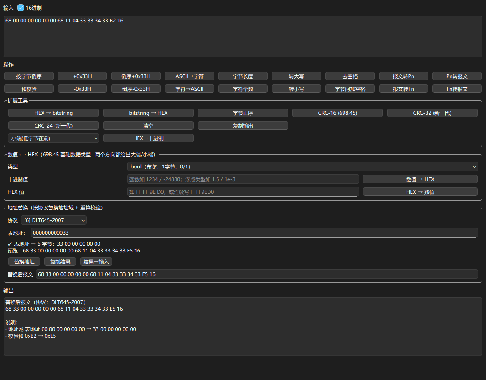

# 功能详解与使用说明

> 本文是 [README](../README.md) 的详细版：完整功能清单与逐模块使用说明。

## 功能总览

| 模块 | 说明 |
| --- | --- |
| 单帧解析 | 输入十六进制报文，按协议分层解析，点击解析行联动高亮输入框对应字节并自动滚动到位置 |
| 批量解析 | 从文件/剪贴板/pcap 导入多帧报文，自动提取完整帧，支持导出选中/全部、类型过滤与 JSON / CSV / Excel 导出；摘要列对**测试帧（业务标识 0xF0）**体现测试模式（如 `测试模式:PLC物理层透传测试模式(3)`）、测试ID、通信频段 |
| 原始报文定位 | 批量摘要表点击行可回跳输入日志对应行；右键「转到原始报文位置」弹出只读查看器并高亮该帧 |
| 协议校验 | 覆盖起始符、长度域、校验和与 CRC（含协议9逐 PB PBCS CRC-24），逐项展示通过 / 失败 / 警告 |
| 表格复制 | 解析结果、批量结果、监控器与 TCP 监控表格支持右键复制及 Ctrl+C |
| 帧生成 | 南网、国网、698.45、DLT645-2007、模组化接口组帧模板，支持预设命令一键填充与解析回读；协议9（南网新一代载波）链路层组帧采用五层折叠表单（FC / 物理块 / MAC 头 / MSDU / ED 封装），SOF 帧优先，25 个测试模式；**支持「仿照报文」——粘贴一帧现成报文自动回填全部参数，并做逐字节重建校验，参数集可存成本地模板** |
| 串口通信 | 串口参数配置、帧发送、实时接收解析与日志窗口；**断帧可调**——协议特征断帧（68 家族自动跳过帧首前导 FEH）/ 仅按字节超时，4 个断帧超时（字节静默 / 聚合最长持有 / 协议帧等待静默 / 协议帧等待上限）现场可调，日志给出当前断帧依据；**批量替换通信地址**——按所选协议把作用范围内每条命令的地址域换成现场表计地址并**重算校验**（可同时写入「协议」列、同步替换预期响应），结果逐条可查、一次可撤销 |
| 蓝牙通信 | BLE 扫描 / 连接、**特征码自动优选与一键探测**（连上即可收发，无需在特征码列表里挑；按设备记忆选择）、收发报文解析、自定义报文按钮、**蓝牙 ⇄ 串口虚拟透传**（把蓝牙模块当无线串口延长线） |
| 生产测试架 | 类串口助手（**三栏可折叠**）：**5 条发送配置**（各自 HEX/ASCII + checksum8 三种落位）、HEX/ASCII 接收日志与时间戳开关；**测试架参数帧**（49 项参数 + 地址域，改动即生成 75 字节整帧并可发送 / 复制 / 恢复现场示例） |
| 虚拟表 | 协议8（698.45）从站模拟器；协议6 另有「645虚拟表」：离线粘贴读请求生成响应、档案 DI 值、可选串口从站 |
| 光伏升级 | 协议8（698.45）文件传输升级：拖入升级包 → 按可设每包字节数分包 → **逐包等设备确认**下发 → 执行升级；可选升级前 / 后读版本信息并**自动比对判定「升级成功 / 升级失败 / 无法判定」**；仅串口可选**「提升波特率」**（升级期间切 115200、收尾自动切回 9600，收尾读版本两种速率各试一遍）；升级包路径会记住；串口 / 蓝牙双通道 |
| 通信时序图 | 协议9/10/11 批量结果一键生成 CCO⇄STA 序列图，与摘要表双向联动，可导出 PNG |
| 测试方案 | 测试项 CRUD、顺序发送、超时匹配、结果记录与 Excel 报告导出 |
| Lua 脚本 | 测试流程中嵌入可编程逻辑，支持条件分支、循环遍历、数据解析与变量共享 |
| 报文对比 | 双报文字节级 / 字段级对比，支持差异高亮、人话解读与报告导出 |
| 报文工具 | ASCII / HEX 转换、DLT645 偏移、字节逆序、Pn/Fn 转换、CRC/校验和计算、按协议地址替换（重算校验） |
| 频谱图 | 按频谱仪参数（起止/中心/扫宽、RBW/VBW、参考电平、每格 dB、单位、检波方式）输入单条 trace 全部扫频点数值，绘制仪器式网格频谱图；支持光标读数、MARK 标记与两点 Δ（频段宽度/电平差）测量，可导出 PNG |
| LLM 预处理 | 批量解析可折叠面板，OpenAI 兼容 API 多轮清洗原始日志后再解析 |
| 实时监控器 | 南网新一代 / 国网新一代串口报文实时监控、自动组帧、过滤与 CSV 记录 |
| TCP 监控 | 基于 scapy 的 TCP 抓包、流重组与南网新一代 / 国网新一代自动识别解析 |
| 档案与拓扑 | 南网 / 国网协议档案导入导出、拓扑组网统计 |
| 查询页 | DI、AFN、DLT645 DI、OBIS、PLC RF 命令字、新一代业务标识、HDC 1.0 报文 ID、EB 数据标识、模组化接口信息类查询 |
| 多端界面 | PySide6 GUI、实验性 Reflex Web |
| 主题与字体 | 5 套主题与字体设置，支持配置持久化；表格 Ctrl+滚轮缩放 |
| 系统集成 | 系统托盘（**菜单内嵌报文输入框**）、**任务栏图标快捷按钮**、全局热键、快捷解析小窗、剪贴板报文检测、Notepad++ 集成、单实例、命令行解析、文件右键菜单与开机自启 |
| 问题反馈 / 报文分享 | GUI 与 Web 共用服务端库；单帧可「分享此帧」到 Web 报文分享页 |
| 自动更新 | 帮助菜单检查更新，可配置自动检查并选择版本下载 |
| 状态栏 | 本软件 CPU / 内存占用、线程数明细（可点击复制） |


## 使用说明

### 单帧解析

1. 顶部下拉框选择协议类型
2. 在「输入报文」文本框粘贴十六进制报文（支持带空格 / 无空格混合）
3. 点击「解析报文」
4. 下方表格显示分层解析结果，点击解析行会高亮输入框中的对应字节并自动滚动到该位置

解析 HDLC 帧后，可双击 `DLMS APDU` 行打开深度解析窗口，支持 Get / Set / Action 等 APDU 类型与 BER-TLV 递归解析。

国网新一代（索引 10）与 HDC 1.0（索引 11）可选择解析级别（自动识别 / FC+PB / 仅FC / 仅MAC / 仅PB / FC+MAC / 应用层）与通道（PLC 载波 / HRF 无线）；新一代载波（索引 9）另支持 FC+eFC 级别与 ED 监控包装剥离。ED 包装头格式支持「自动识别(推荐) / PLC2.0 台体 / 广西台体(14字节头)」。

解析成功后可点「分享此帧」，把有价值的命令帧分享到 Web 服务端报文分享库。

### 批量解析

切换到「批量解析」标签页：

- 从文件加载或剪贴板粘贴
- **导入 pcap**：离线读经典 `.pcap`（零依赖）/ `.pcapng`（需 scapy），TCP 流重组后自动批量解析——PLC2 监控帧 / 业务帧 / 原始 TCP 负载三模式，接「按类型全选 → 时序图」
- 自动从混杂文本中提取完整帧
- 摘要表支持 Ctrl/Shift 多选，「导出选中」只导出目标子集；「按类型全选」可一键选中某类型全部帧
- 点击摘要行可在输入框回跳并选中对应报文行
- 右键「转到原始报文位置」弹出只读查看器（行号 / 高亮 / Ctrl+F 搜索），查看导入时的原始日志快照
- 新一代载波协议支持监控日志前缀剥离与业务摘要；ED 包装头可选 PLC2.0 / 广西台体 / 自动识别
- 国网新一代 / HDC 1.0 支持日志前缀剥离与业务摘要

批量解析工具栏另有「LLM 智能预处理」可折叠面板：配置 OpenAI 兼容 API 后，可对原始日志做多轮智能清洗再解析（内置提取 hex、清理前缀、按协议分类等模板，大文件自动分块异步执行）。


### 通信时序图

批量解析协议 9 / 10 / 11 后，点工具栏「时序图」或切换到「通信时序图」标签页：

- 节点按 TEI 自动判别（TEI=1 为 CCO 固定最左，其余 STA 按首现排序）
- 信标/SACK/应用层广播画虚线，单播画实线；支持台体发射机、未入网站点、阶段分隔线
- 滚轮缩放、拖拽平移、「适应窗口」、「导出 PNG」
- 点击图上消息跳回批量解析页定位对应帧行；反向选中摘要表行时图上对应消息高亮
- 摘要表有勾选行时仅用勾选帧生成，否则使用全部帧

### 虚拟表（协议 698.45 / DLT645）

**协议 698.45「虚拟表」**

「虚拟表」标签页仅在协议 8 下显示，提供 698 从站模拟：

- **离线模式**：粘贴主站请求帧，自动生成响应帧并解析回读，可一键送入单帧解析器
- **串口从站模式**：独立选择串口参数，持续监听 `68...16` 请求帧并自动组帧回复（建议配虚拟串口对）
- 支持 GET Normal/NormalList/Record、链接请求、SET/ACTION 成功 DAR、安全明文封装
- 档案数据（`meter_sim_data.json`）可在档案页增删改、JSON 导入导出；多表通配、黑/白名单、电能递增、冻结漏点等可配置

**协议 6「645虚拟表」（1.23.5）**：

- 离线：粘贴主站读数据请求 → 生成 `91H` 应答（未知 DI 回异常 `D1H`）
- 档案页编辑 DI→值（`dlt645_sim_data.json`）
- 可选串口从站自动监听回复（虚拟串口对）

### 实时监控器

「监控器」标签页在协议 9（南网新一代）与协议 10（国网新一代）下显示：

- 串口原始字节流自动组帧，支持静默间隔组帧与监控解帧模式
- 南网新一代使用 `ED..EE` 包装，国网新一代使用 `96..16` 包装
- 左侧帧列表支持过滤、暂停、自动滚动、清空、CSV 记录与日志目录打开
- 右侧展示完整解析表格与原始 HEX，双击帧可送入单帧解析页

### TCP 流量监控

「TCP监控」标签页基于 scapy 实现：

1. 选择网卡并输入 BPF 过滤条件，例如 `tcp port 8080` 或 `host 192.168.1.1`
2. 点击「开始抓包」
3. 上方 TCP 流列表按四元组实时汇总包数、字节数与最新时间
4. 选中一条流后，下方展示按监控封装格式重组切分出的应用层帧
5. 选中帧后自动调用南网新一代或国网新一代解析器，右侧显示解析结果

TCP 监控支持流关注、表格复制、暂停刷新、CSV 实时记录与历史 CSV 加载。首次打开标签页时 scapy 在后台惰性加载，不阻塞主界面。

记录下来的 CSV 不会「找不到」：工具栏「打开位置」一键在资源管理器中**定位并选中当前记录文件**（无记录文件时打开记录目录）；「记录目录」菜单可**自选记录目录并记住**（重启仍生效，默认 `<数据目录>/Output`），也可恢复默认；状态栏的记录名悬停可看到完整路径。

### 协议8 文件传输升级（「光伏升级」页，1.23.85 起）

选到「698.45 协议」时会出现**「光伏升级」标签页**：把分布式产品的**二进制升级包**拖进去，工具按 DL/T 698.45 的文件传输（OI `F001` 文件分块传输管理）把包分成若干块逐块下发，**每块等设备回确认帧**才发下一块，全部传完后自动发执行升级命令。

1. **拖入升级包**（或点「浏览…」）：显示文件名与字节数，空文件/目录/不可读会明确报错
2. **参数**：每包字节数（默认 600）、确认超时（默认 3000ms）、重试次数（默认 3）、传完是否自动执行升级
2b. **发送通道**（参数区第一行）：**串口**（默认，走顶部「串口配置」的连接）或**蓝牙**（**复用「蓝牙工具」页已建立的连接** —— 先在那页扫描/连接/选特征码；本页不自己开连接）
   - 选蓝牙时**每包字节数上限会自动算好**：按「一次 ATT 写能承载的字节数」（协商 MTU − 3，或特征码自带的免响应写上限）减去 698 整帧开销（帧头/地址/HCS/APDU 头/BER 长度/FCS/结束符，用真实组帧反推）—— 例：**MTU 512 ⇒ 一次写 509 字节 ⇒ 每包最大 475 字节**（你说的「不超过 480」成立）；超出会自动收敛，计算过程写在通道标签上
   - 蓝牙通道下每帧**一整帧一次 ATT 写**（不会把 698 帧拆到多次写；万一超上限会拒发并报错）；MTU 协商完成/变化、连接变化、SA 改了都会自动重算
   - 蓝牙未连接、或 MTU 还没协商好时，「开始升级」会禁用并说明去哪连（**不设一个假的上限**去误导）
3. **SA 地址默认通配地址**（类型=通配、长度 6、`AA AA AA AA AA AA`），可改为单地址/组地址/广播地址，也可按文档示例一键回填；CA、文件信息（源文件/目标文件/文件大小/文件属性/文件版本/文件类别）、校验类型与校验值（可一键按文件算 CRC32/MD5/SHA1）都可编辑
4. **流程** = 启动传输（让设备进入接收升级包状态）→ 写文件 ×N（**每包一帧、逐包确认**）→ 执行升级（默认「立即执行」）
5. **进度与日志**：进度条只按**已确认**的块累加（已传字节/总字节 + 第 x/N 块）；每帧收发的 hex 与判定结果（DAR 值、第几次重试、失败原因）都写进日志，失败/超时同时弹框；**不超过 200 字节的帧整帧显示**，写文件大帧只显示头尾各 100 字节、中间用 `...` 省略并标注总长
6. **串口复用**顶部「串口配置」的连接（不另开端口），未连接时禁止开始
7. **可选「读版本信息」**（默认不勾）：`升级前读版本信息` / `升级完成后读版本信息` 两个开关 —— 勾上后会在升级前、收尾时各发一帧读取命令，结果同时出现在**日志**与**「版本信息」展示区**
   - **收尾那次与「传完后自动执行升级」无关**：勾了自动执行 ⇒ 执行升级被确认后读；**没勾** ⇒ 最后一包写完被确认后读（有的设备收全升级包会**自动复位升级**）
   - **读之前先等设备复位**：参数区「**升级后等待(s)**」默认 **10 秒**（0~600 可改，0 = 立即读）—— 复位期间设备读不到版本；等待时状态栏实时显示「等待设备复位（剩余 N 秒）」，`中止`/`清除` 可随时打断
   - **展示区**（就在「升级参数」下面）：`升级前` / `升级完成后` **并排两栏**，逐字段列出读到的内容，升级前后一眼可比；未读显示「（未读取）」，读失败显示原因；点「开始升级」或「清除」都会重置
   - **日志**里解析内容写在**响应帧的下一行起**（帧一行、明细在下），不用再横向拖到底：`→ 版本信息（升级前·内部）读取成功（6 项）` + 每字段一行（名称 / 值 / 原始字节，如 `软件版本日期 = 2026-08-03 [0A06323630383033]`）
   - **逐字段解析**：按 DL/T 698.45 表191「版本信息」的六个字段解析（厂商代码 / 软件版本号 / 软件版本日期 / 硬件版本号 / 硬件版本日期 / 厂商扩展信息），`YYMMDD` 日期自动补全为 `20YY-MM-DD`；若设备回的字节长度与该表声明不符，字段名照给但会多一行 `⚠ 长度未自证`（写明声明值与实发值），不是版本信息结构时则原样给「数据」一行
   - **读版本内容**下拉二选一：**通用版本信息**（标准 OAD `43 00 03 00`，电气设备类属性 3）或**内部版本**（厂家扩展 OAD `FF 10 04 00`）
   - 命令是通用的 698.45 读取（`05 01 <PIID> <OAD> 00`），**SA/CA 与升级传输同一份配置**（默认通配 `AA AA AA AA AA AA`）
   - **读版本失败不阻断升级**：超时/否定/解析失败按重试次数重发，用尽后记一条日志继续；只有所选那条命令的响应才认（设备若回另一条的响应按「OAD 不符」忽略）
   - 两个开关、「读版本内容」与等待时长都会记住，传输进行中被冻结
8. **自动判定升级成功 / 失败**（1.23.86）：勾了「升级前 + 升级完成后读版本信息」时，「版本信息」展示区顶部会出现**判定条** —— 前后读到的版本**有差异 ⇒ 判定升级成功（✅）**、**完全一致 ⇒ 判定升级失败（❌，设备没换新固件）**、缺升级前基线 / 有一侧没读到 / 前后读的不是同一项 ⇒ **无法判定（⚠）**，两侧都没读则显示「尚未比对（⏳）」。判等按**原始字节**比对（展示用的「值」会补全日期、裁剪长值，拿它判等会把同一版本误判成变了）；结论同时写进收尾状态行与日志，且**判定不影响流程状态**（流程跑完 ≠ 固件升级成功）——没证据时只给「无法判定」，不猜结论
9. **可选「提升波特率」**（1.23.86，**仅串口通道**，默认不勾、参数会记住、传输中冻结）：升级前先让**设备**切到 115200（先发 FT1.2 切换命令，按「切换等待(ms)」默认 300 静默后**主机**才跟着切 —— 主机先切连命令都发不出去；命令只发不等确认），传输收尾 / 中止 / 清除时自动切回 9600。换速率**不关端口、不重连**（先排空发送缓冲再改速率，避免半截帧按旧速率发出去），顶部「串口配置」的速率与状态栏会同步成实际值。勾了它之后，「升级完成后读版本信息」会在 **9600 与 115200 各试一遍**（升级失败时设备可能仍停在 115200），**两种都读不到才算读不到**
10. **升级包路径会记住**（1.23.86）：重开程序 / 重开本页**直接显示上次选的升级包**（只存路径不存字节，避免几十 MB 塞进配置拖慢启动），只有换新文件才更新；原文件已被删除 / 变成目录 / 读不出来时**不恢复**并写明原因（保持「未选择文件」），但记录仍保留（U 盘 / 网络盘插回来还能用）

> 组帧口径已按实帧**逐字节验证**：`协议文档/8.698.45协议/代理升级流程.docx` 里 62 字节的「启动升级」实帧，以及读版本信息的两条现场实帧（通用版本 `68 17 00 43 05 AA AA AA AA AA AA 00 AA 2A 05 01 01 43 00 03 00 00 6D 5C 16`、内部版本 `68 17 00 43 05 03 24 08 04 26 20 00 CD 9A 05 01 2C FF 10 04 00 00 C2 8A 16`），由本工具组出的帧完全相同（含帧头校验与帧校验）。


### 生产测试架

「生产测试架」标签页是面向产线的一页式调试台（常驻显示，与协议无关），**三栏布局**：左「发送配置」、中「接收日志」、右「测试架参数」。左右两栏点标题上的折叠按钮可收起（折叠后只剩窄条，宽度全让给日志），三栏之间的分隔条可直接拖动调宽：

1. **5 条发送配置框**（左栏）：每条独立选 **HEX / ASCII**、独立勾选 **checksum8** 并选落位方式（`追加到末尾` / `覆盖末字节` / `插在 16H 前`），一键发送；名称与内容会记住，重开程序直接可用。HEX 写错（奇数位、非法字符）**拒发并写明原因**，不会静默按文本发出去
2. **接收日志**（中栏，折叠左右栏后自动变宽）：**HEX / ASCII 显示切换**（ASCII 把不可打印字节显示为 `.`）、**时间戳开关**（默认开，精确到毫秒）、自动滚动、清空与收发字节计数；单行超过 512 字节只显示头尾并标注总长
3. **测试架参数**（右栏，可折叠）：现场参数表 49 项（帧头 2 项测试开关 + 参数区 47 项 / 53 字节）+ 6 字节地址域（默认 `AA×6` 广播）。任何一项改动都会**即时重算整帧**，预览行显示总长、参数区长度与 CS8；可 `发送参数帧` / `复制报文` / `恢复现场示例`；**发送形态可选 `HEX`（75 字节二进制帧）或 `ASCII`（大写 HEX 文本 150 字符）**，选择会记住；某一项长度或取值不对时，日志与预览行会指出**具体字段名**，不弹框
4. **串口复用**顶部「串口配置」的连接（不另开端口），未连接时所有发送按钮禁用并说明原因

> 组帧口径已按现场样例**逐字节验证**：`68 AAAAAAAAAAAA 68 14 35 55AA55AA 01 00 60 0E 12 08 18 13 2F 05 FE … 00 39 16`（75 字节），
> 帧结构 `68 + 地址6 + 68 + 14(控制域) + 35(参数区 53 字节) + 55AA55AA(命令标识) + 测试STA + 测试无线 + 参数区 + 保留 4×00 + CS8 + 16`，
> **CS8 = 从 68H 起至保留位末字节的 8 位算术和**（不溢出）——本工具组出的帧与现场样例完全相同。


### 蓝牙工具（BLE）

「蓝牙工具」标签页让工具本身具备 **BLE 蓝牙通信能力**（常驻显示，与协议无关）：

1. 「扫描设备」列出周边 BLE 设备（可选只显示有名称的设备），按信号强度排序
2. 选中一行点「连接」；连接后显示设备名、地址与**协商 MTU**
3. 「特征码…」选择接收（Notify / Indicate）与发送（Write）通道。对话框左右分栏、不可用项置灰，提供「全选 / 全不选 / 自动选择」，并记住上次选择
4. 收发框手动发送 / 接收，接收侧按**静默超时自动切帧**；可选按当前协议解析收到的帧（日志输出摘要 + 逐字段表），解析口径与单帧页、串口工具页完全一致
5. 「送入单帧解析」把输入框内容直接送去主窗口单帧页逐字段解析

其它能力：

- **虚拟模式（蓝牙 ⇄ 串口透传）**：BLE 收到的数据原样写入串口，串口收到的数据原样写入 BLE —— 把蓝牙模块当成**无线串口延长线**。串口复用主窗口顶部「串口配置」的连接（不另开 COM 口），任一侧未连接时明确丢弃并记日志
- **自定义报文按钮**：可新增 / 批量导入（每行 `名称,内容[,HEX|ASCII]`）/ 编辑 / 移位 / 删除 / 导出 / 导入，按钮上点右键即可操作。按钮区**随可用空间自动**（空间够就把按钮全显示、不够才滚动），整区可折叠（收起只剩标题行，状态记住），**编辑按钮常驻在按钮区下方**（收起时也在），右栏还能**拖动分栏**自由分配「日志 ↔ 发送区 + 自定义区」的高度
- **按钮可绑定「协议 + 地址」**（1.23.81）：编辑按钮时选协议，下方按协议出现 1~2 个地址输入框（南网/国网 = 源/目的；645/依瓦 = 表地址；698.45 = SA/CA；南网上行 = 终端地址）。点按钮发送时按该协议**替换地址域并重算校验**，日志给出「地址域 … → …；校验和 0xAA → 0xBB」；**发送框仍显示原始报文**（替换只作用于真正写出去的字节）。地址写法两种都认：带分隔符的 hex 按在线顺序写入，纯数字按协议编码（自动字节序/BCD）。失败（地址非法、长度不符、帧不含地址域、协议暂不支持）会弹框说明并**一个字节都不发**
- **按钮可按「协议类别」批量替换地址**（1.23.84）：工具栏「批量地址…」→ 选协议 → 对话框列出全部按钮（每行带当前绑定摘要），**默认勾选「已绑定该协议」的按钮**（另有 全选 / 全不选 / 只选本协议）→ 填一次该协议的地址 → 一次写入这批按钮。每个按钮按**自己的报文**预检（698.45 的 SA 长度由各帧自己决定），失败的行标出原因且**默认不勾**；强行勾上会二次确认「将跳过哪些」后照改其余。协议下拉第一项 =「（清除协议与地址）」可**批量解绑**
- **发送格式三态**：自动（HEX 优先）/ HEX 字节 / ASCII 文本。**HEX 写错绝不静默改按文本发**：`68 12 0G` 会报错拒发，而不是把这 8 个字符的 UTF-8 字节写到设备上；位数不成对（`68 12 0`）同样拒发（不让底层静默补 `0`）
- **日志**：可选行首时间戳、窗口行数上限、自动保存到 `<数据目录>/Output/bluetooth_log_*.txt`（目录可自选并记住，「打开目录」一键定位），文件收尾写入行数与停止时间
- **参数持久化**：上述开关、特征码选择、自定义按钮与日志设置都存进 `bluetooth_tool_config.json`（原子写，坏文件回落默认）
- 写入按**协商 MTU / 特征码 `max_write_without_response_size`** 自动分包，包间可配延迟；断开或掉线前会把未成帧的残包交出，不丢尾包
- **MTU 与写上限是实时的**：ATT_MTU 由操作系统异步协商（Windows 上应用层只能读、不能请求），连接那一刻常只读到 ATT 默认值 23（单包 20 字节）—— 所以连接后会**轮询等协商结果**（3 秒内到即自动更新界面，日志打出 `MTU 协商更新：23 → 247`；对端确实只支持默认值则只提示一行），且**每次发送前都会重读**，分包按发送那一刻的真实上限
- 只提供扫描 / 连接 / 收发 / 组帧，**不做任何云侧上传**；`config.json` 与蓝牙配置都在本机数据目录

> 与「串口工具」标签页一样，「蓝牙工具」的端口/波特率只在顶部「串口配置」设置，本页只订阅信号。

### 系统集成与命令行

GUI 版提供 Windows 系统集成能力：

- 关闭主窗口默认最小化到系统托盘，托盘左键单击可显示 / 隐藏主窗口
- **右键托盘图标就能直接输入报文解析**：托盘菜单里内嵌一个输入框（带「解析」按钮），打字/粘贴报文后回车即可出结果 —— 判据与剪贴板检测同源（整串是 HEX 就直接解析并按特征识别协议；否则按文本提取报文）；识别不了时状态栏 + 气泡会说明原因
- **任务栏图标上的快捷按钮**：鼠标**悬停任务栏图标**时，预览里出现 4 个可点按钮（解析剪贴板 / 快捷解析 / 批量解析 / 光伏升级），用的是系统官方 `ITaskbarList3/4` 缩略图工具栏接口
  - 说明：Win11 的任务栏对第三方是封闭的（Win10 的「任务栏自定义工具栏」已被移除），**任意控件（包括输入框）不能放进任务栏那一行**；截图中那种「封面+标题+播放键」是**系统媒体卡片（SMTC）**，只有媒体会话能占。所以「在任务栏上操作」的受支持做法就是上面这两条
  - 另注：缩略图按钮只在窗口**有任务栏按钮**时可见（点 X 隐藏到托盘后就不显示了；想常驻请配合「最小化而不是隐藏」）
- 全局热键默认 `Ctrl+Alt+X`，复制十六进制报文后按下即可弹出**快捷解析小窗**（uTools 风格悬浮面板，实时解析 + 徽章 + 完整字段树；Esc/再按热键/失焦隐藏；「在主窗口打开」转入完整视图）
- 开启「剪贴板报文自动检测」后，在任意软件中复制十六进制报文会自动弹出解析提示框，自动识别协议后可直接转入解析
- 可注册 Notepad++ 集成：在 Notepad++ 中选中报文并按 Ctrl+C 复制，右键「用协议解析工具解析」或运行命令即可解析
- 程序支持单实例，重复启动会把命令行参数转发给已运行实例
- 在「配置 → 主题与字体」的「系统集成」面板可配置开机自启、关闭行为、热键与文件右键菜单
- 注册文件右键菜单后，`.log` / `.txt` / `.hex` / `.bin` 文件可右键选择协议直接解析

剪贴板提示框与热键 / 命令行解析弹窗支持切换协议；南网新一代 / 国网新一代报文还可选择解析级别、PB 帧类型，并自动剥离 `ED..EE` 监控包装头。

命令行示例：

```bash
# 按协议索引直接解析十六进制报文
python main_gui.py --parse "68 0E 00 00 00 00 01 00 01 E8 00 05 EF 16" --protocol 0

# 按协议名称解析文件中的报文
python main_gui.py --file sample.log --protocol 国网新一代

# 启动后最小化到托盘
python main_gui.py --minimized

# 读取剪贴板中的十六进制报文并直接弹出解析结果
python main_gui.py --clipboard
```

### 报文对比

切换到「报文对比」标签页：

- 双报文字节级对比与字段级语义对比
- 差异高亮、人话解读、忽略校验和 / 序列号等选项
- 导出对比报告

### 报文工具

「报文工具」标签页提供协议调试常用功能：

- ASCII / HEX 双向转换
- DLT645 偏移（±0x33H）
- 字节逆序
- 报文与 Pn/Fn 转换
- CRC-16 / 24 / 32 与校验和计算
- HEX 与 bitstring 转换
- **地址替换**：粘贴一帧原始报文 + 选协议（南网 / DLT645-2007 / 国网 / 698.45 / 依瓦645 / 南网上行），
  只改地址域并**按该协议重算校验**（地址位置、字节序、校验算法都取自各协议自身实现）；
  留空的字段保持原值，改前先做「结构 + 原帧校验」自证（不是该协议的帧不会被「洗」成合法帧），
  输入框改动即在提示行给出替换预览；协议 645 / 698.45 的 `FE` 前导码会剥离并原样保留



### 帧生成与预设命令

「协议组帧」标签页在协议 0（南网）、协议 6（DLT645-2007）、协议 7（国网）、协议 8（698.45）、协议 9（南网新一代载波）与协议 12（模组化接口）下显示；「预设命令」标签页在协议 0 / 6 / 7 / 8 / 12 下显示（协议 9 暂无预设命令库）：

- 按字段模板填写参数
- 支持预设命令一键填充
- 生成帧后可直接通过串口发送，也可解析回读闭环校验
- 协议 6 支持主站请求 / 从站应答 / 异常应答三组命令，DI 由数据字典驱动并按 data_type 掩码自动推导字段表单
- 协议 9 为**链路层组帧**：①FC 帧控制 / ②物理块 PBH+PBCS / ③MAC 帧头 / ④MSDU / ⑤ED 封装 五层折叠表单，定界符支持 **SOF 帧**（BPLC / ISAC-PLC、长/短 MAC 头、多物理块）、信标帧与选择确认帧（SACK）；默认按 `ED…EE` 封装下发，可切「应用层帧 / 仅测试帧数据单元 / 整帧 MPDU」四种输出层次，FCCS / PBCS（CRC-24）与 ICV（CRC-32）自动计算
- 协议 9 支持**「⓪ 仿照报文 / 模板」**：把官方测试系统里拷来的整帧报文粘进组帧页（ED..EE 封装 / 整帧 MPDU / 应用层帧都能自动识别）→ 点「解析并回填」→ 各层参数被填成默认值（含测试模式与其参数）→ 只改需要变的字段再生成。回填后**立刻用同一套参数重建并与原帧逐字节对比**：完全一致才提示可放心微调；表单表达不了的字段会按「手工 HEX 保真」兜底并明确提示，「对比当前输出」可随时报告首个不一致的字节偏移
- 协议 9 的这套参数可**存成本地模板**（`csg_frame_templates.json`，含完整参数集与原始参考报文）：下次从下拉加载模板 → 只改 TEI / 帧序号 / 频段等关键字段 → 直接生成新帧
- 右侧「**显示响应解析**」开关：协议 9 是纯组帧场景，响应帧解析默认收起、把高度让给实时解析预览；其它协议保持默认显示，勾选状态会被记住

### 频谱图

「频谱图」标签页把频谱仪屏幕上的参数与 trace 数值画成图（常驻显示，与协议无关）：

- 参数区：起始/终止/中心/扫宽四字段**双向联动**（改任一项自动重算其余，按回车或移开焦点生效），可切换 kHz/MHz/GHz；另有 RBW、VBW、参考电平、每格 dB（0.1~20）、纵向格数（4~12）、幅值单位（dBm/dBμV/dBmV，支持按 50Ω 换算）、检波方式
- 数据区：粘贴频谱仪导出的 trace 所有扫频点数值（空格/逗号/分号/换行或中文分隔符均可），点数即频率轴点数、等间隔线性均分；**带日志前缀的行会自动取行尾真实数值**（如 `2026-09-14 12:25:43 015: 流程日志：… --USER--MTC@PC: -51.564613` → `-51.564613`，支持 `-51.5 dBm` 这类单位后缀），清洗行数/跳过行数显示在状态行；非法数值仍明确报错（不会只取一半）
- 绘图：仪器式网格（横向 10 格 × 纵向可配格数，顶格为参考电平、向下每格 −dB/div）；勾选「纵轴自动适配」改为按数据范围取轴；标题与参数注记随图渲染
- **光标测量**：鼠标在图上移动即显示十字光标与读数框（最近数据点的频率与幅值，吸附不插值）
- **MARK 标记与两点测量**：点击绘图区添加标记 M1~M6（吸附最近数据点），**每个标记一种颜色**，图上标记与标记表文字同色，便于一一对应；标记表列出 `标记/频率/幅值/Δ频率(哪两点)/Δ幅值(哪两点)`，Δ 一律标注是哪两个标记之差（如 `M1↔M3`），可用「Δ 参考」下拉切换参考标记；测量栏显示峰值/谷值；「峰值搜索」「下一个峰值」可把标记移到全局峰或下一个局部峰（环形）
- **积分带宽（IBW）**：设定中心频率与积分带宽后勾选「显示积分带宽」，图上出现两条点划线竖线 + 半透明填充带 + `IBW 起–止` 标签，并给出带内**积分功率**（按「频率步进/RBW」归一化，RBW 未填则注明未归一化）与带宽内点数；带宽超出扫宽按交集积分并提示
- 导出：工具栏「导出 PNG」，默认 1600×1000，标记、Δ 与积分带宽注记一并渲染，可直接贴入测试报告

### 测试方案

切换到「测试方案」标签页：

- 添加发送帧、后台监听、纯等待、Lua 脚本等测试项
- 配置超时与匹配规则
- 顺序执行并记录结果，支持导出 Excel 测试报告

Lua 脚本使用说明见 [`docs/Lua脚本使用说明.md`](Lua脚本使用说明.md)。

### 查询、档案与拓扑

- 查询页支持南网 DI、国网 AFN、DLT645 DI、OBIS 码、 PLC RF 命令字、新一代业务标识、HDC 1.0 报文 ID 与 EB 数据标识查询
- 档案管理与拓扑信息仅在南网 / 国网协议下显示
- 支持档案导入导出与拓扑组网统计

### 自动更新与状态栏

- 更新源默认是作者的 **GitHub Release**（`api.github.com` 无需 token），启动时检查一次、之后每 30 分钟复查一次；发现新版在状态栏绿色 ⬆ 提示，点击可**先看更新说明**再决定是否下载
- 「帮助 → 检查更新」可拉取仓库全部版本：**左侧选版本、右侧读更新说明**，并可随时打开对应发布页；「配置 → 更新设置」可开关自动检查、切换更新源（GitHub / Gitee / 自建私有 HTTP）与是否校验 SHA-256
- 下载完成后程序会校验官方 SHA-256 摘要（GitHub 资产自带 `digest`），再自动替换 exe 并重启

### 状态栏

- 状态栏显示本软件 CPU / 内存占用与线程数；点「线程: N」可查看 Python 线程与 QThread 明细并一键复制

